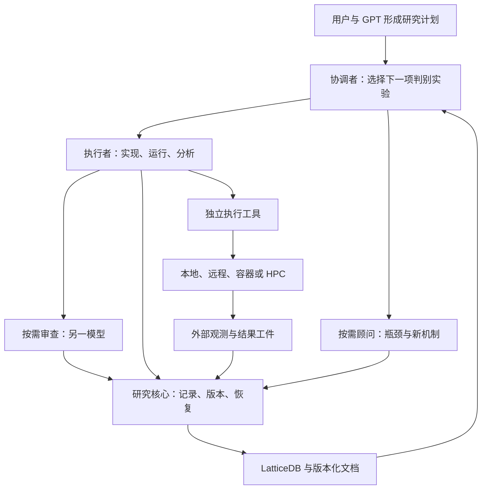
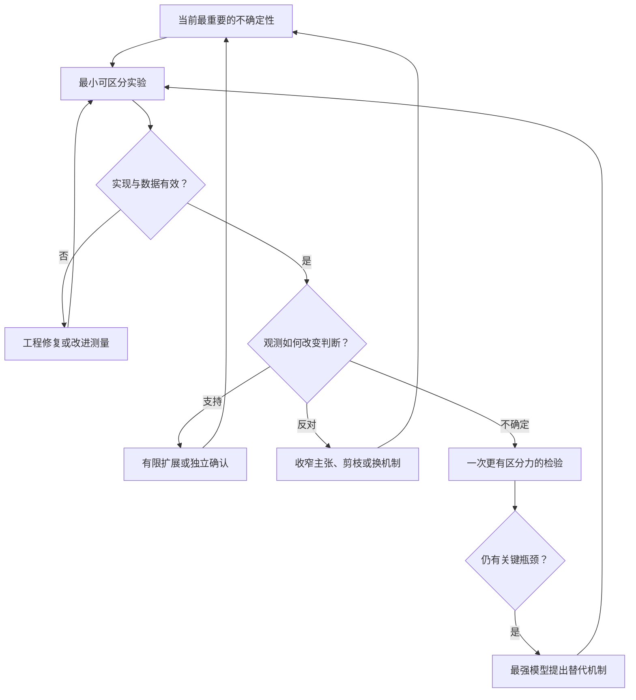
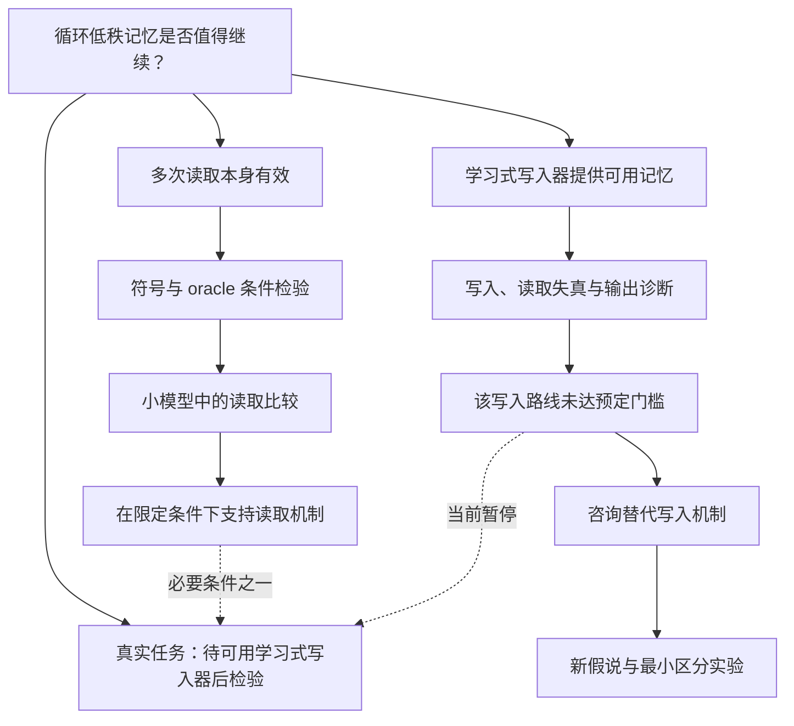

# Smooth Research：面向计划执行的极简 ML 研究 Agent 插件设计

**版本：设计草案 v0.2 · 日期：2026-10-30（日本时间）**

**本文档为事前制作的参考文档,并非权威, 实际执行中应当根据实际情况调整计划并对本文档进行更新**

**v0.3（2026-10-30）首版已实现；实施中的调整与验证结果见第 21 节，与正文冲突时以第 21 节为准。**

## 核心建议

从 research-tree 提炼“研究记忆与运行记录内核”，以 LoopLora 的实践重写研究工作流。用户与 GPT 等模型共同形成研究计划；插件帮助执行 agent 把计划转为可检验的假说，通过成本逐渐增加的实验形成证据，及时调整路线，并在瓶颈处调用最强可用模型。

建议暂名 **Smooth Research**，包名 **smooth-research**。首版采用：

- **一个嵌入式 LatticeDB**：保存假说、任务、实验、证据、决策与论文的关系，以及必要运行记录。
- **一个共享 Python 核心与 CLI**：处理事务、版本、记录去重、恢复、上下文包和文献索引。
- **三个简短 skill**：研究执行、跨模型审查、瓶颈咨询；详细说明按需读取。
- **一个持续协调角色，按需执行者、审查者和顾问**：角色可以延续，物理 session 可以替换。
- **一套平台无关的运行记录接口**：登记 Run/Attempt，关联外部执行标识，接收状态、结果和可选用量；本地、远程、容器和 HPC 的实际执行由 agent 使用已有工具完成。
- **一个由数据库生成的图视图**：按需展示，不引入常驻 UI agent。

终点是“形成值得投入正式实验的路线和可执行方案”，同时清楚说明现有证据的边界。它可以得到有价值的负结果、暂停路线，或返回多个有区别的候选；不要求用探索阶段的小实验宣称超过 SOTA 或保证论文结果。

本文件给出的是新插件的设计和实施验收要求，并非已经实现或已安装的插件。文中的新命令、配置和接口均为拟议接口。

**v0.2 的职责边界**：插件管理研究状态与结果，不提供实验提交、轮询、重试、取消或远程传输能力。Miyabi 等环境继续使用独立工具；任何运行登记、观测导入、结果导入和 resume 都不触发实验执行或外部查询。用于调用研究 agent、审查模型和顾问模型的宿主适配另行保留。

## 目录

1. 审查依据与经验判断
2. 产品目标与减重原则
3. 总体架构
4. 从研究计划到证据的工作流
5. 图数据模型
6. 数据、文档与一致性
7. 团队、session 和上下文
8. 跨模型代码审查
9. 研究瓶颈与最强模型咨询
10. 平台无关的运行状态与结果管理
11. 数据库化文献管理
12. 插件接口与目录布局
13. 配置与授权边界
14. 从 research-tree 提取什么
15. 从 LoopLora 提取什么
16. 实施路线与验收
17. 效率评估
18. LoopLora 场景示例
19. 核心 skill 的内容范围
20. 设计决策与来源
21. 实施记录（v0.3）

---

## 1. 审查依据与经验判断

### 1.1 固定版本

| 材料 | 本次审查版本 | 用途 |
| --- | --- | --- |
| research-tree 指定分支 | `codex/fast-research-workflow-20261011`，`d926805667bb200c7110e22fcde05fd6e4ea9c16` | 核对现有实现和可提取模块 |
| LoopLora master | `14c1fae207a71dcea46fcdae169b98287f6eb607` | 核对执行计划、规则、复盘、提交器与部分实验记录 |
| 用户上传的原始计划 | `recurrent_lora_research_plan_2026-10-26 (1).md` | 对比事前计划与执行中的调整 |
| Miyabi toolbox main | `473c357cdcf621d7dc035188dbe318a353f225a0` | 核对独立站点工具的职责和现有能力 |

源码为只读审查。复盘中的全项目成本采用其作者统计口径；本次没有原始集群访问和完整宿主会话日志，不能独立复算所有成本，也没有运行这两个项目的完整测试。

### 1.2 LoopLora 的经验究竟说明什么

原始上传计划已经约有 1,405 行，包含数学定义、对照、统计、阶段门槛与停止条件。AGENTS.md 的入口很短，但执行还依赖 Miyabi skills、herdr、代码索引、git 和任务文档。因此，值得提炼的模式是：

**详细的问题计划 + 简短的通用执行规则 + 可重复使用的工具 + 证据驱动的计划修订。**

执行中的有效调整包括：先做符号机制实验再进入 LLM；加入 oracle writer 以分离 reader 与 writer 的失效；根据理论反例增加对照；使用较小的 Base 模型；根据用户要求缩窄比较主张。新插件应允许这些调整，同时记录它们依据什么、影响哪些结论。[L1][L2]

复盘报告了 27 项预注册研究、542 个 PBS 作业与 113.3 node·h。作业包含测试、冒烟和评测，不能当作 542 次独立科学实验。Claude 和 Codex 侧累计输入分别约 17.4 亿与 5.0 亿 token，包含大量缓存读取和跨调用重复输入，不能直接换算成唯一文本量或费用。[L3]

这些材料支持“有些机制值得迁移”。它们不能单独证明轻量 harness 导致了多少效率提升：任务、模型、用户干预、基础工具和集群排队条件并未控制一致。

### 1.3 research-tree 当前已经改进的部分

指定分支已经是 config v3 / schema 23 的唯一快速筛选流程，已取消 strict/fast 模式切换，普通廉价筛选不等待逐次模型代码审查，候选可以逐个准入，UI agent 按需启动。因此，这些不应被再次包装为新设计的主要改进。[T1][T2]

真正需要拆开的，是 `research_db.py` 同时承担的两类责任：

- **值得保留的可靠性责任**：事务、引用、版本、运行身份、外部执行关联、证据导入、任务恢复。
- **应移出通用内核的研究政策**：固定角色组织、统一 SOTA 门槛、统一 seed 结构、所有项目统一五维复核、复杂晋级与文档义务。

该文件约 6,447 行，科学政策与存储接口深度耦合；适宜提取机制和测试，重新实现薄接口，不宜整文件复制。[T3]

### 1.4 两类实际偏差决定了设计重点

第一，LoopLora 的复盘要求完整 commit hash，但提交脚本仍能接受并在固定目录解析 HEAD；当前脚本也明确拒绝多节点提交。复盘中的规则不等于工具已经强制执行。第二，部分决策文档中的作业计数已落后于同一版本下的 jobs.json。新插件应记录执行者提供的实际版本与来源，并从已导入账本生成动态计数；执行工具负责确保实际启动的内容与运行规格一致。[L4][L5]

---

## 2. 产品目标与减重原则

### 2.1 输入和输出

**输入**：一份较完整的研究计划、当前代码库、可使用的数据与平台、模型角色选择、已明确的预算和执行范围。

**输出**：

1. 一张有证据关联的假说图，保留支持、反例、未检验部分和停止理由。
2. 一个或多个可进入正式实验的候选及其可重复运行的实现。
3. 对应的正式实验提案：主张、对照、独立性、资源估算与尚未解决的风险。
4. 一份成本与决策记录，能够解释为什么继续、扩展、暂停或停止。

“代码准备完成”和“科学主张已经被验证”分别报告。若只有探索信号，正式实验提案应明确其要确认的内容。

### 2.2 六条设计原则

| 原则 | 对实现的直接要求 |
| --- | --- |
| 计划提供方向，结果可以改变路线 | 导入原计划后保留快照；新增或修订假说记录依据 |
| 优先回答能改变下一步的问题 | 每个实验说明结果会改变什么，不为占满资源扩矩阵 |
| 通用内核只做少量可靠检查 | 不在数据库中写死 SOTA、统一 seed 数或统一成功阈值 |
| 日常执行有充分自主权 | 已授权范围内的分支细化、测试、运行与对账不逐次请示 |
| 状态和上下文可以恢复 | 没有聊天历史也能识别未结束的 attempt、最后观测、当前证据和下一步 |
| 同时优化计算、模型和等待成本 | 记录可获得的资源用量、模型 usage、人工介入与得到决策的时间 |

### 2.3 避免重新长成一个重平台

首版不建设通用多智能体调度系统、独立 Web 服务、模型排名服务、全领域文献抓取平台或完整论文生产流水线。保留现成宿主和站点工具的职责。每增加一条规则，都要回答：它避免了哪种已观察到的损失，能否由较短的任务说明或确定性工具解决？

“极简”的衡量对象是用户和 agent 每轮必须理解与维护的东西，而非强行减少所有内部实体。Run、Attempt 与外部执行引用分离这类小复杂度，可以避免重复记账和错误归因。

---

## 3. 总体架构



图中的运行观测与工件由执行者或外部工具交给记录接口。研究核心不会沿着记录操作反向启动执行工具。

### 3.1 三层边界

**研究层**由 skills 与项目计划负责：选择假说、设计对照、解释结果、判断下一次投入价值。执行 agent 自行使用适合环境的现有工具开展实验，并遵守用户指定的资源限制。

**记录层**由共享核心负责：规范 ID 与引用、文档封存、任务领取、运行规格、外部执行引用、观测与结果去重、版本检查、上下文查询和可选成本记录。

**宿主适配层**连接 Codex、Claude Code、已有跨 session 工具和强模型入口。它管理研究 agent 与模型调用，不承担实验进程、容器或集群作业的生命周期。适配层只报告实际能力，不把目标模型或“进程已启动”当作已核实的能力。

实验执行工具位于插件之外。本地 shell、远程工具、容器运行器或 miyabi-toolbox 可以独立使用；插件没有实验 submit/poll/retry/cancel SDK，也不要求把这些工具注册成自身的执行后端。

### 3.2 数据库选择

**首版继续使用现有 LatticeDB，并固定已核对的依赖版本作为提取起点。** research-tree 使用的是原生 property graph；SQL 文件是约束规范，实际读写使用 LatticeDB，而非 SQLite。[T3][T4]

这一选择满足用户的图数据库需求，也避免迁移引擎和维护多个后端。现有依赖锁定 `latticedb==0.15.0`；正式实施时验证目标操作系统、Python 和打包兼容性，再决定是否升级。

数据库放在协调机的项目本地磁盘。不同 session 经同一个 store 接口访问。本地或远端实验只产生外部工具可读取的状态、日志和结果，由调用方登记；实验进程不直接打开控制端数据库。不让多个主机通过 Lustre/NFS 共同写活动数据库，也不自动同步活动数据库副本。

没有发现必须换成 Neo4j 或 SQLite 的实际理由。首版不构建多后端抽象；如果 LatticeDB 在下面的事务/恢复验收中失败，再基于具体缺陷重新选型。

---

## 4. 从研究计划到证据的工作流

### 4.1 导入计划：提取近期可执行部分

导入时保存原计划内容和来源，仅抽取：

- 用户真正希望证明或改进的核心主张。
- 主张依赖的关键机制与竞争解释。
- 能最先检验这些机制的少量实验。
- 已明确的资源、指标、数据和停止条件。
- 原计划中尚未被证实的假定。

不把一份长计划一次转成几十个已经分配 agent 的任务。远期分支可以保持“候选”，只有近期可执行部分生成 Task。计划里缺少的低风险实施细节由 agent 补全并注明；会改变目标或预算的缺口才需要用户决定。

### 4.2 按问题选择实验层级

| 层级 | 要回答的问题 | 常用检验 | 能得到的结论 |
| --- | --- | --- | --- |
| E0 结构与实现 | 公式是否一致？初始化能训练吗？代码是否实现该算子？ | 维度、梯度、解析构造、等价性、极小输入与必要回归测试 | 排除明确错误；形成可执行机制 |
| E1 隔离机制 | 在有利而可控的条件下，机制本身有效吗？ | 符号任务、合成数据、oracle 组件、阳性/阴性对照 | 在指定条件下支持或反对机制 |
| E2 最小模型实验 | 放进真实模型后，信号还存在吗？ | 小模型、单模块、小数据、固定预算、主要替代解释 | 得到模型内探索信号或定位失效组件 |
| E3 有限确认与准备 | 信号是否足以支持正式投入？什么仍需确认？ | 预先固定的比较、合适的重复/保留材料、关键消融、运行成本 | 确认性证据或明确界限的正式实验候选 |

这四层是默认思考顺序，不是每条研究线都必须完成的状态机。E0 已发现数学问题可以立即修改；成熟代码上的新问题可以直接做 E2；理论研究可能主要停留在 E0/E1。CPU 可完成的工作不强制占用 GPU，但遵守站点对登录节点测试的限制。

### 4.3 每个新实验只需要一个紧凑契约

最小字段为：

| 字段 | 要写清的问题 |
| --- | --- |
| question | 本次实验具体回答什么？ |
| hypothesis_ref | 对应哪个假说的哪一版？ |
| intervention / comparator | 改了什么，与什么比较？ |
| metric / scope | 观察什么，结论适用于哪些条件？ |
| outcome_actions | 哪些结果支持继续、诊断、暂停或停止？ |
| budget / stop | 单次和批次成本边界、提前停止条件是什么？ |

小实验可以用短 frontmatter 加几段正文。多个 seeds 或同一代码路径的参数臂共享契约，不需要为每个 attempt 写一套任务书、预注册、发布、审批和总结。资源边界由用户决定、执行者遵守，记录接口不代替实际执行工具实施资源限制。

### 4.4 结果必须指向下一步



每个“不确定/开放”区间都应有默认动作，例如“暂停，等待新证据”“只追加一项诊断”“咨询顾问”。不保留没有下一步和复议条件的永久开放任务。

### 4.5 保留探索灵活性，也保留结论边界

- 单 seed、小验证集可以用于方向筛选，标记为 screening。
- 改阈值、对照、主指标或筛选方案时创建新契约版本；已看过结果的改动不能追认为事前设定。
- 重新使用验证集可以继续探索，但登记其参与选择的事实。
- 宣称机制得到确认时，比较方案、独立单位和材料须预先明确。新训练 seed、独立数据样本与新任务分别解决不同不确定性，不能互相冒充。
- 一次廉价失败可以支持“当前不值得追加投入”，未必支持“该机制普遍不成立”。
- OOM、错误梯度、未使用记忆、阳性对照失败等首先影响实验诊断能力，不自动成为机制反证。

### 4.6 何时结束探索

使用一个阶段交付记录，包含三个分开的字段：

1. **implementation_ready**：代码、对照、评测、运行规格与成本测量是否足以开展所提议的正式实验。
2. **evidence_scope**：现有证据究竟支持什么；是诊断结果、探索信号还是预先规定的确认性比较。
3. **investment_decision**：recommend_formal / continue_probe / pause / stop，以及理由。

推荐进入正式实验通常需要：主要实现缺陷已排除、至少有值得投入的证据或理论理由、关键替代解释已处理或纳入正式实验、最近工作差异明确、预算与协议可执行。它不要求所有研究先超过 SOTA，也不把“可以开始正式验证”写成“方法已证明成功”。

---

## 5. 图数据模型

### 5.1 六类核心对象

| 对象 | 主要字段 | 作用 |
| --- | --- | --- |
| Hypothesis | id, title, statement_ref, scope_ref, evidence_status, disposition, revision | 可被检验的科学判断 |
| Task | id, kind, target_refs, owner_role, owner_epoch, state, request_ref, output_refs | 一段可交付工作，可关联多个假说 |
| Experiment | id, hypothesis_refs[{id, revision}], protocol_ref, stage, comparator_refs, cost_envelope | 一次实验设计，容纳多个臂和重复 |
| Evidence | id, artifact_refs, validity, evidence_level, scope_ref, source_attempts | 观测、诊断与统计结果 |
| Decision | id, target_refs, action, rationale_ref, evidence_refs, reopen_condition | 继续、修改、暂停、停止或投入决定 |
| Paper | id, identifiers, version, metadata_status, access_status, note_refs | 文献及其可核查来源 |

运行所需的 Run、Attempt、ExecutionRef、Session、Message、ReviewTicket、Usage 等作为同库中的辅助记录，默认不全部展开为图节点。它们仍有明确字段与约束，不能用一个随意的 JSON 字段替代全部语义。

### 5.2 关系比“父节点”更重要

| 关系 | 含义 |
| --- | --- |
| derived_from / combines | 科学思路来源或组合来源 |
| tests | 实验检验假说 |
| supports / challenges | 证据在特定 scope 下支持或挑战主张 |
| depends_on | 任务或实验执行依赖 |
| compared_with | 实验比较对象 |
| motivated_by / nearest_work | 假说与论文的具体关系 |
| based_on | 决策使用哪些证据和材料 |
| supersedes | 新版本替代哪个旧版本 |

**科学来源、代码起点和实验对照分别存储。** 三者可能指向不同对象，不能用同一个 parent_id 代替。执行依赖与版本替代应无环；支持、挑战和关联关系构成普通图，不要求整个知识图是树。

用户看到的是图的一种树形投影：默认沿 derived_from 展开，组合、反例、论文和对照通过侧边关系显示。一个实验可以同时检验多个假说，也可以让同一份证据支持一个机制、挑战另一个机制。

tests、supports、challenges 与 based_on 绑定具体目标 revision。修改假说后，旧证据不自动成为新主张的支持；需要显式核对适用范围并建立新引用，原关联仍保留。

### 5.3 不使用单个 success 表示所有状态

| 维度 | 示例状态 | 不应推出的结论 |
| --- | --- | --- |
| Task 执行 | ready / active / waiting / delivered / accepted / stopped | delivered 不等于科学结论成立 |
| Attempt 执行状态 | prepared / queued（可选）/ running / ended / unknown | ended 不等于执行成功；本地进程不必经过 queued |
| Attempt 结果 | success / failed / cancelled / unknown | 执行成功不等于证据有效 |
| Result 导入状态 | absent / partial / complete / rejected | complete 不等于已验证科学主张 |
| Evidence 有效性 | pending / valid / invalid | valid 不等于效果为正 |
| Hypothesis 证据 | untested / supported / challenged / inconclusive | supported 只在记录的 scope 内成立 |
| 投入处置 | active / paused / retired | retired 不等于被科学证伪 |

证据撤回或修订后，受影响的结论标记“需重新核对”。只追踪实际依赖，不因为无关文档改了标题就让整个项目失效。

---

## 6. 数据、文档与一致性

### 6.1 明确各类信息的权威来源

| 信息 | 权威来源 |
| --- | --- |
| 用户预算、范围与模型替补选择 | 版本化配置/约束文档及关联用户决定 |
| 原始研究意图 | 导入计划的不可变快照 |
| 研究状态、所有权、关联、已登记观测和用量 | 数据库；实际执行事实及用量依据来自外部工具或执行者 |
| 公式、实验设计、解释、交接正文 | 封存后的文档 revision |
| 原始结果与日志 | 运行工件及 manifest |
| 总览、当前计划摘要、图页面 | 从上述内容生成的投影 |

假说 statement、scope、实验判定条件等长正文使用固定文档 revision；数据库仅持有对应引用及少量结构化索引。正文、数据库摘要和仪表板之间不得存在三份可随意编辑的同一事实。

### 6.2 文档封存无需新增审批

草稿可以正常修改。第一次被任务派发、Run 登记、评审或决策正式引用时，工具封存其内容：

```yaml
document_id: DOC-0021
revision: 3
content_digest: blake2b:...
source_path: research/experiments/E-0012.md
git_commit: <完整提交ID或null>
sealed_object: research/documents/objects/<digest>.md
```

数据库引用 `document_id + revision + digest`，不只引用一个会继续变化的文件路径。已有结果始终连接当时版本。新内容成为新 revision，历史版本不覆盖。

先原子写入不可变文档对象，再在数据库事务中登记引用。文件系统和数据库不是一个事务；若中途崩溃，允许出现尚未登记的文件，恢复时核对并补登记，不允许先提交一个没有内容的有效证据引用。

### 6.3 本地多进程一致性

首版使用一个本地 store 写入入口，短期进程锁串行化写事务。数据库事务内同时完成：

- 校验 coordinator_epoch 或 task_owner_epoch。
- 校验目标 revision 与请求的 base_revision 相符。
- 校验引用、唯一键和必需字段。
- 更新实体、关系与对应事件。
- 递增 data_version 并提交。

epoch 检查与写入不能分成两个独立操作。失去所有权的旧 session 不能覆盖新 session 的状态。研究协调者只保留一个有效 epoch；跨主机自动 leader failover 不进入首版范围。

这属于新接口必须验证的契约，不因旧库“有事务”就假定已满足所有并发和崩溃场景。

### 6.4 备份与恢复

保留一致性快照导出，并新增导入恢复。快照必须含实体、边、revision、事件游标、活动 run/attempt/execution_ref 与最后观测、文档索引与工件摘要；正文对象和必要证据随备份复制或保留可验证地址。

不直接复制正在写入的数据库文件作为可靠备份。使用经验证的数据库备份机制，或短暂排除写入后进行一致性导出。恢复到新目录后先核对内容，再列出未结束或状态未知的 attempts、最后观测时间与外部执行引用。是否需要查询外部状态由接手 agent 决定并使用现有工具完成；restore/resume 只恢复记录，不启动查询、执行或重试。

research-tree 已有 export_snapshot，但本次未发现完整的 import/restore 与断电恢复验证；这是必须补齐的能力。[T3][T4]

---

## 7. 团队、session 和上下文

### 7.1 四类职责，按任务组织人员

| 角色 | 生命周期 | 职责 |
| --- | --- | --- |
| Coordinator | 持续的逻辑身份；session 可轮换 | 维护问题方向、选择实验、分配工作、处理分歧和投入决定 |
| Researcher | 可连续承担相关任务；不绑定单一假说 | 实现、测试、运行、分析、必要文献核对 |
| Reviewer | 按代码/协议变化临时启动 | 对指定快照进行独立跨模型审查 |
| Advisor | 瓶颈或关键路线决策时调用 | 解释失败、提出替代机制与最小区分实验 |

文献检索、框架构建和证据分析是 task kind，不各自建立永久角色。单个 agent 可以完成完整的小研究环；只有工作可以独立推进且通信成本合理时才并行。

稳定的是 role_id、task_id、worktree 和文档，而非必须永久保留某一个聊天上下文。

### 7.2 同 session 与跨 session 使用同一任务协议

**同 session**：优先使用宿主原生子代理和完成事件。按任务提供简报，避免默认继承全部研究历史。子代理完成时直接通知任务 owner，普通状态更新不经过 coordinator 二次转发。

**跨 session**：由可用宿主适配器启动独立 CLI session，记录精确 session ID、worktree、请求与观测模型、任务所有权。可以接入现有 herdr，亦可采用宿主已支持的进程方式；herdr 不成为研究核心的必需依赖。

两者都使用版本化任务文档与持久消息索引。宿主聊天消息是通知，任务包才是可恢复的工作依据。

### 7.3 文档消息的最小信封

```yaml
message_id: MSG-...
type: TASK
task_id: T-0012
from_role: coordinator
to_role: researcher-symbolic
document_refs:
  - {id: DOC-0021, revision: 3, digest: "blake2b:..."}
base_revision: 7
owner_epoch: 2
in_reply_to: null
next_action: "实现预注册的线性读取对照并运行一次冒烟"
```

消息类型只保留 TASK、RESULT、WAIT、BLOCKED、HANDOFF、CANCEL。WAIT 引用 attempt IDs、可用的外部执行引用与后续动作；BLOCKED 区分工程、模型不可用、预算和科学问题。CANCEL 只撤回研究任务，不表示外部运行已被取消；若用户要求停止外部执行，执行者另用现有工具操作并登记实际结果。

收到、应用、交付分开记录。同一 message_id 重复投递不会重复领取任务或生成运行记录；过期 revision 返回冲突与当前摘要。保留接收游标，禁止对确认回执再做循环确认。

长内容写文档，通知只含 ID、目的和下一步。消息长度限额是默认格式建议，不成为阻止解释真实问题的僵硬规则。

### 7.4 上下文包围绕“当前决定”

按用途生成四种包：

- **work**：当前任务、范围、相关代码索引、必要文献、最新有效结果与已排除解释。
- **resume**：角色/epoch、首个未完成动作、未结束的 attempts、最后可信观测、未解决问题和工件位置。
- **review**：精确 diff/快照、方法定义、执行配置、重点不变量与必要测试。
- **advice**：瓶颈、关键正负证据、失败机制、尚存解释、预算和待决问题。

首版可把工作包目标设为约 2k–6k tokens，咨询包约 6k–12k tokens，作为待验证的默认值；不包含宿主系统提示的不可控部分。工具按真实 tokenizer 或标注的估算方法计算，不把字符数冒充 token 数。

优先保留进行中的任务、关键反证和预算，其余返回索引供按需读取。大日志与完整数据文件由脚本摘要，原始文件仍可追溯。

### 7.5 有条件复用 session

相关任务继续复用当前 session；到自然任务边界、主题明显切换或上下文负担过大时生成 handoff，用同一个 role_id 开新 session。轮换阈值由使用量观测调整，不预先宣称频繁重启一定省钱。

轮换流程为：封存交接 → 确认写入释放 → 更新 owner_epoch → 新 session 校验代码和运行记录 → 接续未完成动作。状态未知时应先通过外部工具核对，不能仅凭聊天中断就重派实验。

原生团队只是运行方式。Claude 当前文档仍将 agent teams 标为实验功能，且 /resume 不恢复 in-process teammates；跨 session 恢复因此必须依赖项目记录，而不是假定宿主保留所有队员。[O4]

---

## 8. 跨模型代码审查

### 8.1 独立性以代码作者为参照

若代码由 Codex 模型实现，默认由另一个模型族审查；由 Claude 实现则反向选择。比较对象是实际实现者，不只比较 coordinator 的模型。

记录 requested_model、observed_model、provider、session_id、author_models、review_scope。两个 session 使用同一个模型属于独立 session 复核，不能被标为跨模型；模型实际身份无法核实时标记未核实。

### 8.2 按变化审查，不按每个 run 审查

默认触发：

1. 新的核心数学算子或训练/评测路径第一次用于有实质成本的实验。
2. loss mask、数据切分、adapter 注入、checkpoint 读写、分布式执行等高影响部分发生变化。
3. 准备作为正式实验基线或候选的最终快照。
4. 合并产生可能改变上述行为的冲突。

极小的实现冒烟与确定性检查可以先运行。相同执行规格增加 seed、重复已审实验、修改无关文档，不重新发起全面评审。

### 8.3 缓存依据是“审查范围指纹”

指纹由被审代码、执行配置、关键依赖、训练和评测入口以及 scope spec 的确定性摘要构成。只对白名单中的非语义字段放宽，例如该协议允许变化的 seed、日志目录。

不能宣称能够自动判断代码“行为等价”。未明确归入白名单的配置或依赖变化使相关审查失效；不影响的模块保持可复用。

### 8.4 一次审查交付可以覆盖多个维度

Reviewer 获取方法定义、代码 diff、必要上下文、关键测试和中性问题说明，返回：

- 问题位置与可复现依据。
- 影响：结果错误、实验无效、资源浪费或非阻断改进。
- 最小修复与建议验证。
- 已查与未查范围。

不把五个检查维度默认拆成五次全新模型调用。适合脚本完成的数字重算与 manifest 检查交给代码；模型主要检查方法与实现一致性、实验设计和解释。

### 8.5 审查不可用与争议

使用预先选择的 fallback 顺序，同时保持跨模型要求。没有合格 reviewer 时，记录 pending；无关的低成本工作仍可继续。依赖该关键审查的扩大实验等待修复或合格审查，不伪称通过。

合法的反对意见保留原文。修复后仅复核受影响范围；若意见有争议，绑定一次独立复核，保留分歧与 coordinator 的处理理由，不反复重开直到得到 pass。

---

## 9. 研究瓶颈与最强模型咨询

### 9.1 触发条件

以下情况值得咨询：

- 多项有效检验仍不能区分关键竞争解释。
- 几轮不同机制的修改没有产生新的信息。
- 局部机制有效，进入模型后失效，原因仍不清楚。
- 新文献改变了创新性或投入价值判断。
- 准备跨越明显的成本台阶，需要选择最有价值的下一步。
- 用户直接要求寻求建议。

同一个已知代码错误不应被重复计作科学瓶颈。触发计数只是提示，不能机械地要求每做两次实验就调用最贵模型。

### 9.2 “最强模型”是可配置能力

配置 advisor 主入口与已选择的替补入口，启动前核验可用性。API、CLI、宿主子代理与用户通过 GPT 产品手工咨询是不同入口，不假定同名模型的模式、工具、上下文与权限完全相同。

若最强模式仅在交互产品中可用，生成咨询包供用户提交，再导入原始回答及来源。不能假装 CLI 已自动调用那个产品模式。无回复时保留待咨询状态，继续其他独立工作。

### 9.3 输入包与输出协议

输入包含目标、精确瓶颈、关键正负证据、已试路线、最接近文献、当前资源上限和具体问题。提供原始工件索引，让顾问可以质疑 coordinator 的解释。

要求顾问返回有限数量、机制不同的建议，每条包含：

1. 它解释了哪个尚未解释的现象。
2. 与现有路线的关键差别。
3. 可区分的预测和必要对照。
4. 最便宜的验证方式与预期成本。
5. 何种结果会令它停止。

答案保存为建议来源。选择的条目转成新的 Hypothesis/Experiment；建议本身不进入“已支持证据”。超出既有范围或预算的建议提交用户决定。

### 9.4 避免咨询循环

咨询请求按问题、证据版本、约束和模型配置去重。没有新证据时不重复提交同一大包；可以在原咨询中发送明确的新数据差异。没有价值的新路线时允许暂停，不以不断产生建议替代实验判断。

---

## 10. 平台无关的运行状态与结果管理

### 10.1 只记录研究运行，不管理执行环境

插件回答“运行了哪份规格、现在知道什么状态、结果来自哪里、是否可用”。如何启动、排队、等待、终止和传输文件由执行 agent 使用独立工具决定。

| 对象 | 含义 |
| --- | --- |
| Experiment | 科学设计，例如“固定 reader，比较两种 writer” |
| Run | 一个不可变 RunSpec 对应的一次逻辑实验实例 |
| Attempt | 某个 Run 的一次实际执行尝试；失败或重新执行保留新 attempt |
| ExecutionRef | 外部执行对象的引用，可为本地进程、远程进程、容器、HPC job 或其他外部任务 |

普通单次运行由 register 自动登记首个 prepared Attempt，调用者不必手工维护三层对象。一次合法的独立重复实验可以使用同样的 RunSpec，但登记为新的 Run；同一逻辑运行重新执行时登记新的 Attempt。记录接口只描述这个事实，不启动重试。配置或数据发生科学性变化时创建新 RunSpec/Run，不覆盖旧规格；恢复 checkpoint 的来源和实际配置也须记录。

多个 attempts 可以共享一个 ExecutionRef，例如一个 HPC job 顺序运行若干 seeds。它们仍分别保留结果；共享执行中途失败不能抹掉已完成 attempt 的有效工件。本地运行无需模拟一个 PBS Job。

### 10.2 不可变 RunSpec 与外部执行引用

RunSpec 的最小内容是实验与契约引用、arm/seed 等重复标识、代码和配置摘要、数据/模型版本、指标定义及预期输出。环境信息按研究需要记录；未知字段明确写未知，不推测填充。

```yaml
run_id: RUN-0012
request_id: register-run-0012
spec:
  experiment_ref: E-0012@1
  protocol_ref: DOC-0021@3
  arm: learned_writer
  seed: 42
  code_ref: {commit: "<完整提交ID>", content_digest: "blake2b:..."}
  config_digest: "blake2b:..."
  data_revision: "<数据版本与split>"
  model_revision: "<模型与tokenizer版本>"
  metric_spec_ref: DOC-0022@1
  environment_ref: "<依赖或镜像摘要，未知时明确标注>"
  output_spec: "<结果文件和必要诊断的定义>"
spec_digest: "blake2b:..."
```

无 Git 的实验可使用可追溯代码对象与内容摘要；有 Git 时裸分支名或 HEAD 不能作为不可变版本标识。插件登记调用方提供的快照引用，不负责创建或部署代码快照，也不自动验证远端实际运行了什么。

ExecutionRef 只保留最少的外部关联信息：

```yaml
kind: hpc_job  # 也可为 local_process、remote_process、container、external
executor_namespace: "<能够区分执行环境的稳定命名空间>"
opaque_id: "<外部工具提供的完整标识>"
locator: "<可选，供外部工具或执行者定位>"
```

核心不解析特定调度器 ID，也不根据 locator 执行命令。裸 PID 不足以唯一识别进程；调用方应使用能区分主机、启动实例与 PID 复用的命名空间和标识。同一引用可关联多个 attempts；暂时不知道外部 ID 时，Attempt 保持未绑定，不能凭空补一个 ID。

### 10.3 三类写操作，一个共享 store 入口

| 操作 | 最小行为 | 边界 |
| --- | --- | --- |
| register | 登记不可变 RunSpec；自动生成首个 Attempt，或在已有 Run 下登记新的 Attempt | 不启动执行或重试 |
| record | 追加外部引用、状态观测、终态或可选用量；终态记录承担 close_attempt 的作用 | 不查询、轮询、取消或控制外部对象 |
| import-result | 登记结果 manifest、工件引用和结果 revision | 不抓取远端文件，不运行项目 validator |

show/resume 只读已登记状态。这些操作共用直接的数据类型与事务检查；绑定外部引用、记录终态和登记新尝试不各自发展成服务或必装的 SDK。

`request_id` 用于调用重试去重：同 ID、同内容返回原记录；同 ID、不同内容返回冲突。使用新的 request_id 可以登记同规格的合法独立重复。保证的是记录导入不重复，不能保证外部执行没有重复发生；已经发生的重复执行必须如实登记并记账。

### 10.4 观测、执行结果与结果有效性分开

观测保留原始事实，状态是从已接收记录生成的投影：

```yaml
record_id: OBS-0031
attempt_id: ATT-0012-1
source: "<提供本次观测的工具或执行者>"
observed_at: "<事实被观测的时间>"
received_at: "<插件接收时间，由插件填写>"
source_sequence: 8  # 来源能提供时记录，不能伪造
execution_state: running
outcome: unknown
raw_state: "<外部工具原样返回的状态>"
source_ref: "<日志、返回结果或其他观测依据>"
```

`execution_state` 使用 prepared / queued（可选）/ running / ended / unknown；`outcome` 使用 success / failed / cancelled / unknown。`result_status` 使用 absent / partial / complete / rejected，Evidence 的 valid / invalid / pending 另行判断。

同一 record_id 重复接收只生效一次；内容不一致时报告冲突。按来源提供的顺序和 observed_at 判断新旧，不能只看 received_at。旧 running 观测不能覆盖已有终态依据的 ended。来源相互矛盾或顺序不明时保留记录并标待核对；首版不实现分布式事件排序。

尚未确定终态的 Attempt，若查询失败或外部执行事实无法确定，可将当前 execution_state 记为 unknown，并保留 last_trusted_state 与其时间。已有可信终态时，后来的查询失败、历史过期或文件暂不可达只新增观测问题，不撤销 ended 或原 outcome；只有新的实质矛盾证据及显式更正才能改变已确认终态。stale 只表示观测过时或需要刷新，是独立的新鲜度/展示标记，不属于 execution_state 枚举；消息迟到或结果文件不可达也不自动证明执行状态发生变化。unknown 不是新的成功、失败或取消事实；外部对象暂时找不到，也不能推断从未执行。

原始观测追加保留。必要更正用新 revision 明确指向被更正记录和依据；派生状态、结果完整性和科学有效性分别更新。停止本地跟踪不等于外部执行结束，未知 Attempt 不得仅因 session 结束而记为 cancelled。终态 record 关闭 attempt 时只依据已有事实，不向外部对象发命令。

### 10.5 结果导入和实际核验范围

结果 manifest 至少绑定 attempt_id、spec_digest、代码/配置/数据版本、指标定义、工件引用及摘要，并标明结果是 partial 还是 complete。实际执行版本与预期 RunSpec 不一致时，保留工件和差异；原 RunSpec 不随结果修改，结果不能直接作为预定比较的有效证据。

插件可核对提交给它的结构化字段，以及已经提供到本地且可读取的工件摘要。只收到远程 URI 时，仅登记引用和调用方报告的摘要，标明核验范围；不能声称已经读取文件或独立验证过其内容。文件获取和项目特定 validator 由外部工具执行，调用方把结果连同来源交回。

导入按 request_id、attempt 与工件摘要去重。修订结果创建新 revision，旧结果仍可追溯；部分结果不能覆盖完整结果。执行成功、文件完整、指标可信和机制得到支持分别记录。即使 attempt 已关闭，也可继续导入迟到工件，但不得把它们静默归到另一次尝试。

### 10.6 可选用量记录，不承担资源控制

用户设定资源约束，执行者在调用实际工具时遵守。插件保存约束来源、已知用量和未报告项，帮助协调者判断投入；它不预留调度预算、不限制外部并发，也不宣称能阻止未经过自身的进程或作业。

usage 是可选记录，包含 quantity、unit、resource_type、hardware（如适用）、source_ref 和 accounting_ref。时间、GPU·h、node·h、API 金额或其他单位可以并存；不同硬件或单位不能直接相加。没有可信用量就标记未报告，而不是零。

共享执行的成本按带命名空间的 accounting_ref 记一次，并关联成员 attempts。重复导入不重复累计；无法可靠分摊时只报告共享总量，不制造精确 run 成本。估算与实测分别标记，修订账单保留版本。

### 10.7 等待、恢复与外部工具的联用

WAIT 保存 attempt IDs、最后可信观测、外部引用和下一步。外部工具或执行者提供新的观测后，插件更新关联任务和图视图。插件没有常驻 observer，也不自行注册 watcher；没有新观测时只说明记录可能已过时。

所有 session 关闭后，数据库本身不能继续查询或唤醒 agent。下次 resume 返回恢复包，接手者再决定是否使用外部工具检查状态。已有外部唤醒服务可以照常使用，但不是插件成立的前提。

对 Miyabi，执行 agent 可独立使用现有的三项技能：`miyabi-pbs-shell-template` 编写作业脚本，`miyabi-pbs-cmd` 查询、提交与控制作业，`miyabi-pbs-goal-wakeup` 处理适用场景下的长作业等待与唤醒。它们的环境条件和验证范围由 miyabi-toolbox 自身说明。[M0]

miyabi-toolbox 当前没有本设计的 RunSpec/Observation/Result 数据契约，因此不能声称已有直接兼容。首版由执行者把实际工具输出整理成最少的记录输入；将来只有在重复联用确有负担时，才考虑在外部工具一侧提供独立的记录导出助手。该助手仍不进入 Smooth Research 的实验执行控制范围。

本地、远程和容器场景使用同样流程：登记逻辑运行与 prepared Attempt，执行者用自己的工具实际运行，再登记外部引用、观测和结果。无需安装 Miyabi 工具即可使用研究插件。

---

## 11. 数据库化文献管理

### 11.1 文献与假说连接

Paper 至少记录：

- DOI、arXiv ID 与版本、标题、作者、年份和来源 URL。
- 元数据核对状态、全文访问状态、获取时间与内容摘要。
- 本项目阅读笔记、精确页码/章节/公式/表格位置。
- 与假说的关系：来源、最近竞争工作、支持、反例或方法组件。

文献搜索结果、论文存在、读到全文、原文支持某条主张是四件不同的事：

```yaml
metadata_status: verified
fulltext_access: available
claim_checks:
  - claim_ref: H-0004@2
    relation: nearest_work
    locator: "Section 3.2, Equation 4"
    assessment: checked
    note_ref: DOC-0038@1
```

搜索摘要不能自动成为页码级证据。“没有检索到完全相同方法”也不能自动成为新颖性证明。

### 11.2 从 literature.py 提炼

保留 arXiv/DOI 标准化、多来源检索、去重、限流退避、PDF/文本缓存等较独立能力。[T6]

去重优先使用稳定标识符。论文不同版本关联保存；预印本与会议版可以链接但不丢失版本；标题相似只能产生待核对候选。每次查询保存来源、时间、参数与结果标识，失败不能当作“没有相关论文”。

首版用元数据、全文索引和假说关系查询。向量检索、全库抓取、跨项目自动经验归纳和 Zotero 双向同步可后续按真实需求增加，不占据核心执行上下文。

### 11.3 文献读取按决策触发

导入计划时先核对最接近的少量工作；新机制出现或准备扩大实验时补查；旧查询在没有变化时使用缓存。保留对立证据，避免 context pack 只返回支持当前路线的论文。

---

## 12. 插件接口与目录布局

### 12.1 CLI 优先，MCP 为薄包装

首版以统一 CLI 提供接口，宿主 skills 调用它。需要结构化工具时，用 MCP 包装同一套核心动作，不复制业务逻辑，也不把所有底层数据库方法暴露成几十个工具。

拟议命令族：

| 命令 | 示例用途 |
| --- | --- |
| rl init / status / resume / export / restore | 建立项目、查看状态、恢复和备份 |
| rl graph / context | 查询局部图与指定用途的上下文包 |
| rl task | 创建、领取、交付、等待、交接 |
| rl experiment / run | 封存契约、register、record、import-result，以及只读 show |
| rl review | 发起、复用和查询跨模型审查 |
| rl advise | 生成咨询包、提交咨询或导入回答 |
| rl literature | 搜索、登记、核对、关联文献 |

例如：

```bash
rl init --plan plan/research-plan.md
rl context --task T-0012 --purpose work
rl run register --experiment E-0012 --spec run-spec.json --request-id register-0012
rl run record --observation observation.json
rl run import-result --attempt ATT-0012-1 --manifest result.json --request-id result-0012
rl run show --active
rl review request --experiment E-0012
rl advise prepare --hypothesis H-0004
rl resume
```

以上是接口设计示例，不是现有可运行命令。返回默认包含短摘要、状态与工件指针；完整 JSON、日志、图和原始输出按需请求。

CLI 的交付采用一种明确方式：插件附带 Python 包和 pyproject.toml，声明 Python 要求、固定的 LatticeDB 依赖及 `rl = "research_loop.cli:main"` console entry point。安装步骤一次性建立专用虚拟环境并安装该包；宿主包装保存该环境中 rl 的绝对路径，skills 通过此路径调用，不假定加载 skill 后命令已自动进入 PATH。init 检查依赖与版本，缺失时返回清楚的安装问题；普通研究任务不隐式反复安装依赖。

### 12.2 插件代码布局

| 路径 | 内容 |
| --- | --- |
| plugin.json | 当前 OpenAI portable manifest |
| .claude-plugin/plugin.json | Claude 插件包装 |
| pyproject.toml | Python 依赖与 rl console entry point |
| skills/smooth-research/SKILL.md | 主研究执行入口 |
| skills/research-review/SKILL.md | 跨模型审查入口 |
| skills/research-advise/SKILL.md | 瓶颈咨询入口 |
| src/research_loop/cli.py | 三类运行记录写操作与其余研究命令的统一入口 |
| src/research_loop/store.py | 图事务、ID、revision、所有权 |
| src/research_loop/graph.py | 有限的图查询与状态投影 |
| src/research_loop/documents.py | 文档封存、引用与导入 |
| src/research_loop/tasks.py | 任务、消息与恢复 |
| src/research_loop/runs.py | RunSpec、Attempt、外部引用、观测、结果和可选用量 |
| src/research_loop/context.py | 按用途生成上下文包 |
| src/research_loop/reviews.py | 审查与咨询 ticket 共用调用机制 |
| src/research_loop/literature.py | 文献登记与现有检索逻辑 |
| src/research_loop/adapters/ | Codex、Claude 与模型调用的宿主薄适配；不含实验执行后端 |
| templates/ | 少量任务、实验、交接和咨询模板 |
| tests/ | 面向明确故障与不变量的契约测试 |

该模块划分是责任建议，不要求每一行都成为独立 package。脚本与类型可放在同一小型 Python 项目中。

### 12.3 项目数据布局

| 项目内路径 | 内容 |
| --- | --- |
| smooth-research.yaml | 已生效配置与约束来源 |
| plan/original.md | 导入计划副本与来源 |
| research/state/ | 当前控制机的活动数据库与锁 |
| research/documents/objects/ | 已封存的不可变文档 |
| research/tasks/、research/experiments/ | 可读的工作文档与草稿 |
| research/evidence/、research/reviews/、research/advice/ | 结果、审查和咨询材料 |
| research/mailbox/ | 文档消息与未导入事件 |
| research/snapshots/ | 一致性导出与恢复材料 |
| research/view.html | 按需生成的图视图 |

这些目录位于当前研究项目。多个 git worktree 引用同一个 research_root，不各自创建独立权威状态库。本地或远端运行目录由执行者使用的外部工具确定，插件只记录必要引用。

配置、代码、必要研究文档、精简证据和快照可按项目规则进入 git；活动 DB、锁、巨大原始日志和 checkpoint 不机械提交 git。保留原始证据与必要诊断 checkpoint；实验产物的清理由执行者依项目规则另行处理，核心不删除远端平台文件。

### 12.4 Codex 与 Claude 的兼容方式

共享核心、skills、模板和协议；分别验证宿主包装、模型调用与 session 接续。

当前 OpenAI 文档推荐根目录 plugin.json、skills 和可选 mcp.json，并保留 .codex-plugin/plugin.json 兼容形式；也提供 Claude 插件转换路径。Claude 使用自身 manifest 与 agent 定义。可复用的行为应集中在 skills 中，hooks、认证与 session 行为分别处理。[O1][O2][O3]

不要复制 research-tree 的整套宿主 hooks 来维持角色体系。首版只在实际需要且宿主支持时加入轻量恢复提示或结果通知；关键记录校验存在 CLI 中，不依赖 agent 是否触发某个 hook；实际提交保护属于外部执行工具。

Codex 非交互执行可作为外部模型入口之一，适配器记录确切 session ID，避免并发场景用“最后一个 session”恢复错对象。CLI 参数、模型名和能力由目标版本探测与验收决定，不照搬旧脚本的所有 flags。[O5]

---

## 13. 配置与授权边界

### 13.1 默认配置尽量短

```yaml
version: 1
plan: plan/original.md
research_root: research
constraints_ref: plan/constraints.md

models:
  researcher: inherit
  reviewer:
    relation_to_author: different_family
    candidates: [configured_reviewer_a, configured_reviewer_b]
  advisor:
    primary: configured_strongest
    fallback: [configured_advisor_backup]

context:
  work_target_tokens: 4000
  advice_target_tokens: 10000

artifacts:
  content_digest: blake2b
  keep_raw_evidence: true
```

模型别名由用户环境映射到可用入口；token 目标是待验证示例。配置不包含实验执行 profile、队列、SSH、调度器后端或固定 node·h 预算 schema。用户在约束文档中说明资源范围、允许的环境与成本上限，协调者和执行者遵守；已知用量可导入并与约束对照，但这不是调度预算预留或平台限制的实现。

站点用户、组、路径、队列和传输方式由现有执行工具管理。模型凭据由已有宿主或环境凭据机制提供。

### 13.2 自主执行的范围

在明确的目标和资源范围内，agent 可自行调整近期任务分解、选择更便宜的有效检验、扩展有依据的分支、修复实现、使用外部工具运行常规实验、合并无冲突的已验证工作并更新计划。这些是 agent 的工作行为，不是插件记录命令的隐式副作用。

涉及扩大授权资源、改变主要研究目标、使用未授权数据或改变外部访问能力时，向用户说明具体变化后再推进。用户在主会话的明确决定直接成为配置或约束文档的依据，不要求重复进入额外 UI、重复确认或手工填写授权模板。

科学标准的调整可以被用户决定，但不能覆盖历史事实。例如用户改为只做同 rank 比较后，之后的结论就相应收窄；不会因此把之前没有验证的效率优势写成成立。

### 13.3 少量不可混淆的事实约束

结果、来源、实际模型身份、版本、资源用量、未完成状态不得伪造；执行未知不当作未执行；工程失败不当作科学反证；探索后修改的规则不当作原始预注册。记录去重不代表外部实验从未重复，已发生的执行都必须保留。这些是记录准确性要求，而非额外的研究流程审批。

---

## 14. 从 research-tree 提取什么

以下文件路径均相对于 research-tree；固定版本为第 1 节所列 SHA。

| 文件或机制 | 保留内容 | 新设计中的处理 |
| --- | --- | --- |
| schema/create_db.py | 嵌入式图、索引、Meta、schema 版本 | 使用新的小 schema，保留创建模式 |
| tools/research_db.py 的 _Tx / _open / _writer | 短事务、锁、关系读写、data_version | 提炼 store；去除科学晋级政策依赖 |
| reserve_submission / claim_submission / attach_job / reconcile_submission | 外部身份、未知状态与历史保留的经验 | 只提取记录不变量；不迁移提交、预留、对账控制或预算结算流程 |
| import_run_result / retract_run | 工件与代码配置绑定、结果撤回 | 简化为明确的导入与有效性接口 |
| tools/metrics.py | 单位、方向、配对与统计纯函数 | 按项目协议选用，不带入“必须超过 SOTA” |
| tools/evidence.py | 数字与源文件核对 | 作为辅助检查；不视为科学语义证明 |
| tools/review_call.py | 异步 ticket、去重、失败持久化、后端调用 | 抽底座；review 与 advice 分开 schema |
| tools/send_message.py / message.schema.json | 文档引用、消息编号、去重日志 | 缩短协议，加入结构化 WAIT/HANDOFF |
| tools/memory.py / context_pack / resume_package | 事实解释区分、适用范围、有限上下文 | 按当前任务与用途重写查询顺序 |
| tools/literature.py | 标准化、检索、去重、缓存、退避 | 优先提取较独立函数并入 Paper 管理 |
| tools/build_site.py | 数据库生成静态视图的思路 | 首版仅假说图、在途运行、证据详情 |
| codex_runtime.py 等 | 启动、指定 session 恢复、退出观测 | 只保留薄宿主适配 |
| discovery.py | 候选来源记录 | 重写为 plan import / propose，删除全套自主选题机制 |
| research-tree-rules.md / doc_library.md | 有价值的研究原则 | 重写短入口和少量模板 |
| codex_hook.py / Claude register.tsx | 少量宿主能力参考 | 不整体迁移高耦合角色与拦截层 |
| eligibility / 五维复核 / 统一确认批次政策 | 适合严格阶段的设计思想 | 移为项目正式实验协议，不进通用内核 |

源码事实依据见 [T3]–[T8]。现有测试可提供故障场景，不按数量照搬；测试应对应新接口中保留的不变量。

尤其不建议继续使用 SQL schema → 自建约束解析 → 图 API → 科研规则这一整套叠加，或再做一个“通用研究政策 DSL”。首版用直接的记录类型、事务检查和项目文档即可。

---

## 15. 从 LoopLora 提取什么

| LoopLora 实践 | 新插件的提炼方式 | 需修正的地方 |
| --- | --- | --- |
| 计划允许按实际结果更新 | 原计划快照 + 有来源的修订和决策 | 不继续累积巨型执行表格 |
| 先符号、后 LLM | 局部机制检验优先 | 不固定所有项目都走同样阶梯 |
| oracle writer 分离故障来源 | 必要阳性对照与组件隔离 | oracle 成功不外推 learned writer |
| 任务文档 + 短消息 | 持久任务包与消息索引 | 事件不能只留 scratchpad |
| 长期领域 worker | 稳定角色 + 可轮换 session | 不让上下文无限增长 |
| WAIT / STOP | WAIT / BLOCKED 引用外部运行和后续动作 | 不在研究插件中重建等待或唤醒服务 |
| 结果区间与条件对照 | 实验契约中的 outcome_actions | 开放区间必须有默认行动 |
| 冒烟估时与运行规格 | 记录外部工具提供的规格与测量 | 区分预计、实际与未经核验的字段 |
| 计算前静态审查 | 按新代码路径做跨模型审查 | 不在每个 seed 重复全面阅读 |
| 代码快照与 .started/.exit | 保留版本、执行标记与观测来源 | 接收已提供事实，不代替执行工具采集 |
| 每份报告写成本 | 从已导入 usage 生成摘要 | 共享 accounting_ref 去重，未知成本不记零 |
| 研究线停止与重开 | 保留停止理由、新证据与复议条件 | 重开不删除原负结果 |

LoopLora submit.py 可帮助识别哪些执行事实必须记录，但不迁移为本插件的公共执行适配器。其中固定用户/目录/组、单节点限制、HEAD 解析和提交后写账本的窗口，属于执行工具自身应处理的问题。[L4]

复盘推荐的“每次合并后全量测试”也不机械推广。执行 agent 只在共享训练/评估路径和集成冲突有实质风险时运行必要集成测试；文档更新或独立小变动不为测试数量消耗集群资源。

---

## 16. 实施路线与验收

### 16.1 先完成一条完整的研究路径

| 里程碑 | 内容 | 可验证交付 |
| --- | --- | --- |
| M0 核心与导入 | 小 schema、文档封存、图查询、局部 context、原计划导入、快照恢复 | 从 LoopLora 材料重建一条假说—实验—证据—决策链 |
| M1 团队与模型调用 | Task/Session、同/跨 session 协议、所有权、review/advice ticket、文献关联 | 一个 Codex 与一个 Claude session 交接同一任务；独立审查与咨询可追溯 |
| M2 运行记录闭环 | register、record、import-result 与只读恢复；不可变规格、外部引用和可选用量 | 一个通过独立工具完成的本地真实运行，其状态与结果可正确登记；核心不触发执行 |
| M3 研究闭环与图视图 | 分支选择、scope、停止/重开、成本视图与阶段交付 | 正向、不确定和无效实验均能正确改变下一步 |

M0–M3 合起来才是最小可用版，覆盖用户提出的六项能力。不要以只有图和文档模板的版本宣称完整插件，也不先开发完整看板再补运行记录。

每个里程碑都保留一个具体示例可以演示。Miyabi 与 miyabi-toolbox 的联用可作为后续环境集成验收；它验证外部结果能否被如实登记，不要求核心实现调度器。实际运行由执行者在已授权范围内完成，本设计阶段不开展实验。

### 16.2 核心验收场景

| 场景 | 必须发生的行为 |
| --- | --- |
| 两个 session 同时领取任务 | 只有一个 owner 成功，另一个得到当前状态 |
| 旧 worker 在交接后回写 | owner_epoch 检查拒绝覆盖；保留其产物供核对 |
| 封存文档后编辑草稿 | 原实验仍指向旧 revision；不会静默变更历史契约 |
| 文件与数据库登记之间或事务内中断 | 可恢复一致记录，无悬空有效证据或半写的节点/边 |
| 同 request_id 重复 register | 返回同一记录；内容不同则冲突，新 request_id 允许合法重复实验 |
| 同 record_id 重复或乱序观测 | 去重并保留来源时间；旧 running 不覆盖已确认 ended |
| 外部观测失败、来源矛盾或无新状态 | 未确认终态时可记 unknown；单纯查询失败不撤销已有终态，保留观测问题与待核对项 |
| 同 opaque_id 出现在不同执行环境 | 命名空间使其保持独立；核心不解析或操作该 ID |
| 多个 attempts 共享外部执行 | 结果分别记录，共享 accounting_ref 的成本只计一次 |
| 外部执行者重新运行同一 Run | 登记新 Attempt，原失败保留；接口不发起 retry |
| 结果版本不符或只提供远程 URI | 保留差异和核验范围，不假称本地已读取或验证 |
| 重复导入、部分结果与迟到结果 | 去重；版本和 attempt 关联不丢失，部分结果不覆盖完整结果 |
| 登记、导入、关闭记录或 resume | 不启动实验、状态查询、下载、重试、取消或项目 validator |
| 同规格换 seed 或修改关键代码 | 仅在审查范围仍有效时复用 review；关键变化重新审受影响部分 |
| reviewer 不可用或 advisor 提议扩大范围 | 如实记录，按已配置替补和用户约束继续；不伪造审查或授权 |
| 阳性对照失败 | 记实验诊断能力不足，不宣布核心机制被推翻 |
| 全部 session 关闭后重开或导出后恢复 | 短包恢复任务、attempts、最后观测和版本；不自动查询或重跑 |

### 16.3 实际研究验收

建议选一条成本很低、同时能产生正反结果的机制路线。执行者用独立工具运行正确实现、无效实现和有充分对照的负结果，把事实导入后检查插件是否能区分三者。再模拟一次 session 更换、一次重复导入和一条状态未知的外部观测。

这检验研究记录是否帮助推进问题，而非测试某个 HPC 执行后端。测试通过数、代码行数与论文页数均不是主要验收目标。

---

## 17. 效率评估

### 17.1 主指标

**得到一个有证据、可改变下一步的决定所需的总成本。**

分别报告：

- 实际可获得的资源用量及单位、硬件和来源，例如运行秒数、GPU·h 或 node·h；跨平台不把不同单位或硬件直接视为同等算力，缺失用量单独报告。
- LLM 未缓存输入、缓存读写、输出、可观测推理 token 与实际费用。
- 从提出问题到得到可信决定的经过时间。
- 用户介入次数与协调者的人工转发次数。
- 已观察到的重复执行、错误版本实验、结果无法追溯的数量；记录插件不能证明未观察到的外部执行不存在。

没有使用真实价格或账单时只报告 usage，不给虚构美元成本；月度/订阅配额也不自动等价于 API token 账单。

### 17.2 Token 口径

不同提供方可能把缓存输入包含在 input_tokens 中，也可能分列。保留原始 usage，按 provider adapter 规范化；累计计数事件只取增量或最终累计，不能每次相加导致重复计算。相同 message/event ID 去重。

报告明确区分：

1. 累计处理输入量。
2. 其中的缓存读取/写入。
3. 输出与推理量。
4. 实际金额或无法观测的部分。

新 session 重建、缓存失效和上下文压缩本身也有成本。因此“轮换 session”“缩短上下文包”都是要对照验证的优化假说。

### 17.3 如何比较新旧流程

可采用两层验证：

- **历史材料回放**：用相同计划和已产生工件，比较恢复是否正确、上下文读取量、状态查询开销与重复工作的数量。它不能证明真实科研发现质量提高。
- **小型前瞻对照**：选可比较的问题、相同可用模型和资源范围，记录用户干预，比较得到正确正/负/不确定结论的成本和时间。

把“省 token”“更快得到有效方法”作为待验证目标，不在没有对照时写百分比收益。一个成功停止错误路线的决定也应计入有效产出，不能只奖赏正向精度。

---

## 18. LoopLora 场景示例

以下用于展示新设计如何表达已发生的研究过程，不是新的实验结果。

### 18.1 假说图



应显示的关键事实是：oracle 条件下某些读取比较得到支持，不能由此直接宣布 learned writer 或自然任务成立。LoopLora 的 P1-L/P5L 决策和结构化 endpoints 支持有限条件下的比较，同时保留主 reader 门槛失败及真实任务未运行等范围限制。[L6]

### 18.2 新插件中一次完整的小循环

1. Coordinator 从原计划抽出“reader 失败可能来自 writer 的输出”这一待区分解释。
2. Task 指派给熟悉该模块的 Researcher；context 仅包含有关公式、两段实现和此前失败证据。
3. Researcher 定义 oracle 对照和测量，不生成全面参数网格。
4. 新训练/评测路径由另一模型审查一次；确定性检查和冒烟由脚本执行。
5. 登记固定代码、配置与数据版本的 RunSpec 和 prepared Attempt；执行者使用本地或远端现有工具运行。
6. 执行者登记外部引用及实际观测；需要等待或核实时使用独立工具，未知事实保持 unknown。
7. 导入提供到手的结果、工件引用与可选用量，分别记录核验范围和证据有效性；worker 提交短结果包。
8. Coordinator 判断这是支持 reader、挑战 writer，还是实验仍无诊断能力。
9. 若出现瓶颈，顾问看到明确的失败模式，并提出可区分的下一个实验。
10. 图、当前计划摘要和成本数字自动更新；无需重写大型任务总表。

### 18.3 使用者应能直接问的问题

- 这条假说现在为什么暂停？哪份证据改变了决定？
- 当前阳性结果依赖 oracle、特定 rank，还是实际学习得到的组件？
- 哪个未结束的 attempt 对应哪份代码和契约，最后可信观测是什么？
- 关闭当前 session 后，谁能接手，第一步应该做什么？
- 顾问提出的新机制与已失败的路线有什么区别？
- 哪篇最接近文献可能覆盖我们的主张？具体在哪一节？
- 下一项最便宜但有区分力的实验是什么？

这些查询是图数据库和文档协议的主要价值，而不只是把节点画得更漂亮。

---

## 19. 核心 skill 的内容范围

主入口建议约 80–150 行，先以实际使用量验证；流程、字段和异常说明分到按需 reference。以下是内容提纲，不是可直接安装的完整 skill：

```text
1. 读取当前用户目标、授权范围和项目状态；已有项目先读 resume 包，外部状态需由执行者另行核对。
2. 保留原计划，把近期工作提取为可检验假说和有限任务。
3. 选择能改变下一步判断的最便宜有效实验。
4. 分别记录科学来源、代码起点和比较对象。
5. 开始前写清预测、对照、观察指标、范围、结果动作和成本。
6. 在目标与预算内自主执行；有依据时修订计划并保留来源。
7. 按任务组织并行，优先复用现有执行能力。
8. 用任务文档和短消息交接，保存真实 session 与模型身份。
9. 对新的关键实现路径调用另一模型审查，按范围指纹复用结果。
10. 执行者使用独立工具运行实验；插件仅登记运行、观测和结果，未知执行先由外部工具核实。
11. 将执行结果、证据有效性、科学判断和投入处置分开。
12. 遇到有信息价值的瓶颈，向最强可用模型提交精简证据包。
13. 把建议变成待验证假说；用文献原文和实验检验。
14. 每个开放结果写下一步或复议条件；不为保持忙碌增加实验。
15. 在任务边界形成恢复包，限制历史与日志累积。
16. 形成正式实验候选或暂停/停止报告，明确证据边界与成本。
```

入口不重复教授通用 ML 知识，也不要求 agent 每次加载全部 schema、所有平台说明和整个研究历史。真实宿主、模型身份和审批能力遵循当前环境，不由 skill 文本扩张。

---

## 20. 设计决策与来源

### 20.1 关键决策

| 决策 | 理由 | 重新考虑的条件 |
| --- | --- | --- |
| 保留 LatticeDB，重写薄 store | 满足原生图要求，已有提取起点，复杂度主要不在引擎 | 目标环境兼容或事务/恢复验收失败 |
| 同一项目一个权威状态位置 | 减少状态漂移，工作目录可见 | 真正需要多机器并行控制且已有服务化需求 |
| CLI 优先，MCP 薄包装 | 宿主共用核心，避免工具目录膨胀 | 某宿主无法可靠调用 CLI |
| 四类职责，只有协调身份持续 | 降低组织、转发与上下文成本 | 实际并行瓶颈需要独立专业工作者 |
| 原始计划快照 + 局部图 + 决策修订 | 保留意图并支持外推 | 用户要求固定协议的确认阶段 |
| 关键变化触发跨模型审查 | 覆盖真实风险，减少重复阅读全文 | 缺陷率或费用观测表明需调整触发条件 |
| 咨询与审查分开 | 顾问提出新路线，审查者核对特定实现 | 两者共享底层 ticket，但职责仍分开 |
| 事实完整性进入工具，研究策略留给 agent | 避免通用数据库决定研究是否值得做 | 某项目有可明确验证的独立自动判定脚本 |
| 不默认设置超过 SOTA 的探索门槛 | 用户目标包括机制有效性和正式实验准备 | 具体项目明确将竞争性能作为核心主张 |
| 平台无关的记录接口，执行工具独立 | 复用已有本地、远程和 HPC 能力；如实保留未知状态和核验范围 | 实际联用需要更便捷的记录导出时，在外部工具侧单独处理 |

### 20.2 实施前仍需核验的具体事项

- 目标机器的 LatticeDB 安装、跨进程事务与恢复契约。
- 用户实际安装的 Codex/Claude 版本及可用模型入口。
- 记录接口在本地运行和已有远端工具联用时，能否完整保留版本、外部引用与核验范围。
- 目标执行者能否提供稳定观测标识与可追溯结果；缺失字段的未知状态是否清晰。
- 基于实际任务的数据，选择上下文包与 session 轮换默认值。

这些是实施核验项，不应被预先扩展成复杂平台或新增长期角色。

### 20.3 来源

GitHub 链接固定到本次读取的提交；外部产品文档按 2026-10-30 查询。

**research-tree**

- [T1 README](https://github.com/UnbearableFate/research-tree/blob/d926805667bb200c7110e22fcde05fd6e4ea9c16/README.md)
- [T2 配置模板与站点义务](https://github.com/UnbearableFate/research-tree/blob/d926805667bb200c7110e22fcde05fd6e4ea9c16/shared/research-tree/schema/config.template.yaml)
- [T3 ResearchDB 实现](https://github.com/UnbearableFate/research-tree/blob/d926805667bb200c7110e22fcde05fd6e4ea9c16/shared/research-tree/tools/research_db.py)
- [T4 图数据库初始化](https://github.com/UnbearableFate/research-tree/blob/d926805667bb200c7110e22fcde05fd6e4ea9c16/shared/research-tree/schema/create_db.py)
- [T5 异步评审实现](https://github.com/UnbearableFate/research-tree/blob/d926805667bb200c7110e22fcde05fd6e4ea9c16/shared/research-tree/tools/review_call.py)
- [T6 文献检索实现](https://github.com/UnbearableFate/research-tree/blob/d926805667bb200c7110e22fcde05fd6e4ea9c16/shared/research-tree/tools/literature.py)
- [T7 记忆与上下文包](https://github.com/UnbearableFate/research-tree/blob/d926805667bb200c7110e22fcde05fd6e4ea9c16/shared/research-tree/tools/memory.py)
- [T8 文档消息](https://github.com/UnbearableFate/research-tree/blob/d926805667bb200c7110e22fcde05fd6e4ea9c16/shared/research-tree/tools/send_message.py)
- [T9 当前研究规则](https://github.com/UnbearableFate/research-tree/blob/d926805667bb200c7110e22fcde05fd6e4ea9c16/shared/research-tree/rules/research-tree-rules.md)
- [T10 数据库回归场景](https://github.com/UnbearableFate/research-tree/blob/d926805667bb200c7110e22fcde05fd6e4ea9c16/shared/research-tree/tests/test_research_db.py)
- [T11 依赖版本](https://github.com/UnbearableFate/research-tree/blob/d926805667bb200c7110e22fcde05fd6e4ea9c16/pyproject.toml)

**LoopLora**

- [L1 原始上传计划](https://chatgpt.com/library?file_id=libfile_5106ad1251648191b4af5183f801a6e4&account_id=personal)：本次用户附件；在线执行版见 L2。
- [L2 执行中修订的研究计划](https://github.com/UnbearableFate/LoopLora/blob/14c1fae207a71dcea46fcdae169b98287f6eb607/plan/recurrent_lora_research_plan_2026-10-26.md)
- [L3 过程复盘与统计口径](https://github.com/UnbearableFate/LoopLora/blob/14c1fae207a71dcea46fcdae169b98287f6eb607/docs/review/process_retrospective_2026-10-29.md)
- [L4 提交器](https://github.com/UnbearableFate/LoopLora/blob/14c1fae207a71dcea46fcdae169b98287f6eb607/scripts/submit.py)
- [L5 P1L 作业账本](https://github.com/UnbearableFate/LoopLora/blob/14c1fae207a71dcea46fcdae169b98287f6eb607/reports/p1l/jobs.json) 与 [决策文档](https://github.com/UnbearableFate/LoopLora/blob/14c1fae207a71dcea46fcdae169b98287f6eb607/reports/decisions/P1L.md)
- [L6 P1L 结果](https://github.com/UnbearableFate/LoopLora/blob/14c1fae207a71dcea46fcdae169b98287f6eb607/reports/p1l/r128/endpoints.json) 与 [P5L 结果](https://github.com/UnbearableFate/LoopLora/blob/14c1fae207a71dcea46fcdae169b98287f6eb607/reports/p5l/r128/endpoints.json)
- [L7 AGENTS](https://github.com/UnbearableFate/LoopLora/blob/14c1fae207a71dcea46fcdae169b98287f6eb607/AGENTS.md) 与 [执行任务规则](https://github.com/UnbearableFate/LoopLora/blob/14c1fae207a71dcea46fcdae169b98287f6eb607/docs/tasks/_common_rules.md)
- [L8 LSQT 预注册](https://github.com/UnbearableFate/LoopLora/blob/14c1fae207a71dcea46fcdae169b98287f6eb607/docs/prereg/LSQT.md)、[release](https://github.com/UnbearableFate/LoopLora/blob/14c1fae207a71dcea46fcdae169b98287f6eb607/reports/p1l-lsqt/release.json) 与 [audit](https://github.com/UnbearableFate/LoopLora/blob/14c1fae207a71dcea46fcdae169b98287f6eb607/reports/p1l-lsqt/audit.json)

**外部执行工具与宿主接口**

- [M0 miyabi-toolbox README 与三项独立技能](https://github.com/tsukuba-hpcs/miyabi-toolbox/blob/473c357cdcf621d7dc035188dbe318a353f225a0/README.md)
- [M1 Miyabi PBS 工具说明](https://github.com/tsukuba-hpcs/miyabi-toolbox/blob/473c357cdcf621d7dc035188dbe318a353f225a0/miyabi-pbs-cmd/SKILL.md)
- [M2 qstat JSON 查询实现](https://github.com/tsukuba-hpcs/miyabi-toolbox/blob/473c357cdcf621d7dc035188dbe318a353f225a0/miyabi-pbs-cmd/scripts/qstat_json.py)
- [M3 qsub 站点说明](https://github.com/tsukuba-hpcs/miyabi-toolbox/blob/473c357cdcf621d7dc035188dbe318a353f225a0/miyabi-pbs-cmd/references/qsub.md)
- [O1 OpenAI 插件包装](https://developers.openai.com/plugins/build/plugins)
- [O2 Claude 插件向 OpenAI 的转换](https://developers.openai.com/plugins/guides/submit-claude-plugin)
- [O3 Claude 插件 manifest](https://code.claude.com/docs/en/plugins-reference)
- [O4 Claude agent teams 与恢复限制](https://code.claude.com/docs/en/agent-teams)
- [O5 Codex 非交互执行](https://developers.openai.com/codex/noninteractive)


---

## 21. 实施记录（v0.3）

首版按 M0–M3 的范围实现为一个共享核心加两个宿主薄适配。下表记录与正文不同或正文未定的地方。

### 21.1 结构与交付

| 项 | 实施 | 原因 |
| --- | --- | --- |
| 包名与入口 | Python 包 `smooth_research`，console entry `rl = "smooth_research.cli:main"` | 与仓库名一致；`research_loop` 只是拟议名 |
| 共通与适配 | `src/smooth_research/`（核心与 CLI）+ `plugin/`（`bin/rl` 与三个 skill）共享；`hosts/claude/`、`hosts/codex/` 只放 manifest、SessionStart hook、宿主说明与占位符取值；`scripts/build_plugins.py` 组装 `dist/claude`、`dist/codex` 两个 marketplace | 沿用 research-tree 的 shared + adapter + build 模式；适配层不得覆盖共享文件，构建时检查 |
| Codex manifest | `.codex-plugin/plugin.json`（skills、hooks、interface） | 本机 Codex 0.163 的内置插件采用此形式；hook 使用 `${PLUGIN_ROOT}` |
| Claude 包装 | `.claude-plugin/plugin.json`、`hooks/hooks.json`、`agents/researcher.md`；skill 中的 CLI 写作 `${CLAUDE_PLUGIN_ROOT}/bin/rl`，会话 ID 用 `${CLAUDE_SESSION_ID}`，调用时由宿主替换为绝对路径 | 不假定 PATH；`claude plugin validate --strict` 通过 |
| CLI 环境 | `bin/rl setup` 一次性用 uv 按锁文件把包（非 editable）装进 `${XDG_DATA_HOME:-~/.local/share}/smooth-research/env-<build id>`；其它命令从不安装依赖，缺失时给出明确提示（SessionStart 提示同理） | 插件目录可能只读或随更新替换；构建号随内容变化，旧环境不会被误用 |
| MCP | 未提供 | CLI 已覆盖两宿主；需要结构化工具时再加薄包装 |
| 摘要算法 | 全部使用 blake2b（文档封存、RunSpec、构建清单） | 项目规则：不使用 SHA-256 |

### 21.2 研究项目布局（用户要求）

| 路径 | 内容 |
| --- | --- |
| `src/` | 实验代码 |
| `docs/` | 面向人的文档：`plan/original.md`（导入计划快照，封存）、`plan/constraints.md`、`experiments/E-xxxx.md`（实验契约草稿）、`tasks/`、`notes/` |
| `reports/` | 报告：`rl report` 生成的进度/阶段报告、`reviews/RV-xxxx.md`、`advice/AD-xxxx.md`、`research-graph.html` |
| `research/` | 机器记录：`state/`（活动数据库与锁，不进 git）、`documents/objects/`（封存对象）、`packages/`（审查与咨询包）、`artifacts/<attempt>/`（运行输出，不进 git）、`calls/`、`snapshots/` |

因此 12.3 节中的 `plan/`、`research/tasks|experiments|evidence|reviews|advice/`、`research/view.html` 分别移到上表位置。

### 21.3 行为细节

- 记录类型：六类图对象与辅助记录（DocRevision、Run、Attempt、ExecRef、Observation、Result、Usage、Session、Message、Cursor、Ticket、Event、Request）同在一个 LatticeDB 0.15.0 库；ID 计数器存于 Meta，不复用。写入在进程锁与单个数据库事务中完成，异常即整体回滚。
- 绑定 revision 的关系（tests、supports、challenges、decides、cites 等）允许同类型平行边：修订假说后，旧证据仍绑定旧 revision，核对后可再绑定新 revision。
- 实验契约：`rl experiment add` 在 `docs/experiments/` 生成草稿；首次被 run 登记、审查或任务正式引用时封存。封存后的修改形成新 revision；已有结果后再改则标记 `revised_after_results`（探索性，不算事前设定）。
- 协调者 epoch：`rl session start --role coordinator` 递增并取代旧协调 session；协调写操作通过 `--epoch`（或 `SMOOTH_RESEARCH_EPOCH`）在同一事务内校验。简化：协调写操作的 epoch 为可选传入，任务的 `owner_epoch` 为强制。过期 owner 的产物照常封存并以 NOTE 消息交给协调者。
- 消息：任务状态变化自动生成 TASK/RESULT/WAIT/BLOCKED/HANDOFF/CANCEL；另有 NOTE。`rl inbox --ack` 只移动游标，不发回执。
- 观测投影：同一来源有序号时按序号，否则按 `observed_at`；终态后的查询失败只记为观测问题；终态后更晚的非终态、两个不同终态、比最近观测更早的终态都标记待核对；只有带依据的 `--correction-of` 才能改变已确认终态。
- 结果：本地路径计算 blake2b 并与报告摘要比较；远程 URI 只登记（“未读取”）；与 RunSpec 不一致的字段保留并标记不可用于预设比较；partial 不覆盖 complete。
- 模型入口写作 `<claude|codex|manual>:<model>[@effort]`。默认 reviewer 候选 `codex:gpt-6-astra@medium`、`claude:claude-opus-5-5@medium`，按作者模型族自动排除同族；advisor 默认 `claude:claude-fable-5-1@high`，后备 `codex:gpt-6-astra@high`、`manual:gpt-pro`。实际模型：Claude 取 `modelUsage`，Codex 取 rollout 文件中的 `turn_context.model`，取不到则记为未核实。审查/咨询可后台运行（独立 worker 进程），这是宿主适配层的模型调用，不涉及实验执行。
- 跨 session：`rl delegate T-x --entry <entry>` 用 `codex exec` 或 `claude -p` 启动独立 session，按工作包领取并交付任务，记录线程/会话 ID 与请求/实际模型。同 session：Claude 插件提供 `smooth-research:researcher` 子代理。
- 上下文包的 token 数为标注方法的估算（ASCII 字符/4 + 非 ASCII 字符），超出预算的部分列为按需读取的索引。

### 21.4 首版未做

向量检索、Zotero 同步、MCP 包装、自动 session 轮换阈值、跨主机协调者 failover；文献检索只接 arXiv（元数据核对另支持 Crossref DOI）。

### 21.5 验证

- 43 项契约测试，对应 16.2 节场景：并发领取只有一个 owner、交接后旧 owner 回写被拒且产物保留、封存契约不随草稿变化、事务内异常与写进程被 SIGKILL 后无半写记录、封存中断只留下未登记对象、request_id 幂等与冲突、观测去重/乱序/unknown/矛盾与显式更正、命名空间隔离与共享外部执行、重新执行为新 attempt、结果版本不符/远程 URI/partial/迟到结果、共享用量只计一次且未报告不记零、记录操作不启动进程或模型调用、审查范围指纹复用与关键变化重审、无合格 reviewer 时如实记为不可用、阳性对照失败只作诊断、导出后恢复并生成恢复包；另有宿主适配（伪造的 claude/codex CLI）与构建检查。
- 端到端：在 herdr 新 tab 中启动 Claude Code 2.1.314（Sonnet 5.5，effort medium），`--plugin-dir dist/claude/plugins/smooth-research` 加载插件，用本计划的小型研究（标签噪声下的权重衰减）跑完一次研究循环。结果见 21.6。
- 其后增至 51 项：观测的批量导入与 `occurred_at`、miyabi-mcp 导出契约（`tests/test_executor_contract.py`，见 21.7）等。Miyabi 上的端到端测试见 21.8。

### 21.6 端到端测试结果（2026-10-30）

环境：herdr 新 tab（`sr-e2e-claude`）中的 Claude Code 2.1.314，Sonnet 5.5，effort medium，auto 权限模式；`--plugin-dir dist/claude/plugins/smooth-research`；测试项目 `/home/yu/workspace/sr-e2e/wd-noise-claude`，计划为“对称标签噪声下 L2 权重衰减能否提升逻辑回归泛化”。

第一轮（完整研究循环，约 5.7 分钟）：
- 首次使用：SessionStart 提示 CLI 环境缺失，agent 运行 `rl setup` 后继续；插件 skill 中的 `${CLAUDE_PLUGIN_ROOT}/bin/rl` 与 `${CLAUDE_SESSION_ID}` 均被正确替换。
- 记录：登记为 coordinator（epoch 1）；3 个假说（M1 active，竞争解释 C1/C2 先为 candidate）；E0/E1 两份契约（封存）；29 次运行全部先 register 再执行、record、import-result，并以实测 CPU 秒数登记用量（约 53 cpu_s）；4 条证据、5 个决策，最后以 `--stage` 交付 `continue_probe`，生成 `reports/` 报告与图视图；`rl doctor` 无问题。
- 研究行为：E0 未达预设阈值时没有放过，而是登记并做大样本诊断，明确标注该诊断为事后补做；单次运行超出 30 秒上限也如实记录；M1 仅作为 screening 级支持，早停对照增益更大，因此 C1 未被排除。
- 发现的问题：本机无法运行 Codex 的 bubblewrap 沙箱，只读审查者读不到审查包。agent 没有把它当作通过，改用同族子会话审查，并如实标注“非跨模型”。插件据此修复：审查包内联被审代码与配置，提示词直接携带整个包；自动调用没有可解析的结论时记为失败，不记为已回答。

第二轮（插件更新后的复审，约 1.3 分钟）：`/reload-plugins` 后，构建号变化，agent 再次 `rl setup`。随后以 `--recheck-of RV-0002` 发起后台跨模型审查 RV-0004：实际模型为 gpt-6-astra（由 rollout 核实），关系为 cross_model，结论 `issues`，1 条真实的非阻塞发现（早停时 `train_loss` 与返回权重不一致）。agent 修复了代码，以 D-0006 记录影响范围与不重跑的理由，并写明审查只覆盖了静态阅读。

其他：报告中逐个 attempt 的长列表改为按 arm 汇总的表格（描述性均值，4 位有效数字）。Codex 适配在隔离的 `CODEX_HOME` 中完成了 marketplace 添加、插件安装和 SessionStart hook 执行，hook 读到了 Claude 会话写入的同一份记录；Codex 的模型调用适配由两次真实审查验证。尚未在交互式 Codex 会话中跑完整的研究循环。

### 21.7 Miyabi 集成：与 pi-env-mcp、miyabi-mcp 的分工（2026-10-30）

与 pi-env-mcp、miyabi-mcp 的开发会话协商后确定。miyabi-mcp 一侧的权威说明在 miyabi-toolbox 的 `miyabi-mcp/DESIGN.md` 第 11 节。

| 组件 | 负责 | 不负责 |
| --- | --- | --- |
| pi-env-mcp | 通用传输：exec、文件、终端、后台进程、上传下载 | 本地与远端项目的映射、同步（用户决定保持简单） |
| miyabi-mcp | PBS 语义：提交、查询、取消、作业台账、用量、通知，以及导出为 Observation | 研究记录 |
| smooth-research | 研究记录：RunSpec、attempt、绑定、观测排序与去重、结果、证据 | 调度、SSH、轮询 |

接口要点：
- **观测。** 导出是 miyabi-mcp 已存事件的纯函数，JSON Lines 格式。
  - miyabi-mcp 返回一条本机可执行的 `export_command`，输出写入文件后交给 `rl run record --observation @file`，记录不经过模型转抄。
  - `rl run record` 接受单个对象、数组或 JSON Lines，按 `record_id` 去重，所以整批重发是安全的。
  - 新增字段 `occurred_at`，记录来源自己报告的事件时间。它只作证据，不参与排序。
- **标识。** 命名空间是 `miyabi-pbs`，`record_id` 为 `miyabi-pbs:<job>:<seq>`。
- **用量。** 单位不同的用量不相加：
  - G 节点记为 `node_hours`，hardware 为 `GH200`；
  - MIG 实例记为 `mig_instance_hours`，hardware 为 `GH200 MIG 2g.24gb`；
  - TOKEN 用单独的 `accounting_ref`。
- **提交。** 参数如下：
  - `request_key` 为 `sr:<ATT>`，`client_ref` 为 ATT（导出时成为 `attempt_id`），`name` 为 ATT；
  - `env` 带 `SR_ATTEMPT_ID` 和 `SR_SPEC_DIGEST`，`labels.code_commit` 记录提交的代码版本；
  - 只能经 miyabi-mcp 提交和取消作业。
- **代码与输出。** 远端根目录就是 miyabi-mcp 的项目目录，一个研究项目对应一个，不共用。
  - 每个 commit 先 `git archive`，再上传，在远端解压为只读的 `snapshots/<sha>/`；
  - 作业脚本和 workdir 都放在快照里，输出写到 `runs/<ATT>/`，以 blake2b 清单结尾。
- **等待。** 一起分析的一批作业用一个通知组，在后台运行 listener。收到通知后先 `notify_ack`，再导出并记录。
- **契约测试。** 用两份真实数据检查导出能被 `rl` 正确接收：
  - 作业 3731052 的 `qstat -H -f` 构造的样例；
  - miyabi-mcp 五个 debug-mig 演练作业的真实导出，覆盖成功、运行中 qdel（271）、HELD 时删除（FINISH no-start）、超过 walltime（−29）。

### 21.8 Miyabi 端到端测试结果（2026-10-30）

**环境**
- herdr tab `sr-miyabi-e2e`：Claude Code 2.1.314，Sonnet 5.5，effort medium，auto 权限模式。
- MCP 有两个：miyabi-g（pi-env-mcp），以及 miyabi-pbs（miyabi-mcp v0.1 e5ea326，经 ssh 在登录节点运行）。只预先放行了 miyabi-pbs。
- 测试项目是 `/home/yu/workspace/sr-e2e/miyabi-bf16`，问题是 2 层 transformer 学模加法（p=97）时，bf16 autocast 与 fp32 有何差别。
- 远端项目目录是 `/work/xg24i002/x10041/tmp/sr-e2e-bf16`。miyabi-mcp 的 policy 按用户授权设定：只用 debug-mig，每个作业 1 个 MIG 实例、walltime 不超过 10 分钟，24 小时内最多 6 个作业、申请量合计不超过 1.0 实例·小时。

**过程**（约 10 分钟）
1. 提交代码 1b1adbb，登记 3 个 RunSpec。每个 seed 一个作业，作业内依次跑三个臂：fp32、bf16 autocast、fp32 加 bf16 舍入的梯度。
2. 上传代码快照，在远端解压并设为只读。
3. seed 0 先 dry-run 再提交，用 `job_wait` 试跑。
4. 提交 seed 1、2，三个作业组成通知组（expected 3），在后台运行 listener。
5. 最后一个作业结束约 3 分钟后收到组通知。agent 依次执行 `notify_ack`、`export_command`、`rl run record`，下载清单并 `import-result`，再登记证据、做决策（`continue_probe`），生成报告。

**核对**（独立进行）
- 3 个作业都以 Exit_status=0 结束。申请 0.4、实际使用 0.155834 MIG 实例·小时，没有台账外的作业。
- 本地的 observations.jsonl 与重新导出的结果逐字节一致。`rl` 中有 9 条观测，用量与台账一致。
- `rl doctor` 无问题。

**研究结果**（screening）
- 速度：bf16 每步 9.2 ms，fp32 为 17.6 ms，快 1.91 倍。
- 准确率：bf16 三个 seed 都是 1.000。fp32 的 seed 1 为 0.932，原因是第 4000 步时还没学完。因此未达到"差距小于 1 pp"的严格判据，但这不是 bf16 有害的证据。

**发现并在 smooth-research 修复的问题**（a35ac78）
- **manifest 字段。** 作业写的 metric 文字与 RunSpec 不同，结果都被标为不能用于计划比较。现在流程要求逐字复制 RunSpec 字段或者省略，导入提示也写明了这一点。
- **重复记录用量。** 导出已带用量，agent 又用 `rl run usage` 手工记录，被判为 CONFLICT。现在流程说明不要重复记录，冲突信息会显示已记录的值。
- **快照带入缓存。** 代码快照里带进了 `__pycache__`。现在 `rl init` 会在 `src/` 写入 `.gitignore`。
- **可变代码警告。** 默认 workdir 是可写的项目目录，触发了 miyabi-mcp 的 code.mutable 警告。现在脚本和 workdir 都指向只读快照，已用 dry-run 确认不再警告。

**转交 miyabi-mcp 的问题**
- 默认 workdir 下 code.mutable 误报；
- 未给作业名时使用脚本文件名；
- 确认通知后 `notify_list` 的 daemons 为空；
- 申请量求和的取整。
