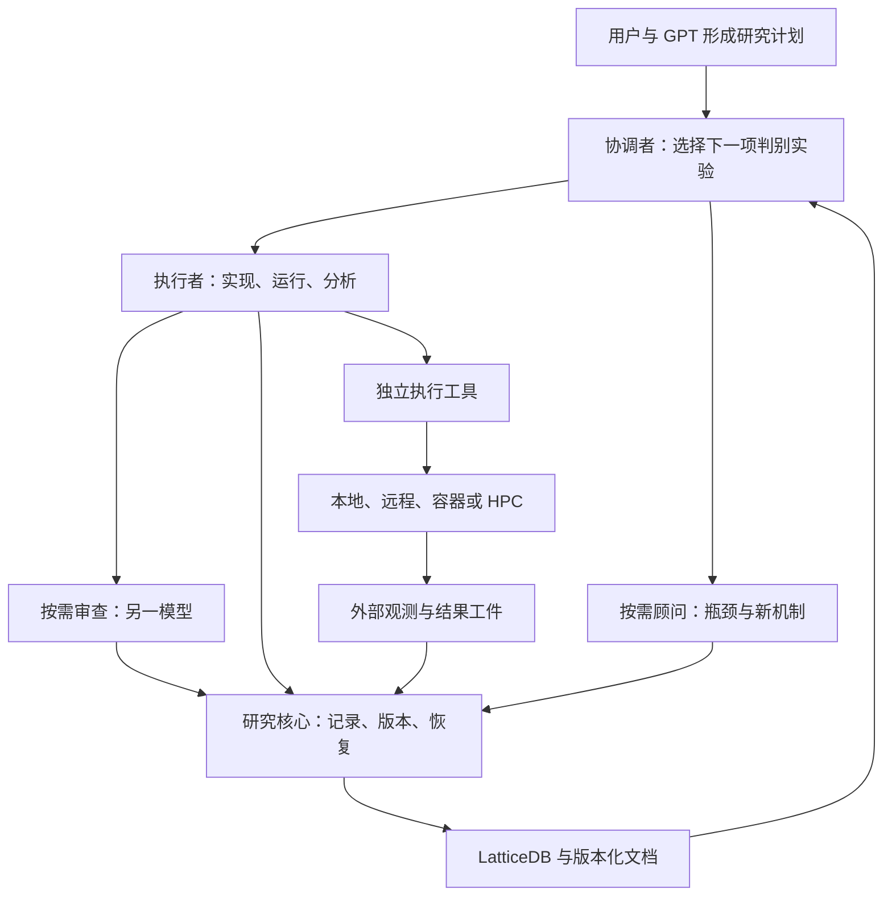
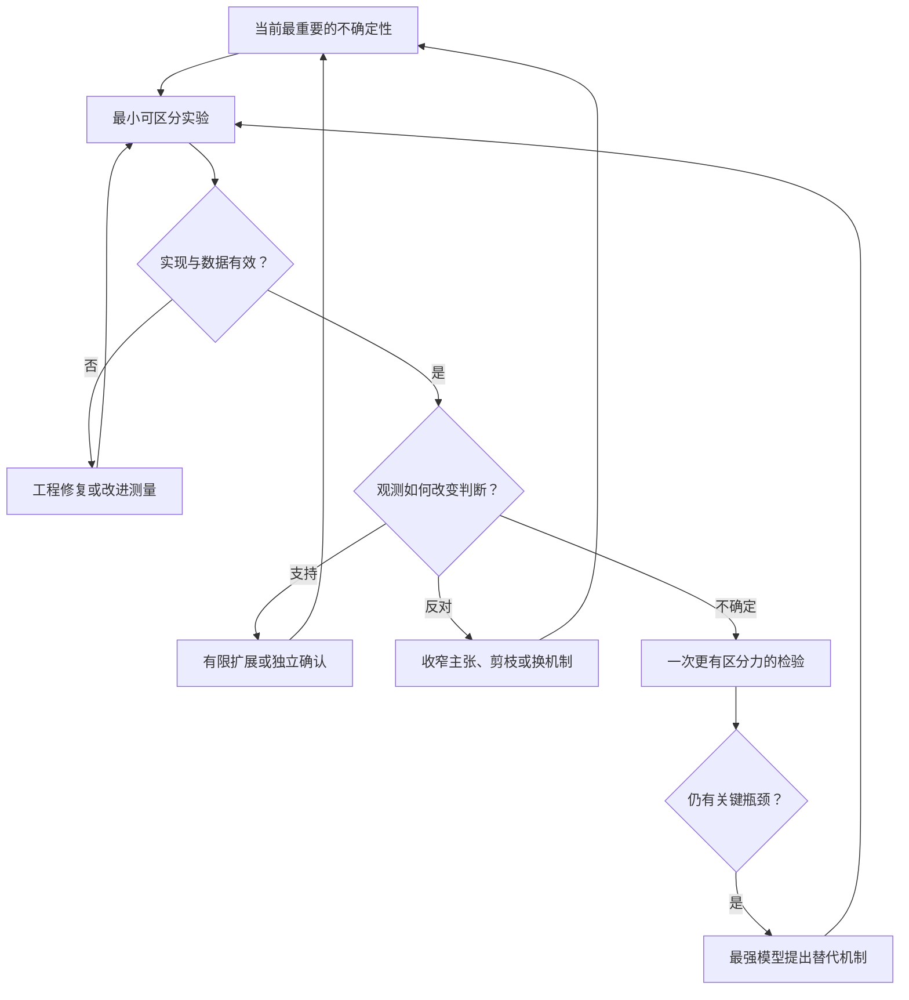
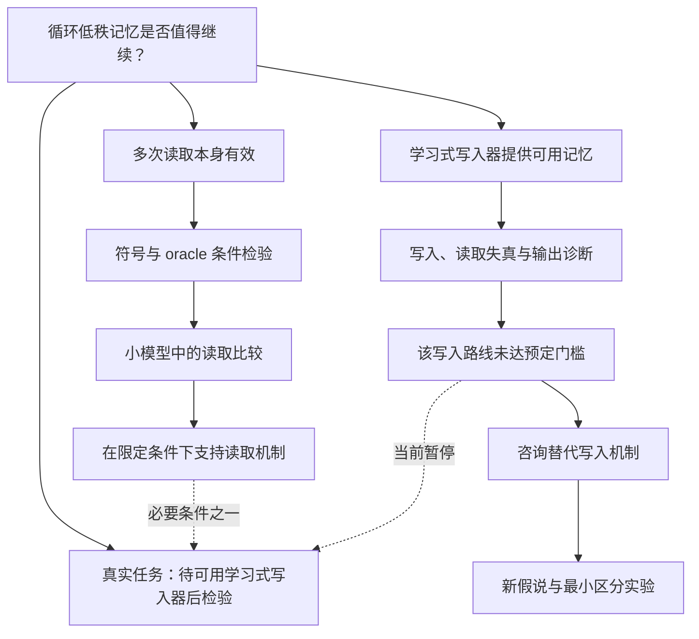

# Smooth Research：面向计划执行的极简 ML 研究 Agent 插件设计

**版本：设计草案 v0.2 · 日期：2026-10-30（日本时间）**

**本文档为事前制作的参考文档,并非权威, 实际执行中应当根据实际情况调整计划并对本文档进行更新**

**v0.3（2026-10-30）首版已实现；实施中的调整与验证结果见第 21 节，与正文冲突时以第 21 节为准。**

## 核心建议

从 research-tree 提炼“研究记忆与运行记录内核”，以 LoopLora 的实践重写研究工作流。用户与 GPT 等模型共同形成研究计划；插件帮助执行 agent 把计划转为可检验的假说，通过成本逐渐增加的实验形成证据，及时调整路线，并在瓶颈处调用最强可用模型。

建议暂名 **Smooth Research**，包名 **smooth-research**。首版采用：

- **一个嵌入式 LatticeDB**：保存假说、任务、实验、证据、决策与论文的关系，以及必要运行记录。
- **一个共享 Python 核心与 CLI**：处理事务、版本、记录去重、恢复、上下文包和文献索引。
- **三个简短 skill**：研究执行、跨模型审查、瓶颈咨询；详细说明按需读取。
- **一个持续协调角色，按需执行者、审查者和顾问**：角色可以延续，物理 session 可以替换。
- **一套平台无关的运行记录接口**：登记 Run/Attempt，关联外部执行标识，接收状态、结果和可选用量；本地、远程、容器和 HPC 的实际执行由 agent 使用已有工具完成。
- **一个由数据库生成的图视图**：按需展示，不引入常驻 UI agent。

终点是“形成值得投入正式实验的路线和可执行方案”，同时清楚说明现有证据的边界。它可以得到有价值的负结果、暂停路线，或返回多个有区别的候选；不要求用探索阶段的小实验宣称超过 SOTA 或保证论文结果。

本文件给出的是新插件的设计和实施验收要求，并非已经实现或已安装的插件。文中的新命令、配置和接口均为拟议接口。

**v0.2 的职责边界**：插件管理研究状态与结果，不提供实验提交、轮询、重试、取消或远程传输能力。Miyabi 等环境继续使用独立工具；任何运行登记、观测导入、结果导入和 resume 都不触发实验执行或外部查询。用于调用研究 agent、审查模型和顾问模型的宿主适配另行保留。

## 目录

1. 审查依据与经验判断
2. 产品目标与减重原则
3. 总体架构
4. 从研究计划到证据的工作流
5. 图数据模型
6. 数据、文档与一致性
7. 团队、session 和上下文
8. 跨模型代码审查
9. 研究瓶颈与最强模型咨询
10. 平台无关的运行状态与结果管理
11. 数据库化文献管理
12. 插件接口与目录布局
13. 配置与授权边界
14. 从 research-tree 提取什么
15. 从 LoopLora 提取什么
16. 实施路线与验收
17. 效率评估
18. LoopLora 场景示例
19. 核心 skill 的内容范围
20. 设计决策与来源
21. 实施记录（v0.3）

---

## 1. 审查依据与经验判断

### 1.1 固定版本

| 材料 | 本次审查版本 | 用途 |
| --- | --- | --- |
| research-tree 指定分支 | `codex/fast-research-workflow-20261011`，`d926805667bb200c7110e22fcde05fd6e4ea9c16` | 核对现有实现和可提取模块 |
| LoopLora master | `14c1fae207a71dcea46fcdae169b98287f6eb607` | 核对执行计划、规则、复盘、提交器与部分实验记录 |
| 用户上传的原始计划 | `recurrent_lora_research_plan_2026-10-26 (1).md` | 对比事前计划与执行中的调整 |
| Miyabi toolbox main | `473c357cdcf621d7dc035188dbe318a353f225a0` | 核对独立站点工具的职责和现有能力 |

源码为只读审查。复盘中的全项目成本采用其作者统计口径；本次没有原始集群访问和完整宿主会话日志，不能独立复算所有成本，也没有运行这两个项目的完整测试。

### 1.2 LoopLora 的经验究竟说明什么

原始上传计划已经约有 1,405 行，包含数学定义、对照、统计、阶段门槛与停止条件。AGENTS.md 的入口很短，但执行还依赖 Miyabi skills、herdr、代码索引、git 和任务文档。因此，值得提炼的模式是：

**详细的问题计划 + 简短的通用执行规则 + 可重复使用的工具 + 证据驱动的计划修订。**

执行中的有效调整包括：先做符号机制实验再进入 LLM；加入 oracle writer 以分离 reader 与 writer 的失效；根据理论反例增加对照；使用较小的 Base 模型；根据用户要求缩窄比较主张。新插件应允许这些调整，同时记录它们依据什么、影响哪些结论。[L1][L2]

复盘报告了 27 项预注册研究、542 个 PBS 作业与 113.3 node·h。作业包含测试、冒烟和评测，不能当作 542 次独立科学实验。Claude 和 Codex 侧累计输入分别约 17.4 亿与 5.0 亿 token，包含大量缓存读取和跨调用重复输入，不能直接换算成唯一文本量或费用。[L3]

这些材料支持“有些机制值得迁移”。它们不能单独证明轻量 harness 导致了多少效率提升：任务、模型、用户干预、基础工具和集群排队条件并未控制一致。

### 1.3 research-tree 当前已经改进的部分

指定分支已经是 config v3 / schema 23 的唯一快速筛选流程，已取消 strict/fast 模式切换，普通廉价筛选不等待逐次模型代码审查，候选可以逐个准入，UI agent 按需启动。因此，这些不应被再次包装为新设计的主要改进。[T1][T2]

真正需要拆开的，是 `research_db.py` 同时承担的两类责任：

- **值得保留的可靠性责任**：事务、引用、版本、运行身份、外部执行关联、证据导入、任务恢复。
- **应移出通用内核的研究政策**：固定角色组织、统一 SOTA 门槛、统一 seed 结构、所有项目统一五维复核、复杂晋级与文档义务。

该文件约 6,447 行，科学政策与存储接口深度耦合；适宜提取机制和测试，重新实现薄接口，不宜整文件复制。[T3]

### 1.4 两类实际偏差决定了设计重点

第一，LoopLora 的复盘要求完整 commit hash，但提交脚本仍能接受并在固定目录解析 HEAD；当前脚本也明确拒绝多节点提交。复盘中的规则不等于工具已经强制执行。第二，部分决策文档中的作业计数已落后于同一版本下的 jobs.json。新插件应记录执行者提供的实际版本与来源，并从已导入账本生成动态计数；执行工具负责确保实际启动的内容与运行规格一致。[L4][L5]

---

## 2. 产品目标与减重原则

### 2.1 输入和输出

**输入**：一份较完整的研究计划、当前代码库、可使用的数据与平台、模型角色选择、已明确的预算和执行范围。

**输出**：

1. 一张有证据关联的假说图，保留支持、反例、未检验部分和停止理由。
2. 一个或多个可进入正式实验的候选及其可重复运行的实现。
3. 对应的正式实验提案：主张、对照、独立性、资源估算与尚未解决的风险。
4. 一份成本与决策记录，能够解释为什么继续、扩展、暂停或停止。

“代码准备完成”和“科学主张已经被验证”分别报告。若只有探索信号，正式实验提案应明确其要确认的内容。

### 2.2 六条设计原则

| 原则 | 对实现的直接要求 |
| --- | --- |
| 计划是事前的参考，不是权威；结果改变路线 | 导入时提取一次，之后不再参考：记录就是当前的计划；新增或修订假说、改变路线都记录依据（21.16） |
| 优先回答能改变下一步的问题 | 每个实验说明结果会改变什么，不为占满资源扩矩阵 |
| 通用内核只做少量可靠检查 | 不在数据库中写死 SOTA、统一 seed 数或统一成功阈值 |
| 日常执行有充分自主权 | 已授权范围内的分支细化、测试、运行与对账不逐次请示 |
| 状态和上下文可以恢复 | 没有聊天历史也能识别未结束的 attempt、最后观测、当前证据和下一步 |
| 同时优化计算、模型和等待成本 | 记录可获得的资源用量、模型 usage、人工介入与得到决策的时间 |

### 2.3 避免重新长成一个重平台

首版不建设通用多智能体调度系统、独立 Web 服务、模型排名服务、全领域文献抓取平台或完整论文生产流水线。保留现成宿主和站点工具的职责。每增加一条规则，都要回答：它避免了哪种已观察到的损失，能否由较短的任务说明或确定性工具解决？

“极简”的衡量对象是用户和 agent 每轮必须理解与维护的东西，而非强行减少所有内部实体。Run、Attempt 与外部执行引用分离这类小复杂度，可以避免重复记账和错误归因。

---

## 3. 总体架构



图中的运行观测与工件由执行者或外部工具交给记录接口。研究核心不会沿着记录操作反向启动执行工具。

### 3.1 三层边界

**研究层**由 skills 与项目计划负责：选择假说、设计对照、解释结果、判断下一次投入价值。执行 agent 自行使用适合环境的现有工具开展实验，并遵守用户指定的资源限制。

**记录层**由共享核心负责：规范 ID 与引用、文档封存、任务领取、运行规格、外部执行引用、观测与结果去重、版本检查、上下文查询和可选成本记录。

**宿主适配层**连接 Codex、Claude Code、已有跨 session 工具和强模型入口。它管理研究 agent 与模型调用，不承担实验进程、容器或集群作业的生命周期。适配层只报告实际能力，不把目标模型或“进程已启动”当作已核实的能力。

实验执行工具位于插件之外。本地 shell、远程工具、容器运行器或 miyabi-toolbox 可以独立使用；插件没有实验 submit/poll/retry/cancel SDK，也不要求把这些工具注册成自身的执行后端。

### 3.2 数据库选择

**首版继续使用现有 LatticeDB，并固定已核对的依赖版本作为提取起点。** research-tree 使用的是原生 property graph；SQL 文件是约束规范，实际读写使用 LatticeDB，而非 SQLite。[T3][T4]

这一选择满足用户的图数据库需求，也避免迁移引擎和维护多个后端。现有依赖锁定 `latticedb==0.15.0`；正式实施时验证目标操作系统、Python 和打包兼容性，再决定是否升级。

数据库放在协调机的项目本地磁盘。不同 session 经同一个 store 接口访问。本地或远端实验只产生外部工具可读取的状态、日志和结果，由调用方登记；实验进程不直接打开控制端数据库。不让多个主机通过 Lustre/NFS 共同写活动数据库，也不自动同步活动数据库副本。

没有发现必须换成 Neo4j 或 SQLite 的实际理由。首版不构建多后端抽象；如果 LatticeDB 在下面的事务/恢复验收中失败，再基于具体缺陷重新选型。

---

## 4. 从研究计划到证据的工作流

### 4.1 导入计划：提取近期可执行部分

导入时保存原计划内容和来源，仅抽取：

- 用户真正希望证明或改进的核心主张。
- 主张依赖的关键机制与竞争解释。
- 能最先检验这些机制的少量实验。
- 已明确的资源、指标、数据和停止条件。
- 原计划中尚未被证实的假定。

不把一份长计划一次转成几十个已经分配 agent 的任务。远期分支可以保持“候选”，只有近期可执行部分生成 Task。计划里缺少的低风险实施细节由 agent 补全并注明；会改变目标或预算的缺口才需要用户决定。

提取只做一次（2026-10-31 按用户的原则补充，见 21.16）：计划里只有用户能改的部分（目标与主张范围、允许的数据与环境、资源上限、需要用户先决定的动作）写进 `docs/constraints.md`，其余变成假设、实验和任务。此后计划不再被参考，也不修改；协调者根据实际情况调整记录。

### 4.2 按问题选择实验层级

| 层级 | 要回答的问题 | 常用检验 | 能得到的结论 |
| --- | --- | --- | --- |
| E0 结构与实现 | 公式是否一致？初始化能训练吗？代码是否实现该算子？ | 维度、梯度、解析构造、等价性、极小输入与必要回归测试 | 排除明确错误；形成可执行机制 |
| E1 隔离机制 | 在有利而可控的条件下，机制本身有效吗？ | 符号任务、合成数据、oracle 组件、阳性/阴性对照 | 在指定条件下支持或反对机制 |
| E2 最小模型实验 | 放进真实模型后，信号还存在吗？ | 小模型、单模块、小数据、固定预算、主要替代解释 | 得到模型内探索信号或定位失效组件 |
| E3 有限确认与准备 | 信号是否足以支持正式投入？什么仍需确认？ | 预先固定的比较、合适的重复/保留材料、关键消融、运行成本 | 确认性证据或明确界限的正式实验候选 |

这四层是默认思考顺序，不是每条研究线都必须完成的状态机。E0 已发现数学问题可以立即修改；成熟代码上的新问题可以直接做 E2；理论研究可能主要停留在 E0/E1。CPU 可完成的工作不强制占用 GPU，但遵守站点对登录节点测试的限制。

### 4.3 每个新实验只需要一个紧凑契约

最小字段为：

| 字段 | 要写清的问题 |
| --- | --- |
| question | 本次实验具体回答什么？ |
| hypothesis_ref | 对应哪个假说的哪一版？ |
| intervention / comparator | 改了什么，与什么比较？ |
| metric / scope | 观察什么，结论适用于哪些条件？ |
| outcome_actions | 哪些结果支持继续、诊断、暂停或停止？ |
| budget / stop | 单次和批次成本边界、提前停止条件是什么？ |

小实验可以用短 frontmatter 加几段正文。多个 seeds 或同一代码路径的参数臂共享契约，不需要为每个 attempt 写一套任务书、预注册、发布、审批和总结。资源边界由用户决定、执行者遵守，记录接口不代替实际执行工具实施资源限制。

### 4.4 结果必须指向下一步



每个“不确定/开放”区间都应有默认动作，例如“暂停，等待新证据”“只追加一项诊断”“咨询顾问”。不保留没有下一步和复议条件的永久开放任务。

### 4.5 保留探索灵活性，也保留结论边界

- 单 seed、小验证集可以用于方向筛选，标记为 screening。
- 改阈值、对照、主指标或筛选方案时创建新契约版本；已看过结果的改动不能追认为事前设定。
- 重新使用验证集可以继续探索，但登记其参与选择的事实。
- 宣称机制得到确认时，比较方案、独立单位和材料须预先明确。新训练 seed、独立数据样本与新任务分别解决不同不确定性，不能互相冒充。
- 一次廉价失败可以支持“当前不值得追加投入”，未必支持“该机制普遍不成立”。
- OOM、错误梯度、未使用记忆、阳性对照失败等首先影响实验诊断能力，不自动成为机制反证。

### 4.6 何时结束探索

使用一个阶段交付记录，包含三个分开的字段：

1. **implementation_ready**：代码、对照、评测、运行规格与成本测量是否足以开展所提议的正式实验。
2. **evidence_scope**：现有证据究竟支持什么；是诊断结果、探索信号还是预先规定的确认性比较。
3. **investment_decision**：recommend_formal / continue_probe / pause / stop，以及理由。

推荐进入正式实验通常需要：主要实现缺陷已排除、至少有值得投入的证据或理论理由、关键替代解释已处理或纳入正式实验、最近工作差异明确、预算与协议可执行。它不要求所有研究先超过 SOTA，也不把“可以开始正式验证”写成“方法已证明成功”。

---

## 5. 图数据模型

### 5.1 六类核心对象

| 对象 | 主要字段 | 作用 |
| --- | --- | --- |
| Hypothesis | id, title, statement_ref, scope_ref, evidence_status, disposition, revision | 可被检验的科学判断 |
| Task | id, kind, target_refs, owner_role, state, request_ref, output_refs | 一段可交付工作，可关联多个假说 |
| Experiment | id, hypothesis_refs[{id, revision}], protocol_ref, stage, comparator_refs, cost_envelope | 一次实验设计，容纳多个臂和重复 |
| Evidence | id, artifact_refs, validity, evidence_level, scope_ref, source_attempts | 观测、诊断与统计结果 |
| Decision | id, target_refs, action, rationale_ref, evidence_refs, reopen_condition | 继续、修改、暂停、停止或投入决定 |
| Paper | id, identifiers, version, metadata_status, access_status, note_refs | 文献及其可核查来源 |

运行所需的 Run、Attempt、ExecutionRef、Session、Message、ReviewTicket、Usage 等作为同库中的辅助记录，默认不全部展开为图节点。它们仍有明确字段与约束，不能用一个随意的 JSON 字段替代全部语义。

### 5.2 关系比“父节点”更重要

| 关系 | 含义 |
| --- | --- |
| derived_from / combines | 科学思路来源或组合来源 |
| tests | 实验检验假说 |
| supports / challenges | 证据在特定 scope 下支持或挑战主张 |
| depends_on | 任务或实验执行依赖 |
| compared_with | 实验比较对象 |
| motivated_by / nearest_work | 假说与论文的具体关系 |
| based_on | 决策使用哪些证据和材料 |
| supersedes | 新版本替代哪个旧版本 |

**科学来源、代码起点和实验对照分别存储。** 三者可能指向不同对象，不能用同一个 parent_id 代替。执行依赖与版本替代应无环；支持、挑战和关联关系构成普通图，不要求整个知识图是树。

用户看到的是图的一种树形投影：默认沿 derived_from 展开，组合、反例、论文和对照通过侧边关系显示。一个实验可以同时检验多个假说，也可以让同一份证据支持一个机制、挑战另一个机制。

tests、supports、challenges 与 based_on 绑定具体目标 revision。修改假说后，旧证据不自动成为新主张的支持；需要显式核对适用范围并建立新引用，原关联仍保留。

### 5.3 不使用单个 success 表示所有状态

| 维度 | 示例状态 | 不应推出的结论 |
| --- | --- | --- |
| Task 执行 | ready / active / waiting / delivered / accepted / stopped | delivered 不等于科学结论成立 |
| Attempt 执行状态 | prepared / queued（可选）/ running / ended / unknown | ended 不等于执行成功；本地进程不必经过 queued |
| Attempt 结果 | success / failed / cancelled / unknown | 执行成功不等于证据有效 |
| Result 导入状态 | absent / partial / complete / rejected | complete 不等于已验证科学主张 |
| Evidence 有效性 | pending / valid / invalid | valid 不等于效果为正 |
| Hypothesis 证据 | untested / supported / challenged / inconclusive | supported 只在记录的 scope 内成立 |
| 投入处置 | active / paused / retired | retired 不等于被科学证伪 |

证据撤回或修订后，受影响的结论标记“需重新核对”。只追踪实际依赖，不因为无关文档改了标题就让整个项目失效。

---

## 6. 数据、文档与一致性

### 6.1 明确各类信息的权威来源

| 信息 | 权威来源 |
| --- | --- |
| 用户预算、范围与模型替补选择 | 版本化配置/约束文档及关联用户决定 |
| 原始研究意图 | 导入计划的不可变快照 |
| 研究状态、所有权、关联、已登记观测和用量 | 数据库；实际执行事实及用量依据来自外部工具或执行者 |
| 公式、实验设计、解释、交接正文 | 封存后的文档 revision |
| 原始结果与日志 | 运行工件及 manifest |
| 总览、当前计划摘要、图页面 | 从上述内容生成的投影 |

假说 statement、scope、实验判定条件等长正文使用固定文档 revision；数据库仅持有对应引用及少量结构化索引。正文、数据库摘要和仪表板之间不得存在三份可随意编辑的同一事实。

### 6.2 文档封存无需新增审批

草稿可以正常修改。第一次被任务派发、Run 登记、评审或决策正式引用时，工具封存其内容：

```yaml
document_id: DOC-0021
revision: 3
content_digest: blake2b:...
source_path: research/experiments/E-0012.md
git_commit: <完整提交ID或null>
sealed_object: research/documents/objects/<digest>.md
```

数据库引用 `document_id + revision + digest`，不只引用一个会继续变化的文件路径。已有结果始终连接当时版本。新内容成为新 revision，历史版本不覆盖。

先原子写入不可变文档对象，再在数据库事务中登记引用。文件系统和数据库不是一个事务；若中途崩溃，允许出现尚未登记的文件，恢复时核对并补登记，不允许先提交一个没有内容的有效证据引用。

### 6.3 本地多进程一致性

首版使用一个本地 store 写入入口，短期进程锁串行化写事务。数据库事务内同时完成：

- 校验目标 revision 与请求的 base_revision 相符。
- 校验引用、唯一键和必需字段。
- 更新实体、关系与对应事件。
- 递增 data_version 并提交。

不设协调者 epoch 或任务 owner_epoch。任务领取在事务内完成，只有一个 session 成为 owner；新 session 通过 `rl resume` 接续。跨主机自动 leader failover 不进入首版范围。

这属于新接口必须验证的契约，不因旧库“有事务”就假定已满足所有并发和崩溃场景。

### 6.4 备份与恢复

保留一致性快照导出，并新增导入恢复。快照必须含实体、边、revision、事件游标、活动 run/attempt/execution_ref 与最后观测、文档索引与工件摘要；正文对象和必要证据随备份复制或保留可验证地址。

不直接复制正在写入的数据库文件作为可靠备份。使用经验证的数据库备份机制，或短暂排除写入后进行一致性导出。恢复到新目录后先核对内容，再列出未结束或状态未知的 attempts、最后观测时间与外部执行引用。是否需要查询外部状态由接手 agent 决定并使用现有工具完成；restore/resume 只恢复记录，不启动查询、执行或重试。

research-tree 已有 export_snapshot，但本次未发现完整的 import/restore 与断电恢复验证；这是必须补齐的能力。[T3][T4]

---

## 7. 团队、session 和上下文

### 7.1 四类职责，按任务组织人员

| 角色 | 生命周期 | 职责 |
| --- | --- | --- |
| Coordinator | 持续的逻辑身份；session 可轮换 | 维护问题方向、选择实验、分配工作、处理分歧和投入决定 |
| Researcher | 可连续承担相关任务；不绑定单一假说 | 实现、测试、运行、分析、必要文献核对 |
| Reviewer | 按代码/协议变化临时启动 | 对指定快照进行独立审查（模型由配置决定，见 §8.1） |
| Advisor | 瓶颈或关键路线决策时调用 | 解释失败、提出替代机制与最小区分实验 |

文献检索、框架构建和证据分析是 task kind，不各自建立永久角色。协调者默认不亲自执行：实现与运行交给研究者，自己只做小改动、冒烟检查和读结果，把上下文留给假说、证据和路线决定；只有任务可以独立推进时才同时启动多个研究者。（2026-10-30 调整：原文允许单个 agent 包办整个小研究环，实施时 skill 写成了协调者“通常也执行”；与用户讨论后回到本表的分工，不另设流程与科学分离的常驻角色，见 §8.6 与 §21.3。）

稳定的是 role_id、task_id、worktree 和文档，而非必须永久保留某一个聊天上下文。

（2026-10-31 按用户要求增加：协调者在 herdr 里时，researcher、reviewer、advisor 都是协调者经 `rl agent open` 打开的会话，各占一个 tab，用 Claude Code、Codex 或 pi，模型取配置里该角色列表的第一个可用条目。任何会话都可以开宿主自己的子代理，但只用更低一档的模型：Anthropic 的 Fable 用 Opus 及以下、Opus 用 Sonnet 或 Haiku、Sonnet 用 Haiku；OpenAI 用更小的模型或更低的 effort；其他家族用同一模型、effort 降一级。子代理不领取任务、不写记录。见 §21.9。）

### 7.2 同 session 与跨 session 使用同一任务协议

**同 session**：优先使用宿主原生子代理和完成事件。按任务提供简报，避免默认继承全部研究历史。子代理完成时直接通知任务 owner，普通状态更新不经过 coordinator 二次转发。

**跨 session**：由可用宿主适配器启动独立 CLI session，记录精确 session ID、worktree、请求与观测模型、任务所有权。可以接入现有 herdr，亦可采用宿主已支持的进程方式；herdr 不成为研究核心的必需依赖。

两者都使用版本化任务文档与持久消息索引。宿主聊天消息是通知，任务包才是可恢复的工作依据。

（2026-10-31 实施：跨 session 的默认方式是 herdr。每个 researcher 会话有自己的 git worktree，位于 `<项目>/../<项目名>-worktrees/<会话名>`，每个任务一个分支 `sr/<会话名>/<任务>`，由协调者合并。记录的消息照旧进 inbox；收件人有活动会话时，再用 `herdr agent prompt` 送一行通知，并注明来自其他会话、不是用户。不在 herdr 里时，原生子代理、`rl delegate`、`rl review run`、`rl advise run` 照旧可用。见 §21.9。）

（2026-10-31 按用户要求：各角色的询问、许可请求和会话里的对话框都交给协调者，协调者能判断的直接判断并回答，只有协调者不能判断的才问用户。见 §21.9“询问与许可”。）

（2026-10-31 按用户要求增加监视程序：协调者打开会话后，`sr-watch` tab 每 20 分钟查看一轮。意外退出的会话在原目录重启，空闲而任务没做完的会话收到提醒；记录里看得出在等待的会话不唤醒。CLI 替协调者回答 worktree 的信任问题，其他对话框仍交给用户。见 §21.9。）

### 7.3 文档消息的最小信封

```yaml
message_id: MSG-...
type: TASK
task_id: T-0012
from_role: coordinator
to_role: researcher-symbolic
document_refs:
  - {id: DOC-0021, revision: 3, digest: "blake2b:..."}
base_revision: 7
in_reply_to: null
next_action: "实现预注册的线性读取对照并运行一次冒烟"
```

消息类型只保留 TASK、RESULT、WAIT、BLOCKED、HANDOFF、CANCEL。WAIT 引用 attempt IDs、可用的外部执行引用与后续动作；BLOCKED 区分工程、模型不可用、预算和科学问题。CANCEL 只撤回研究任务，不表示外部运行已被取消；若用户要求停止外部执行，执行者另用现有工具操作并登记实际结果。

收到、应用、交付分开记录。同一 message_id 重复投递不会重复领取任务或生成运行记录；过期 revision 返回冲突与当前摘要。保留接收游标，禁止对确认回执再做循环确认。

长内容写文档，通知只含 ID、目的和下一步。消息长度限额是默认格式建议，不成为阻止解释真实问题的僵硬规则。

### 7.4 上下文包围绕“当前决定”

按用途生成四种包：

- **work**：当前任务、范围、相关代码索引、必要文献、最新有效结果与已排除解释。
- **resume**：角色、首个未完成动作、未结束的 attempts、最后可信观测、未解决问题和工件位置。
- **review**：精确 diff/快照、方法定义、执行配置、重点不变量与必要测试。
- **advice**：瓶颈、关键正负证据、失败机制、尚存解释、预算和待决问题。

首版可把工作包目标设为约 2k–6k tokens，咨询包约 6k–12k tokens，作为待验证的默认值；不包含宿主系统提示的不可控部分。工具按真实 tokenizer 或标注的估算方法计算，不把字符数冒充 token 数。

优先保留进行中的任务、关键反证和预算，其余返回索引供按需读取。大日志与完整数据文件由脚本摘要，原始文件仍可追溯。

### 7.5 有条件复用 session

相关任务继续复用当前 session；到自然任务边界、主题明显切换或上下文负担过大时生成 handoff，用同一个 role_id 开新 session。轮换阈值由使用量观测调整，不预先宣称频繁重启一定省钱。

轮换流程为：封存交接并释放任务 → 新 session 领取任务，校验代码和运行记录 → 接续未完成动作。状态未知时应先通过外部工具核对，不能仅凭聊天中断就重派实验。

（2026-10-31 增加：herdr 会话完成一项工作后，由协调者决定复用还是关闭。相关的下一项工作用 `rl agent reset --compact`，无关的用 `--clear`，再 `rl agent assign`。复用的 researcher 保留它的 worktree，切到新任务的分支；有未提交的改动时拒绝切换。不再需要的会话用 `rl agent close` 关闭，tab 一起关掉。）

原生团队只是运行方式。Claude 当前文档仍将 agent teams 标为实验功能，且 /resume 不恢复 in-process teammates；跨 session 恢复因此必须依赖项目记录，而不是假定宿主保留所有队员。[O4]

---

## 8. 跨模型代码审查

### 8.1 独立性以代码作者为参照

若代码由 Codex 模型实现，默认由另一个模型族审查；由 Claude 实现则反向选择。比较对象是实际实现者，不只比较 coordinator 的模型。

记录 requested_model、observed_model、provider、session_id、author_models、review_scope。两个 session 使用同一个模型属于独立 session 复核，不能被标为跨模型；模型实际身份无法核实时标记未核实。

（2026-10-31 按用户决定调整：审查者只由配置决定，`models.reviewer` 按顺序尝试，第一个可用且给出可解析回答的生效；不再按作者的模型族排除候选。与作者的关系仍如实记录，但代码审查的复用、§8.7 的覆盖检查和 `rl decide` 的检查都不以它为条件。需要跨族审查时，把另一族的模型排在列表前面。）

### 8.2 按变化审查，不按每个 run 审查

默认触发：

1. 新的核心数学算子或训练/评测路径第一次用于有实质成本的实验。
2. loss mask、数据切分、adapter 注入、checkpoint 读写、分布式执行等高影响部分发生变化。
3. 准备作为正式实验基线或候选的最终快照。
4. 合并产生可能改变上述行为的冲突。

极小的实现冒烟与确定性检查可以先运行。相同执行规格增加 seed、重复已审实验、修改无关文档，不重新发起全面评审。

### 8.3 缓存依据是“审查范围指纹”

指纹由被审代码、执行配置、关键依赖、训练和评测入口以及 scope spec 的确定性摘要构成。只对白名单中的非语义字段放宽，例如该协议允许变化的 seed、日志目录。

不能宣称能够自动判断代码“行为等价”。未明确归入白名单的配置或依赖变化使相关审查失效；不影响的模块保持可复用。

### 8.4 一次审查交付可以覆盖多个维度

Reviewer 获取方法定义、代码 diff、必要上下文、关键测试和中性问题说明（代码审查包只列文件路径，审查者自己读文件，见 21.12），返回：

- 问题位置与可复现依据。
- 影响：结果错误、实验无效、资源浪费或非阻断改进。
- 最小修复与建议验证。
- 已查与未查范围。

不把五个检查维度默认拆成五次全新模型调用。适合脚本完成的数字重算与 manifest 检查交给代码；模型主要检查方法与实现一致性、实验设计和解释。

### 8.5 审查不可用与争议

使用预先选择的 fallback 顺序（2026-10-31 起只按配置顺序，见 §8.1）。没有可用 reviewer 时，记录 pending 或 unavailable；无关的低成本工作仍可继续。依赖该关键审查的扩大实验等待修复或合格审查，不伪称通过。

合法的反对意见保留原文。修复后仅复核受影响范围；若意见有争议，绑定一次独立复核，保留分歧与 coordinator 的处理理由，不反复重开直到得到 pass。

（2026-10-31 按用户要求改为轮次：一轮审查最多两次，即第一次加一次复查（代码审查和结论审查都一样）。每条发现标严重度：high 指结果会错或实验无效，medium 指很可能扭曲结果或浪费大量预算，low 指值得修但不改变结论。只剩 low 的 issues 算通过。第二次审查后仍有 medium 以上的问题，就交给协调者：协调者写明理由批准（`rl review approve`），或者退回工作。第三次请求报 LIMIT；要再审，须写明原因开新一轮（`--new-round`）。herdr 里的 reviewer 由协调者分配，只读，补丁写在回答里，由 researcher 修改，二者直接对话。见 §21.9。）

### 8.6 结论审查（2026-10-30 增加）

代码审查只回答“实现是否忠实于方法”。实验由协调者设计、结果也由它解读时，结论本身同样需要独立核对。以下关键结论在记录前做一次只读、跨模型的结论审查：

1. 把假说的证据状态定为 supported 或 challenged。
2. 停止一条路线（假说转为 retired）。
3. 阶段交付中的 recommend_formal 或 stop。

由协调者发起（`rl review conclusion --target H-x --proposal … --author-model …`），与代码审查共用 RV 工单、候选顺序和回答格式。审查包从记录生成：拟记录的结论、假说陈述与范围、每条相关证据及其 attempt、结果与各臂数字、实验契约（含是否在结果后修订）、代码审查、已有决定和其他开放假说。审查者检查证据等级、结论范围、事前设定的比较、工程失败或对照失败是否被当作否证、未排除的竞争解释，以及摘要与记录数字是否一致。审查包内容不变时复用已有的回答。

不强制拦截：没有引用通过（pass 或 issues）的结论审查的关键决定照常记录，但会一直列在 `rl status`、恢复包和 session 开始提示的待处理中，直到用 `rl link D-x based_on RV-x` 补上；unavailable 或 blocking 都不算通过。报告为每个关键决定标出审查状态。

### 8.7 登记 run 时检查代码审查是否覆盖（2026-10-30 增加）

哪个 run 需要代码审查（§8.2）仍由研究者判断，CLI 不判断一个 run 是不是“新核心路径上的高成本 run”。但每次 `rl run register` 都检查已有的代码审查是否仍覆盖这个 run 实际执行的代码，并把结果记在 attempt 上：

- 候选审查：针对该实验、以及它的代码来源（code_from）实验的代码审查，加上 `--review RV-x` 指名的审查。
- 覆盖的含义：通过（pass 或 issues）的审查审过的每个路径（2026-10-31 起不再要求跨模型，见 §8.1），在 run 实际执行的代码中都至少与其中一次审查看到的版本一致。RunSpec 给出 commit 时读该 commit 的文件，否则读工作区；配置去掉该审查允许变化的键后再比较。按 §8.5 修复后只复核受影响文件，也因此仍算覆盖。
- 结果：covered；stale（列出变化的文件和看到旧版本的审查）；not_passed（只有 pending、unavailable 或 blocking 的审查）；none；unchecked（commit 不在本仓库，或读不到代码）；waived（`--no-review` 附理由，例如冒烟测试）。
- 为此代码审查工单记录审查范围明细：每个文件、依赖和配置的摘要，忽略键，scope 文字。（此前的工单没有这份明细；已有项目的旧工单在 2026-10-31 一次性迁移，见 21.14。）

不拦截。结果出现在 register 的输出、`rl run show`、工作包、结论审查包（每条证据背后各 attempt 的状态）和报告的证据条目中，让缺口在下结论之前可见。它不单独进入待处理，以免冒烟测试反复提示。

---

## 9. 研究瓶颈与最强模型咨询

### 9.1 触发条件

以下情况值得咨询：

- 多项有效检验仍不能区分关键竞争解释。
- 几轮不同机制的修改没有产生新的信息。
- 局部机制有效，进入模型后失效，原因仍不清楚。
- 新文献改变了创新性或投入价值判断。
- 准备跨越明显的成本台阶，需要选择最有价值的下一步。
- 用户直接要求寻求建议。

同一个已知代码错误不应被重复计作科学瓶颈。触发计数只是提示，不能机械地要求每做两次实验就调用最贵模型。

### 9.2 “最强模型”是可配置能力

配置 advisor 主入口与已选择的替补入口，启动前核验可用性。API、CLI、宿主子代理与用户通过 GPT 产品手工咨询是不同入口，不假定同名模型的模式、工具、上下文与权限完全相同。

若最强模式仅在交互产品中可用，生成咨询包供用户提交，再导入原始回答及来源。不能假装 CLI 已自动调用那个产品模式。无回复时保留待咨询状态，继续其他独立工作。

（2026-10-31 按用户决定改为多方独立建议：一轮建议里，`models.advisor` 列出的每个模型各有一个工单，同时调用，各自独立回答；默认 `codex:gpt-6-astra@max` 与 `claude:claude-fable-5-1@high`。协调者综合各方建议，决定采纳哪些、怎样修改假说树。每个项目最多 `advice.max_rounds` 轮（默认 3）；用完后要先向用户报告，经用户同意才开新一轮，同意的原话记在工单上。没有任何 advisor 回答的一轮不计数。）

（2026-10-31 按用户要求增加：herdr 里每个 advisor 工单开一个会话。advisor 独立回答，用 `rl agent tell` 与协调者对话，可以修订自己的回答，旧版本保留。协调者拿到最终建议后关闭会话。Codex advisor 会话带网页搜索；headless 的 Claude advisor 开放 WebSearch 和 WebFetch。）

### 9.3 输入包与输出协议

输入包含目标、精确瓶颈、关键正负证据、已试路线、最接近文献、当前资源上限和具体问题。提供原始工件索引，让顾问可以质疑 coordinator 的解释。

要求顾问返回有限数量、机制不同的建议，每条包含：

1. 它解释了哪个尚未解释的现象。
2. 与现有路线的关键差别。
3. 可区分的预测和必要对照。
4. 最便宜的验证方式与预期成本。
5. 何种结果会令它停止。

答案保存为建议来源。选择的条目转成新的 Hypothesis/Experiment；建议本身不进入“已支持证据”。超出既有范围或预算的建议提交用户决定。

（2026-10-31 调整输出协议：顾问先评估现状与证据，再广泛检索相关研究（每个来源给出处，并说明是否亲自核对），指出瓶颈，然后给至多三条机制不同的建议，最后建议继续、暂停或停止并说明理由。JSON 块的键为 assessment、bottleneck、related_work、proposals、recommendation、pause_recommended。）

### 9.4 避免咨询循环

咨询请求按咨询包的内容（问题、证据、文献、约束等）和模型配置去重（实现见 21.15）。没有新证据时不重复提交同一大包；可以在原咨询中发送明确的新数据差异。没有价值的新路线时允许暂停，不以不断产生建议替代实验判断。

---

## 10. 平台无关的运行状态与结果管理

### 10.1 只记录研究运行，不管理执行环境

插件回答“运行了哪份规格、现在知道什么状态、结果来自哪里、是否可用”。如何启动、排队、等待、终止和传输文件由执行 agent 使用独立工具决定。

| 对象 | 含义 |
| --- | --- |
| Experiment | 科学设计，例如“固定 reader，比较两种 writer” |
| Run | 一个不可变 RunSpec 对应的一次逻辑实验实例 |
| Attempt | 某个 Run 的一次实际执行尝试；失败或重新执行保留新 attempt |
| ExecutionRef | 外部执行对象的引用，可为本地进程、远程进程、容器、HPC job 或其他外部任务 |

普通单次运行由 register 自动登记首个 prepared Attempt，调用者不必手工维护三层对象。一次合法的独立重复实验可以使用同样的 RunSpec，但登记为新的 Run；同一逻辑运行重新执行时登记新的 Attempt。记录接口只描述这个事实，不启动重试。配置或数据发生科学性变化时创建新 RunSpec/Run，不覆盖旧规格；恢复 checkpoint 的来源和实际配置也须记录。

多个 attempts 可以共享一个 ExecutionRef，例如一个 HPC job 顺序运行若干 seeds。它们仍分别保留结果；共享执行中途失败不能抹掉已完成 attempt 的有效工件。本地运行无需模拟一个 PBS Job。

### 10.2 不可变 RunSpec 与外部执行引用

RunSpec 的最小内容是实验与契约引用、arm/seed 等重复标识、代码和配置摘要、数据/模型版本、指标定义及预期输出。环境信息按研究需要记录；未知字段明确写未知，不推测填充。

```yaml
run_id: RUN-0012
request_id: register-run-0012
spec:
  experiment_ref: E-0012@1
  protocol_ref: DOC-0021@3
  arm: learned_writer
  seed: 42
  code_ref: {commit: "<完整提交ID>", content_digest: "blake2b:..."}
  config_digest: "blake2b:..."
  data_revision: "<数据版本与split>"
  model_revision: "<模型与tokenizer版本>"
  metric_spec_ref: DOC-0022@1
  environment_ref: "<依赖或镜像摘要，未知时明确标注>"
  output_spec: "<结果文件和必要诊断的定义>"
spec_digest: "blake2b:..."
```

无 Git 的实验可使用可追溯代码对象与内容摘要；有 Git 时裸分支名或 HEAD 不能作为不可变版本标识。插件登记调用方提供的快照引用，不负责创建或部署代码快照，也不自动验证远端实际运行了什么。

ExecutionRef 只保留最少的外部关联信息：

```yaml
kind: hpc_job  # 也可为 local_process、remote_process、container、external
executor_namespace: "<能够区分执行环境的稳定命名空间>"
opaque_id: "<外部工具提供的完整标识>"
locator: "<可选，供外部工具或执行者定位>"
```

核心不解析特定调度器 ID，也不根据 locator 执行命令。裸 PID 不足以唯一识别进程；调用方应使用能区分主机、启动实例与 PID 复用的命名空间和标识。同一引用可关联多个 attempts；暂时不知道外部 ID 时，Attempt 保持未绑定，不能凭空补一个 ID。

### 10.3 三类写操作，一个共享 store 入口

| 操作 | 最小行为 | 边界 |
| --- | --- | --- |
| register | 登记不可变 RunSpec；自动生成首个 Attempt，或在已有 Run 下登记新的 Attempt | 不启动执行或重试 |
| record | 追加外部引用、状态观测、终态或可选用量；终态记录承担 close_attempt 的作用 | 不查询、轮询、取消或控制外部对象 |
| import-result | 登记结果 manifest、工件引用和结果 revision | 不抓取远端文件，不运行项目 validator |

show/resume 只读已登记状态。这些操作共用直接的数据类型与事务检查；绑定外部引用、记录终态和登记新尝试不各自发展成服务或必装的 SDK。

`request_id` 用于调用重试去重：同 ID、同内容返回原记录；同 ID、不同内容返回冲突。使用新的 request_id 可以登记同规格的合法独立重复。保证的是记录导入不重复，不能保证外部执行没有重复发生；已经发生的重复执行必须如实登记并记账。

### 10.4 观测、执行结果与结果有效性分开

观测保留原始事实，状态是从已接收记录生成的投影：

```yaml
record_id: OBS-0031
attempt_id: ATT-0012-1
source: "<提供本次观测的工具或执行者>"
observed_at: "<事实被观测的时间>"
received_at: "<插件接收时间，由插件填写>"
source_sequence: 8  # 来源能提供时记录，不能伪造
execution_state: running
outcome: unknown
raw_state: "<外部工具原样返回的状态>"
source_ref: "<日志、返回结果或其他观测依据>"
```

`execution_state` 使用 prepared / queued（可选）/ running / ended / unknown；`outcome` 使用 success / failed / cancelled / unknown。`result_status` 使用 absent / partial / complete / rejected，Evidence 的 valid / invalid / pending 另行判断。

同一 record_id 重复接收只生效一次；内容不一致时报告冲突。按来源提供的顺序和 observed_at 判断新旧，不能只看 received_at。旧 running 观测不能覆盖已有终态依据的 ended。来源相互矛盾或顺序不明时保留记录并标待核对；首版不实现分布式事件排序。

尚未确定终态的 Attempt，若查询失败或外部执行事实无法确定，可将当前 execution_state 记为 unknown，并保留 last_trusted_state 与其时间。已有可信终态时，后来的查询失败、历史过期或文件暂不可达只新增观测问题，不撤销 ended 或原 outcome；只有新的实质矛盾证据及显式更正才能改变已确认终态。stale 只表示观测过时或需要刷新，是独立的新鲜度/展示标记，不属于 execution_state 枚举；消息迟到或结果文件不可达也不自动证明执行状态发生变化。unknown 不是新的成功、失败或取消事实；外部对象暂时找不到，也不能推断从未执行。

原始观测追加保留。必要更正用新 revision 明确指向被更正记录和依据；派生状态、结果完整性和科学有效性分别更新。停止本地跟踪不等于外部执行结束，未知 Attempt 不得仅因 session 结束而记为 cancelled。终态 record 关闭 attempt 时只依据已有事实，不向外部对象发命令。

### 10.5 结果导入和实际核验范围

结果 manifest 至少绑定 attempt_id、spec_digest、代码/配置/数据版本、指标定义、工件引用及摘要，并标明结果是 partial 还是 complete。实际执行版本与预期 RunSpec 不一致时，保留工件和差异；原 RunSpec 不随结果修改，结果不能直接作为预定比较的有效证据。

插件可核对提交给它的结构化字段，以及已经提供到本地且可读取的工件摘要。只收到远程 URI 时，仅登记引用和调用方报告的摘要，标明核验范围；不能声称已经读取文件或独立验证过其内容。文件获取和项目特定 validator 由外部工具执行，调用方把结果连同来源交回。

导入按 request_id、attempt 与工件摘要去重。修订结果创建新 revision，旧结果仍可追溯；部分结果不能覆盖完整结果。执行成功、文件完整、指标可信和机制得到支持分别记录。即使 attempt 已关闭，也可继续导入迟到工件，但不得把它们静默归到另一次尝试。

### 10.6 可选用量记录，不承担资源控制

用户设定资源约束，执行者在调用实际工具时遵守。插件保存约束来源、已知用量和未报告项，帮助协调者判断投入；它不预留调度预算、不限制外部并发，也不宣称能阻止未经过自身的进程或作业。

usage 是可选记录，包含 quantity、unit、resource_type、hardware（如适用）、source_ref 和 accounting_ref。时间、GPU·h、node·h、API 金额或其他单位可以并存；不同硬件或单位不能直接相加。没有可信用量就标记未报告，而不是零。

共享执行的成本按带命名空间的 accounting_ref 记一次，并关联成员 attempts。重复导入不重复累计；无法可靠分摊时只报告共享总量，不制造精确 run 成本。估算与实测分别标记，修订账单保留版本。

### 10.7 等待、恢复与外部工具的联用

WAIT 保存 attempt IDs、最后可信观测、外部引用和下一步。外部工具或执行者提供新的观测后，插件更新关联任务和图视图。插件没有常驻 observer，也不自行注册 watcher；没有新观测时只说明记录可能已过时。

所有 session 关闭后，数据库本身不能继续查询或唤醒 agent。下次 resume 返回恢复包，接手者再决定是否使用外部工具检查状态。已有外部唤醒服务可以照常使用，但不是插件成立的前提。

对 Miyabi，执行 agent 可独立使用现有的三项技能：`miyabi-pbs-shell-template` 编写作业脚本，`miyabi-pbs-cmd` 查询、提交与控制作业，`miyabi-pbs-goal-wakeup` 处理适用场景下的长作业等待与唤醒。它们的环境条件和验证范围由 miyabi-toolbox 自身说明。[M0]

miyabi-toolbox 当前没有本设计的 RunSpec/Observation/Result 数据契约，因此不能声称已有直接兼容。首版由执行者把实际工具输出整理成最少的记录输入；将来只有在重复联用确有负担时，才考虑在外部工具一侧提供独立的记录导出助手。该助手仍不进入 Smooth Research 的实验执行控制范围。

本地、远程和容器场景使用同样流程：登记逻辑运行与 prepared Attempt，执行者用自己的工具实际运行，再登记外部引用、观测和结果。无需安装 Miyabi 工具即可使用研究插件。远程资源写在配置的 `compute` 里；`rl compute steps` 给出把一个 commit 同步成远程只读快照、启动和取回结果的步骤，由执行者用自己的工具执行（§21.18）。

---

## 11. 数据库化文献管理

### 11.1 文献与假说连接

Paper 至少记录：

- DOI、arXiv ID 与版本、标题、作者、年份和来源 URL。
- 元数据核对状态、全文访问状态、获取时间与内容摘要。
- 本项目阅读笔记、精确页码/章节/公式/表格位置。
- 与假说的关系：来源、最近竞争工作、支持、反例或方法组件。

文献搜索结果、论文存在、读到全文、原文支持某条主张是四件不同的事：

```yaml
metadata_status: verified
fulltext_access: available
claim_checks:
  - claim_ref: H-0004@2
    relation: nearest_work
    locator: "Section 3.2, Equation 4"
    assessment: checked
    note_ref: DOC-0038@1
```

搜索摘要不能自动成为页码级证据。“没有检索到完全相同方法”也不能自动成为新颖性证明。

### 11.2 从 literature.py 提炼

保留 arXiv/DOI 标准化、多来源检索、去重、限流退避、PDF/文本缓存等较独立能力。[T6]

去重优先使用稳定标识符。论文不同版本关联保存；预印本与会议版可以链接但不丢失版本；标题相似只能产生待核对候选。每次查询保存来源、时间、参数与结果标识，失败不能当作“没有相关论文”。

首版用元数据、全文索引和假说关系查询。向量检索、全库抓取、跨项目自动经验归纳和 Zotero 双向同步可后续按真实需求增加，不占据核心执行上下文。

### 11.3 文献读取按决策触发

导入计划时先核对最接近的少量工作；新机制出现或准备扩大实验时补查；旧查询在没有变化时使用缓存。保留对立证据，避免 context pack 只返回支持当前路线的论文。

---

## 12. 插件接口与目录布局

### 12.1 CLI 优先，MCP 为薄包装

首版以统一 CLI 提供接口，宿主 skills 调用它。需要结构化工具时，用 MCP 包装同一套核心动作，不复制业务逻辑，也不把所有底层数据库方法暴露成几十个工具。

拟议命令族：

| 命令 | 示例用途 |
| --- | --- |
| rl init / status / resume / export / restore | 建立项目、查看状态、恢复和备份 |
| rl graph / context | 查询局部图与指定用途的上下文包 |
| rl task | 创建、领取、交付、等待、交接 |
| rl experiment / run | 封存契约、register、record、import-result，以及只读 show |
| rl review | 发起、复用和查询跨模型审查 |
| rl advise | 生成咨询包、提交咨询或导入回答 |
| rl literature | 搜索、登记、核对、关联文献 |

例如：

```bash
rl init --plan plan/research-plan.md
rl context --task T-0012 --purpose work
rl run register --experiment E-0012 --spec run-spec.json --request-id register-0012
rl run record --observation observation.json
rl run import-result --attempt ATT-0012-1 --manifest result.json --request-id result-0012
rl run show --active
rl review request --experiment E-0012
rl advise prepare --hypothesis H-0004
rl resume
```

以上是接口设计示例，不是现有可运行命令。返回默认包含短摘要、状态与工件指针；完整 JSON、日志、图和原始输出按需请求。

CLI 的交付采用一种明确方式：插件附带 Python 包和 pyproject.toml，声明 Python 要求、固定的 LatticeDB 依赖及 `rl = "research_loop.cli:main"` console entry point。安装步骤一次性建立专用虚拟环境并安装该包；宿主包装保存该环境中 rl 的绝对路径，skills 通过此路径调用，不假定加载 skill 后命令已自动进入 PATH。init 检查依赖与版本，缺失时返回清楚的安装问题；普通研究任务不隐式反复安装依赖。

### 12.2 插件代码布局

| 路径 | 内容 |
| --- | --- |
| plugin.json | 当前 OpenAI portable manifest |
| .claude-plugin/plugin.json | Claude 插件包装 |
| pyproject.toml | Python 依赖与 rl console entry point |
| skills/smooth-research/SKILL.md | 主研究执行入口 |
| skills/research-review/SKILL.md | 跨模型审查入口 |
| skills/research-advise/SKILL.md | 瓶颈咨询入口 |
| src/research_loop/cli.py | 三类运行记录写操作与其余研究命令的统一入口 |
| src/research_loop/store.py | 图事务、ID、revision、所有权 |
| src/research_loop/graph.py | 有限的图查询与状态投影 |
| src/research_loop/documents.py | 文档封存、引用与导入 |
| src/research_loop/tasks.py | 任务、消息与恢复 |
| src/research_loop/runs.py | RunSpec、Attempt、外部引用、观测、结果和可选用量 |
| src/research_loop/context.py | 按用途生成上下文包 |
| src/research_loop/reviews.py | 审查与咨询 ticket 共用调用机制 |
| src/research_loop/literature.py | 文献登记与现有检索逻辑 |
| src/research_loop/adapters/ | Codex、Claude 与模型调用的宿主薄适配；不含实验执行后端 |
| templates/ | 少量任务、实验、交接和咨询模板 |
| tests/ | 面向明确故障与不变量的契约测试 |

该模块划分是责任建议，不要求每一行都成为独立 package。脚本与类型可放在同一小型 Python 项目中。

### 12.3 项目数据布局

| 项目内路径 | 内容 |
| --- | --- |
| smooth-research.yaml | 已生效配置与约束来源 |
| plan/original.md | 导入计划副本与来源 |
| research/state/ | 当前控制机的活动数据库与锁 |
| research/documents/objects/ | 已封存的不可变文档 |
| research/tasks/、research/experiments/ | 可读的工作文档与草稿 |
| research/evidence/、research/reviews/、research/advice/ | 结果、审查和咨询材料 |
| research/mailbox/ | 文档消息与未导入事件 |
| research/snapshots/ | 一致性导出与恢复材料 |
| research/view.html | 按需生成的图视图 |

这些目录位于当前研究项目。多个 git worktree 引用同一个 research_root，不各自创建独立权威状态库。本地或远端运行目录由执行者使用的外部工具确定，插件只记录必要引用。

配置、代码、必要研究文档、精简证据和快照可按项目规则进入 git；活动 DB、锁、巨大原始日志和 checkpoint 不机械提交 git。保留原始证据与必要诊断 checkpoint；实验产物的清理由执行者依项目规则另行处理，核心不删除远端平台文件。

### 12.4 Codex 与 Claude 的兼容方式

共享核心、skills、模板和协议；分别验证宿主包装、模型调用与 session 接续。

当前 OpenAI 文档推荐根目录 plugin.json、skills 和可选 mcp.json，并保留 .codex-plugin/plugin.json 兼容形式；也提供 Claude 插件转换路径。Claude 使用自身 manifest 与 agent 定义。可复用的行为应集中在 skills 中，hooks、认证与 session 行为分别处理。[O1][O2][O3]

不要复制 research-tree 的整套宿主 hooks 来维持角色体系。首版只在实际需要且宿主支持时加入轻量恢复提示或结果通知；关键记录校验存在 CLI 中，不依赖 agent 是否触发某个 hook；实际提交保护属于外部执行工具。

Codex 非交互执行可作为外部模型入口之一，适配器记录确切 session ID，避免并发场景用“最后一个 session”恢复错对象。CLI 参数、模型名和能力由目标版本探测与验收决定，不照搬旧脚本的所有 flags。[O5]

---

## 13. 配置与授权边界

### 13.1 默认配置尽量短

```yaml
version: 1

models:
  researcher: [claude:claude-opus-5-5@high, codex:gpt-6-astra@high]
  reviewer: [codex:gpt-6-astra@medium, claude:claude-opus-5-5@medium]
  advisor: [codex:gpt-6-astra@max, claude:claude-fable-5-1@high]
advice:
  max_rounds: 3
agents:
  args: {claude: [--permission-mode, auto], codex: [], pi: []}
  watch_minutes: 20
usage:
  switch_left_percent: 10
  coordinator_host_left_percent: 20

context:
  work_target_tokens: 4000
  advice_target_tokens: 10000
manuscript:
  latex: null
compute:
  default: local
  resources:
    local: {kind: local}
    # miyabi: {host: miyabi-g, connect: pi-env-mcp:miyabi-g, jobs: mcp:miyabi-pbs,
    #          workspace: /work/<group>/<user>/<project>, code: git}
```

（2026-10-31 按实现更新。上面每个键都由 CLI 读取。原稿中的 `artifacts` 一节没有代码读取，已经删除。模型选择统一写在这里：三个角色各有一个模型列表，researcher 和 reviewer 按顺序使用第一个可用的，advisor 每轮咨询全部可用的。旧写法（`researcher: inherit`、reviewer 的 `candidates`/`relation_to_author`、advisor 的 `primary`/`fallback`）仍能读取，但会给出警告；拼错的键也会警告。配置里的问题都不会让命令失败，见 §21.11。各键的含义见 `docs/configuration.md`。2026-10-31 按用户要求，目录改为固定的 `src/`、`docs/`、`research/`，`plan`、`constraints_ref`、`code_root`、`docs_root`、`reports_root`、`research_root` 不再配置，旧配置里的这些键会给出警告，见 §21.10；新增 `manuscript.latex`。新增 `usage` 一节：订阅窗口只剩多少时交给下一个模型，见 §21.17。2026-10-31 按用户要求新增 `compute` 一节：计算资源在哪里、怎样访问、代码怎样过去，见 §21.18。）

模型别名由用户环境映射到可用入口；token 目标是待验证示例。配置不包含队列、调度器参数或固定 node·h 预算 schema。`compute` 只写每个计算资源怎样访问（主机、ssh 或 pi-env-mcp、提交作业的 MCP 或 skill、远程工作目录、代码经 git 还是打包过去），CLI 据此检查本地状态、打印步骤，不连接、不提交（§21.18）。用户在约束文档中说明资源的使用范围、队列与成本上限，协调者和执行者遵守；已知用量可导入并与约束对照，但这不是调度预算预留或平台限制的实现。

站点用户、组、路径、队列和传输方式由现有执行工具管理。模型凭据由已有宿主或环境凭据机制提供。

### 13.2 自主执行的范围

在明确的目标和资源范围内，agent 可自行调整近期任务分解、选择更便宜的有效检验、扩展有依据的分支、修复实现、使用外部工具运行常规实验、合并无冲突的已验证工作并更新计划。这些是 agent 的工作行为，不是插件记录命令的隐式副作用。

涉及扩大授权资源、改变主要研究目标、使用未授权数据或改变外部访问能力时，向用户说明具体变化后再推进。用户在主会话的明确决定直接成为配置或约束文档的依据，不要求重复进入额外 UI、重复确认或手工填写授权模板。

科学标准的调整可以被用户决定，但不能覆盖历史事实。例如用户改为只做同 rank 比较后，之后的结论就相应收窄；不会因此把之前没有验证的效率优势写成成立。

### 13.3 少量不可混淆的事实约束

结果、来源、实际模型身份、版本、资源用量、未完成状态不得伪造；执行未知不当作未执行；工程失败不当作科学反证；探索后修改的规则不当作原始预注册。记录去重不代表外部实验从未重复，已发生的执行都必须保留。这些是记录准确性要求，而非额外的研究流程审批。

---

## 14. 从 research-tree 提取什么

以下文件路径均相对于 research-tree；固定版本为第 1 节所列 SHA。

| 文件或机制 | 保留内容 | 新设计中的处理 |
| --- | --- | --- |
| schema/create_db.py | 嵌入式图、索引、Meta、schema 版本 | 使用新的小 schema，保留创建模式 |
| tools/research_db.py 的 _Tx / _open / _writer | 短事务、锁、关系读写、data_version | 提炼 store；去除科学晋级政策依赖 |
| reserve_submission / claim_submission / attach_job / reconcile_submission | 外部身份、未知状态与历史保留的经验 | 只提取记录不变量；不迁移提交、预留、对账控制或预算结算流程 |
| import_run_result / retract_run | 工件与代码配置绑定、结果撤回 | 简化为明确的导入与有效性接口 |
| tools/metrics.py | 单位、方向、配对与统计纯函数 | 按项目协议选用，不带入“必须超过 SOTA” |
| tools/evidence.py | 数字与源文件核对 | 作为辅助检查；不视为科学语义证明 |
| tools/review_call.py | 异步 ticket、去重、失败持久化、后端调用 | 抽底座；review 与 advice 分开 schema |
| tools/send_message.py / message.schema.json | 文档引用、消息编号、去重日志 | 缩短协议，加入结构化 WAIT/HANDOFF |
| tools/memory.py / context_pack / resume_package | 事实解释区分、适用范围、有限上下文 | 按当前任务与用途重写查询顺序 |
| tools/literature.py | 标准化、检索、去重、缓存、退避 | 优先提取较独立函数并入 Paper 管理 |
| tools/build_site.py | 数据库生成静态视图的思路 | 首版仅假说图、在途运行、证据详情 |
| codex_runtime.py 等 | 启动、指定 session 恢复、退出观测 | 只保留薄宿主适配 |
| discovery.py | 候选来源记录 | 重写为 plan import / propose，删除全套自主选题机制 |
| research-tree-rules.md / doc_library.md | 有价值的研究原则 | 重写短入口和少量模板 |
| codex_hook.py / Claude register.tsx | 少量宿主能力参考 | 不整体迁移高耦合角色与拦截层 |
| eligibility / 五维复核 / 统一确认批次政策 | 适合严格阶段的设计思想 | 移为项目正式实验协议，不进通用内核 |

源码事实依据见 [T3]–[T8]。现有测试可提供故障场景，不按数量照搬；测试应对应新接口中保留的不变量。

尤其不建议继续使用 SQL schema → 自建约束解析 → 图 API → 科研规则这一整套叠加，或再做一个“通用研究政策 DSL”。首版用直接的记录类型、事务检查和项目文档即可。

---

## 15. 从 LoopLora 提取什么

| LoopLora 实践 | 新插件的提炼方式 | 需修正的地方 |
| --- | --- | --- |
| 计划允许按实际结果更新 | 原计划快照 + 有来源的修订和决策 | 不继续累积巨型执行表格 |
| 先符号、后 LLM | 局部机制检验优先 | 不固定所有项目都走同样阶梯 |
| oracle writer 分离故障来源 | 必要阳性对照与组件隔离 | oracle 成功不外推 learned writer |
| 任务文档 + 短消息 | 持久任务包与消息索引 | 事件不能只留 scratchpad |
| 长期领域 worker | 稳定角色 + 可轮换 session | 不让上下文无限增长 |
| WAIT / STOP | WAIT / BLOCKED 引用外部运行和后续动作 | 不在研究插件中重建等待或唤醒服务 |
| 结果区间与条件对照 | 实验契约中的 outcome_actions | 开放区间必须有默认行动 |
| 冒烟估时与运行规格 | 记录外部工具提供的规格与测量 | 区分预计、实际与未经核验的字段 |
| 计算前静态审查 | 按新代码路径做跨模型审查 | 不在每个 seed 重复全面阅读 |
| 代码快照与 .started/.exit | 保留版本、执行标记与观测来源 | 接收已提供事实，不代替执行工具采集 |
| 每份报告写成本 | 从已导入 usage 生成摘要 | 共享 accounting_ref 去重，未知成本不记零 |
| 研究线停止与重开 | 保留停止理由、新证据与复议条件 | 重开不删除原负结果 |

LoopLora submit.py 可帮助识别哪些执行事实必须记录，但不迁移为本插件的公共执行适配器。其中固定用户/目录/组、单节点限制、HEAD 解析和提交后写账本的窗口，属于执行工具自身应处理的问题。[L4]

复盘推荐的“每次合并后全量测试”也不机械推广。执行 agent 只在共享训练/评估路径和集成冲突有实质风险时运行必要集成测试；文档更新或独立小变动不为测试数量消耗集群资源。

---

## 16. 实施路线与验收

### 16.1 先完成一条完整的研究路径

| 里程碑 | 内容 | 可验证交付 |
| --- | --- | --- |
| M0 核心与导入 | 小 schema、文档封存、图查询、局部 context、原计划导入、快照恢复 | 从 LoopLora 材料重建一条假说—实验—证据—决策链 |
| M1 团队与模型调用 | Task/Session、同/跨 session 协议、所有权、review/advice ticket、文献关联 | 一个 Codex 与一个 Claude session 交接同一任务；独立审查与咨询可追溯 |
| M2 运行记录闭环 | register、record、import-result 与只读恢复；不可变规格、外部引用和可选用量 | 一个通过独立工具完成的本地真实运行，其状态与结果可正确登记；核心不触发执行 |
| M3 研究闭环与图视图 | 分支选择、scope、停止/重开、成本视图与阶段交付 | 正向、不确定和无效实验均能正确改变下一步 |

M0–M3 合起来才是最小可用版，覆盖用户提出的六项能力。不要以只有图和文档模板的版本宣称完整插件，也不先开发完整看板再补运行记录。

每个里程碑都保留一个具体示例可以演示。Miyabi 与 miyabi-toolbox 的联用可作为后续环境集成验收；它验证外部结果能否被如实登记，不要求核心实现调度器。实际运行由执行者在已授权范围内完成，本设计阶段不开展实验。

### 16.2 核心验收场景

| 场景 | 必须发生的行为 |
| --- | --- |
| 两个 session 同时领取任务 | 只有一个 owner 成功，另一个得到当前状态 |
| 封存文档后编辑草稿 | 原实验仍指向旧 revision；不会静默变更历史契约 |
| 文件与数据库登记之间或事务内中断 | 可恢复一致记录，无悬空有效证据或半写的节点/边 |
| 同 request_id 重复 register | 返回同一记录；内容不同则冲突，新 request_id 允许合法重复实验 |
| 同 record_id 重复或乱序观测 | 去重并保留来源时间；旧 running 不覆盖已确认 ended |
| 外部观测失败、来源矛盾或无新状态 | 未确认终态时可记 unknown；单纯查询失败不撤销已有终态，保留观测问题与待核对项 |
| 同 opaque_id 出现在不同执行环境 | 命名空间使其保持独立；核心不解析或操作该 ID |
| 多个 attempts 共享外部执行 | 结果分别记录，共享 accounting_ref 的成本只计一次 |
| 外部执行者重新运行同一 Run | 登记新 Attempt，原失败保留；接口不发起 retry |
| 结果版本不符或只提供远程 URI | 保留差异和核验范围，不假称本地已读取或验证 |
| 重复导入、部分结果与迟到结果 | 去重；版本和 attempt 关联不丢失，部分结果不覆盖完整结果 |
| 登记、导入、关闭记录或 resume | 不启动实验、状态查询、下载、重试、取消或项目 validator |
| 同规格换 seed 或修改关键代码 | 仅在审查范围仍有效时复用 review；关键变化重新审受影响部分 |
| reviewer 不可用或 advisor 提议扩大范围 | 如实记录，按已配置替补和用户约束继续；不伪造审查或授权 |
| 阳性对照失败 | 记实验诊断能力不足，不宣布核心机制被推翻 |
| 全部 session 关闭后重开或导出后恢复 | 短包恢复任务、attempts、最后观测和版本；不自动查询或重跑 |

### 16.3 实际研究验收

建议选一条成本很低、同时能产生正反结果的机制路线。执行者用独立工具运行正确实现、无效实现和有充分对照的负结果，把事实导入后检查插件是否能区分三者。再模拟一次 session 更换、一次重复导入和一条状态未知的外部观测。

这检验研究记录是否帮助推进问题，而非测试某个 HPC 执行后端。测试通过数、代码行数与论文页数均不是主要验收目标。

---

## 17. 效率评估

### 17.1 主指标

**得到一个有证据、可改变下一步的决定所需的总成本。**

分别报告：

- 实际可获得的资源用量及单位、硬件和来源，例如运行秒数、GPU·h 或 node·h；跨平台不把不同单位或硬件直接视为同等算力，缺失用量单独报告。
- LLM 未缓存输入、缓存读写、输出、可观测推理 token 与实际费用。
- 从提出问题到得到可信决定的经过时间。
- 用户介入次数与协调者的人工转发次数。
- 已观察到的重复执行、错误版本实验、结果无法追溯的数量；记录插件不能证明未观察到的外部执行不存在。

没有使用真实价格或账单时只报告 usage，不给虚构美元成本；月度/订阅配额也不自动等价于 API token 账单。

### 17.2 Token 口径

不同提供方可能把缓存输入包含在 input_tokens 中，也可能分列。保留原始 usage，按 provider adapter 规范化；累计计数事件只取增量或最终累计，不能每次相加导致重复计算。相同 message/event ID 去重。

报告明确区分：

1. 累计处理输入量。
2. 其中的缓存读取/写入。
3. 输出与推理量。
4. 实际金额或无法观测的部分。

新 session 重建、缓存失效和上下文压缩本身也有成本。因此“轮换 session”“缩短上下文包”都是要对照验证的优化假说。

### 17.3 如何比较新旧流程

可采用两层验证：

- **历史材料回放**：用相同计划和已产生工件，比较恢复是否正确、上下文读取量、状态查询开销与重复工作的数量。它不能证明真实科研发现质量提高。
- **小型前瞻对照**：选可比较的问题、相同可用模型和资源范围，记录用户干预，比较得到正确正/负/不确定结论的成本和时间。

把“省 token”“更快得到有效方法”作为待验证目标，不在没有对照时写百分比收益。一个成功停止错误路线的决定也应计入有效产出，不能只奖赏正向精度。

---

## 18. LoopLora 场景示例

以下用于展示新设计如何表达已发生的研究过程，不是新的实验结果。

### 18.1 假说图



应显示的关键事实是：oracle 条件下某些读取比较得到支持，不能由此直接宣布 learned writer 或自然任务成立。LoopLora 的 P1-L/P5L 决策和结构化 endpoints 支持有限条件下的比较，同时保留主 reader 门槛失败及真实任务未运行等范围限制。[L6]

### 18.2 新插件中一次完整的小循环

1. Coordinator 从原计划抽出“reader 失败可能来自 writer 的输出”这一待区分解释。
2. Task 指派给熟悉该模块的 Researcher；context 仅包含有关公式、两段实现和此前失败证据。
3. Researcher 定义 oracle 对照和测量，不生成全面参数网格。
4. 新训练/评测路径由另一模型审查一次；确定性检查和冒烟由脚本执行。
5. 登记固定代码、配置与数据版本的 RunSpec 和 prepared Attempt；执行者使用本地或远端现有工具运行。
6. 执行者登记外部引用及实际观测；需要等待或核实时使用独立工具，未知事实保持 unknown。
7. 导入提供到手的结果、工件引用与可选用量，分别记录核验范围和证据有效性；worker 提交短结果包。
8. Coordinator 判断这是支持 reader、挑战 writer，还是实验仍无诊断能力。
9. 若出现瓶颈，顾问看到明确的失败模式，并提出可区分的下一个实验。
10. 图、当前计划摘要和成本数字自动更新；无需重写大型任务总表。

### 18.3 使用者应能直接问的问题

- 这条假说现在为什么暂停？哪份证据改变了决定？
- 当前阳性结果依赖 oracle、特定 rank，还是实际学习得到的组件？
- 哪个未结束的 attempt 对应哪份代码和契约，最后可信观测是什么？
- 关闭当前 session 后，谁能接手，第一步应该做什么？
- 顾问提出的新机制与已失败的路线有什么区别？
- 哪篇最接近文献可能覆盖我们的主张？具体在哪一节？
- 下一项最便宜但有区分力的实验是什么？

这些查询是图数据库和文档协议的主要价值，而不只是把节点画得更漂亮。

---

## 19. 核心 skill 的内容范围

主入口建议约 80–150 行，先以实际使用量验证；流程、字段和异常说明分到按需 reference。以下是内容提纲，不是可直接安装的完整 skill：

```text
1. 读取当前用户目标、授权范围和项目状态；已有项目先读 resume 包，外部状态需由执行者另行核对。
2. 保留原计划，把近期工作提取为可检验假说和有限任务。
3. 选择能改变下一步判断的最便宜有效实验。
4. 分别记录科学来源、代码起点和比较对象。
5. 开始前写清预测、对照、观察指标、范围、结果动作和成本。
6. 在目标与预算内自主执行；有依据时修订计划并保留来源。
7. 按任务组织并行，优先复用现有执行能力。
8. 用任务文档和短消息交接，保存真实 session 与模型身份。
9. 对新的关键实现路径调用另一模型审查，按范围指纹复用结果。
10. 执行者使用独立工具运行实验；插件仅登记运行、观测和结果，未知执行先由外部工具核实。
11. 将执行结果、证据有效性、科学判断和投入处置分开。
12. 遇到有信息价值的瓶颈，向最强可用模型提交精简证据包。
13. 把建议变成待验证假说；用文献原文和实验检验。
14. 每个开放结果写下一步或复议条件；不为保持忙碌增加实验。
15. 在任务边界形成恢复包，限制历史与日志累积。
16. 形成正式实验候选或暂停/停止报告，明确证据边界与成本。
```

入口不重复教授通用 ML 知识，也不要求 agent 每次加载全部 schema、所有平台说明和整个研究历史。真实宿主、模型身份和审批能力遵循当前环境，不由 skill 文本扩张。

---

## 20. 设计决策与来源

### 20.1 关键决策

| 决策 | 理由 | 重新考虑的条件 |
| --- | --- | --- |
| 保留 LatticeDB，重写薄 store | 满足原生图要求，已有提取起点，复杂度主要不在引擎 | 目标环境兼容或事务/恢复验收失败 |
| 同一项目一个权威状态位置 | 减少状态漂移，工作目录可见 | 真正需要多机器并行控制且已有服务化需求 |
| CLI 优先，MCP 薄包装 | 宿主共用核心，避免工具目录膨胀 | 某宿主无法可靠调用 CLI |
| 四类职责，只有协调身份持续 | 降低组织、转发与上下文成本 | 实际并行瓶颈需要独立专业工作者 |
| 原始计划快照 + 局部图 + 决策修订 | 保留意图并支持外推 | 用户要求固定协议的确认阶段 |
| 关键变化触发跨模型审查 | 覆盖真实风险，减少重复阅读全文 | 缺陷率或费用观测表明需调整触发条件 |
| 咨询与审查分开 | 顾问提出新路线，审查者核对特定实现 | 两者共享底层 ticket，但职责仍分开 |
| 事实完整性进入工具，研究策略留给 agent | 避免通用数据库决定研究是否值得做 | 某项目有可明确验证的独立自动判定脚本 |
| 不默认设置超过 SOTA 的探索门槛 | 用户目标包括机制有效性和正式实验准备 | 具体项目明确将竞争性能作为核心主张 |
| 平台无关的记录接口，执行工具独立 | 复用已有本地、远程和 HPC 能力；如实保留未知状态和核验范围 | 实际联用需要更便捷的记录导出时，在外部工具侧单独处理 |

### 20.2 实施前仍需核验的具体事项

- 目标机器的 LatticeDB 安装、跨进程事务与恢复契约。
- 用户实际安装的 Codex/Claude 版本及可用模型入口。
- 记录接口在本地运行和已有远端工具联用时，能否完整保留版本、外部引用与核验范围。
- 目标执行者能否提供稳定观测标识与可追溯结果；缺失字段的未知状态是否清晰。
- 基于实际任务的数据，选择上下文包与 session 轮换默认值。

这些是实施核验项，不应被预先扩展成复杂平台或新增长期角色。

### 20.3 来源

GitHub 链接固定到本次读取的提交；外部产品文档按 2026-10-30 查询。

**research-tree**

- [T1 README](https://github.com/UnbearableFate/research-tree/blob/d926805667bb200c7110e22fcde05fd6e4ea9c16/README.md)
- [T2 配置模板与站点义务](https://github.com/UnbearableFate/research-tree/blob/d926805667bb200c7110e22fcde05fd6e4ea9c16/shared/research-tree/schema/config.template.yaml)
- [T3 ResearchDB 实现](https://github.com/UnbearableFate/research-tree/blob/d926805667bb200c7110e22fcde05fd6e4ea9c16/shared/research-tree/tools/research_db.py)
- [T4 图数据库初始化](https://github.com/UnbearableFate/research-tree/blob/d926805667bb200c7110e22fcde05fd6e4ea9c16/shared/research-tree/schema/create_db.py)
- [T5 异步评审实现](https://github.com/UnbearableFate/research-tree/blob/d926805667bb200c7110e22fcde05fd6e4ea9c16/shared/research-tree/tools/review_call.py)
- [T6 文献检索实现](https://github.com/UnbearableFate/research-tree/blob/d926805667bb200c7110e22fcde05fd6e4ea9c16/shared/research-tree/tools/literature.py)
- [T7 记忆与上下文包](https://github.com/UnbearableFate/research-tree/blob/d926805667bb200c7110e22fcde05fd6e4ea9c16/shared/research-tree/tools/memory.py)
- [T8 文档消息](https://github.com/UnbearableFate/research-tree/blob/d926805667bb200c7110e22fcde05fd6e4ea9c16/shared/research-tree/tools/send_message.py)
- [T9 当前研究规则](https://github.com/UnbearableFate/research-tree/blob/d926805667bb200c7110e22fcde05fd6e4ea9c16/shared/research-tree/rules/research-tree-rules.md)
- [T10 数据库回归场景](https://github.com/UnbearableFate/research-tree/blob/d926805667bb200c7110e22fcde05fd6e4ea9c16/shared/research-tree/tests/test_research_db.py)
- [T11 依赖版本](https://github.com/UnbearableFate/research-tree/blob/d926805667bb200c7110e22fcde05fd6e4ea9c16/pyproject.toml)

**LoopLora**

- [L1 原始上传计划](https://chatgpt.com/library?file_id=libfile_5106ad1251648191b4af5183f801a6e4&account_id=personal)：本次用户附件；在线执行版见 L2。
- [L2 执行中修订的研究计划](https://github.com/UnbearableFate/LoopLora/blob/14c1fae207a71dcea46fcdae169b98287f6eb607/plan/recurrent_lora_research_plan_2026-10-26.md)
- [L3 过程复盘与统计口径](https://github.com/UnbearableFate/LoopLora/blob/14c1fae207a71dcea46fcdae169b98287f6eb607/docs/review/process_retrospective_2026-10-29.md)
- [L4 提交器](https://github.com/UnbearableFate/LoopLora/blob/14c1fae207a71dcea46fcdae169b98287f6eb607/scripts/submit.py)
- [L5 P1L 作业账本](https://github.com/UnbearableFate/LoopLora/blob/14c1fae207a71dcea46fcdae169b98287f6eb607/reports/p1l/jobs.json) 与 [决策文档](https://github.com/UnbearableFate/LoopLora/blob/14c1fae207a71dcea46fcdae169b98287f6eb607/reports/decisions/P1L.md)
- [L6 P1L 结果](https://github.com/UnbearableFate/LoopLora/blob/14c1fae207a71dcea46fcdae169b98287f6eb607/reports/p1l/r128/endpoints.json) 与 [P5L 结果](https://github.com/UnbearableFate/LoopLora/blob/14c1fae207a71dcea46fcdae169b98287f6eb607/reports/p5l/r128/endpoints.json)
- [L7 AGENTS](https://github.com/UnbearableFate/LoopLora/blob/14c1fae207a71dcea46fcdae169b98287f6eb607/AGENTS.md) 与 [执行任务规则](https://github.com/UnbearableFate/LoopLora/blob/14c1fae207a71dcea46fcdae169b98287f6eb607/docs/tasks/_common_rules.md)
- [L8 LSQT 预注册](https://github.com/UnbearableFate/LoopLora/blob/14c1fae207a71dcea46fcdae169b98287f6eb607/docs/prereg/LSQT.md)、[release](https://github.com/UnbearableFate/LoopLora/blob/14c1fae207a71dcea46fcdae169b98287f6eb607/reports/p1l-lsqt/release.json) 与 [audit](https://github.com/UnbearableFate/LoopLora/blob/14c1fae207a71dcea46fcdae169b98287f6eb607/reports/p1l-lsqt/audit.json)

**外部执行工具与宿主接口**

- [M0 miyabi-toolbox README 与三项独立技能](https://github.com/tsukuba-hpcs/miyabi-toolbox/blob/473c357cdcf621d7dc035188dbe318a353f225a0/README.md)
- [M1 Miyabi PBS 工具说明](https://github.com/tsukuba-hpcs/miyabi-toolbox/blob/473c357cdcf621d7dc035188dbe318a353f225a0/miyabi-pbs-cmd/SKILL.md)
- [M2 qstat JSON 查询实现](https://github.com/tsukuba-hpcs/miyabi-toolbox/blob/473c357cdcf621d7dc035188dbe318a353f225a0/miyabi-pbs-cmd/scripts/qstat_json.py)
- [M3 qsub 站点说明](https://github.com/tsukuba-hpcs/miyabi-toolbox/blob/473c357cdcf621d7dc035188dbe318a353f225a0/miyabi-pbs-cmd/references/qsub.md)
- [O1 OpenAI 插件包装](https://developers.openai.com/plugins/build/plugins)
- [O2 Claude 插件向 OpenAI 的转换](https://developers.openai.com/plugins/guides/submit-claude-plugin)
- [O3 Claude 插件 manifest](https://code.claude.com/docs/en/plugins-reference)
- [O4 Claude agent teams 与恢复限制](https://code.claude.com/docs/en/agent-teams)
- [O5 Codex 非交互执行](https://developers.openai.com/codex/noninteractive)


---

## 21. 实施记录（v0.3）

首版按 M0–M3 的范围实现为一个共享核心加两个宿主薄适配。下表记录与正文不同或正文未定的地方。

### 21.1 结构与交付

| 项 | 实施 | 原因 |
| --- | --- | --- |
| 包名与入口 | Python 包 `smooth_research`，console entry `rl = "smooth_research.cli:main"` | 与仓库名一致；`research_loop` 只是拟议名 |
| 共通与适配 | `src/smooth_research/`（核心与 CLI）+ `plugin/`（`bin/rl` 与三个 skill）共享；`hosts/claude/`、`hosts/codex/` 只放 manifest、SessionStart hook、宿主说明与占位符取值；`scripts/build_plugins.py` 组装 `dist/claude`、`dist/codex` 两个 marketplace | 沿用 research-tree 的 shared + adapter + build 模式；适配层不得覆盖共享文件，构建时检查 |
| Codex manifest | `.codex-plugin/plugin.json`（skills、hooks、interface） | 本机 Codex 0.163 的内置插件采用此形式；hook 使用 `${PLUGIN_ROOT}` |
| Claude 包装 | `.claude-plugin/plugin.json`、`hooks/hooks.json`、`agents/researcher.md`；skill 中的 CLI 写作 `${CLAUDE_PLUGIN_ROOT}/bin/rl`，会话 ID 用 `${CLAUDE_SESSION_ID}`，调用时由宿主替换为绝对路径 | 不假定 PATH；`claude plugin validate --strict` 通过 |
| CLI 环境 | `bin/rl setup` 一次性用 uv 按锁文件把包（非 editable）装进 `${XDG_DATA_HOME:-~/.local/share}/smooth-research/env-<build id>`；其它命令从不安装依赖，缺失时给出明确提示（SessionStart 提示同理） | 插件目录可能只读或随更新替换；构建号随内容变化，旧环境不会被误用 |
| MCP | 未提供 | CLI 已覆盖两宿主；需要结构化工具时再加薄包装 |
| 摘要算法 | 全部使用 blake2b（文档封存、RunSpec、构建清单） | 项目规则：不使用 SHA-256 |

### 21.2 研究项目布局（用户要求）

| 路径 | 内容 |
| --- | --- |
| `src/` | 实验代码 |
| `docs/` | 只放给人读的文档：`plan.md`（导入计划快照，封存）、`constraints.md`、`research-graph.html`（`rl view`）、论文草稿（`rl manuscript`：`manuscript.md`，或 `manuscript/manuscript.tex` 和 PDF）、`explanations/`（用户让 agent 解释时写的说明） |
| `research/` | 其余的一切。agent 的工作文档：`experiments/E-xxxx.md`（实验契约草稿）、`tasks/`、`notes/`、`reviews/RV-xxxx.md`、`advice/AD-xxxx.md`、`reports/`（`rl report` 的阶段报告）。机器记录：`state/`（活动数据库与锁，不进 git）、`documents/objects/`（封存对象）、`packages/`（审查与咨询包）、`artifacts/<attempt>/`（运行输出，不进 git）、`calls/`、`snapshots/` |

12.3 节中的 `plan/original.md` 移到 `docs/plan.md`，`research/view.html` 移到 `docs/research-graph.html`；`research/tasks|experiments|reviews|advice/` 保持原位置。（2026-10-31 用户要求修改：原先还有 `reports/` 目录，`docs/` 里放着计划目录、实验契约、任务和笔记，四个目录名都能在配置里改。用户认为 docs 和 reports 的含义不清，人也不必读审查和建议的回答。现在目录固定，`docs/` 只放上表那五类，见 §21.10。）

### 21.3 行为细节

- 记录类型：六类图对象与辅助记录（DocRevision、Run、Attempt、ExecRef、Observation、Result、Usage、Session、Message、Cursor、Ticket、Event、Request）同在一个 LatticeDB 0.15.0 库；ID 计数器存于 Meta，不复用。写入在进程锁与单个数据库事务中完成，异常即整体回滚。
- 绑定 revision 的关系（tests、supports、challenges、decides、cites 等）允许同类型平行边：修订假说后，旧证据仍绑定旧 revision，核对后可再绑定新 revision。
- 实验契约：`rl experiment add` 在 `research/experiments/`（2026-10-31 以前是 `docs/experiments/`）生成草稿；首次被 run 登记、审查或任务正式引用时封存。封存后的修改形成新 revision；已有结果后再改则标记 `revised_after_results`（探索性，不算事前设定）。
- 会话与任务：不设 epoch。新的协调 session 把此前活动的协调 session 标为 superseded，只作记录；任务领取在事务内完成，只有一个 owner；deliver、wait、block、resume、handoff 只要求任务已被领取，handoff 后任务回到 ready。2026-10-30 按用户决定移除协调者 epoch 与任务 `owner_epoch`（没有必要）；旧库里遗留的 epoch 字段不影响读取。
- 消息：任务状态变化自动生成 TASK/RESULT/WAIT/BLOCKED/HANDOFF/CANCEL；另有 NOTE。`rl inbox --ack` 只移动游标，不发回执。
- 观测投影：同一来源有序号时按序号，否则按 `observed_at`；终态后的查询失败只记为观测问题；终态后更晚的非终态、两个不同终态、比最近观测更早的终态都标记待核对；只有带依据的 `--correction-of` 才能改变已确认终态。
- 结果：本地路径计算 blake2b 并与报告摘要比较；远程 URI 只登记（“未读取”）；与 RunSpec 不一致的字段保留并标记不可用于预设比较；partial 不覆盖 complete。
- 模型入口写作 `<claude|codex|pi|manual>:<model>[@effort]`。（2026-10-31 前：reviewer 候选按作者模型族自动排除同族；advisor 只有一个首选和后备。现行规则见本节“模型选择”。）实际模型：Claude 取 `modelUsage`，Codex 取 rollout 文件中的 `turn_context.model`，pi 取 JSON 事件流中助手消息的 `model`/`responseModel`，取不到则记为未核实。审查/咨询可后台运行（独立 worker 进程），这是宿主适配层的模型调用，不涉及实验执行。
- 跨 session：`rl delegate T-x [--entry <entry>]` 用 `codex exec`、`claude -p` 或 `pi -p` 启动独立 session，按工作包领取并交付任务，记录线程/会话 ID 与请求/实际模型。同 session：Claude 插件提供 `smooth-research:researcher` 子代理。
- 上下文包的 token 数为标注方法的估算（ASCII 字符/4 + 非 ASCII 字符），超出预算的部分列为按需读取的索引。
- 执行下放（2026-10-30，见 §7.1）：协调者的 skill 改为“掌握与用户的对话、假说和路线决定，实现和运行交给研究者”；记录运行的规则单列一节，研究者和做小检查的协调者共用。研究者子代理不再限定工具，继承主 session 的工具（含 pi-env-mcp、miyabi-mcp），可以直接在 Miyabi 上执行。等待集群作业归协调者：研究者提交后以 `task wait` 结束并报告监听命令，协调者等到通知后以同一角色重启研究者；`rl delegate` 也能续接同一角色拥有的未完成任务。工作包列出协调者的 session，作业通知发往那里。代码审查由写代码的一方（通常是研究者）发起。
- 结论审查（2026-10-30，见 §8.6）：新增 `rl review conclusion`。Ticket 新增 `subject`（code / conclusion），Decision 新增 `evidence_status_set`（记下该决定设定的证据状态）；两者都是可选字段，旧库照常读取（2026-10-31 起旧库先迁移，见 21.14）。
- 登记时的代码审查覆盖检查（2026-10-30，见 §8.7）：Ticket 新增 `code_scope`（审查范围明细），Attempt 新增 `code_review`（登记时的检查结果）；`rl run register` 新增 `--review`、`--no-review`。都是可选字段，旧库照常读取，旧 attempt 显示为 not checked（2026-10-31 起旧库先迁移，读旧格式的代码已删除，见 21.14）。
- 配置（2026-10-31，见 §13.1 和 `docs/configuration.md`）：
  - 删除了没有代码读取的 `models.researcher`、`artifacts.content_digest`、`artifacts.keep_raw_evidence`。
  - 以下几种情况会给出警告，但不阻止命令：CLI 不认识的键、旧版本写下的上述键、旧的模型写法或格式不对的模型条目（2026-10-31 起旧键和旧写法不再特别说明，按不认识的键和不是列表处理，见 21.14）、不是非负整数的 `advice.max_rounds`。警告出现在每条命令的输出和会话开始的 hook 里。
  - 配置文件不能加载时，hook 直接说明错误，不再当成没有项目。（之后按用户要求改为：解析不了时沿用上次读到的设置，只警告，见 §21.11。）
  - 工作包新增 Locations 一行。skill 和 researcher 子代理改为按它放文件，文中路径按默认值书写并注明。（目录固定后，Locations 一行保留，文中不再注明默认值，见 §21.10。）
  - `rl decide` 对结论审查不检查 relation，和 §8.6 不一致；按用户决定，当时未修改。随后的模型选择调整让 relation 不再作为任何检查的条件，这个不一致随之消失。
- 模型选择（2026-10-31，用户要求，见 §8.1、§9.2、§13.1）：
  - 三个角色的模型都写在 `smooth-research.yaml` 的 `models` 里，每个角色一个条目列表；约束文档不再有“模型选择”一项。
  - researcher：`rl delegate` 不带 `--entry` 时按顺序使用，跳过 `manual` 和未安装的入口；会话失败就换下一个条目，角色名不变，下一个会话接着做同一个任务。
  - reviewer：按顺序尝试，不再按作者模型族过滤；relation 只记录。
  - advisor：`rl advise prepare` 开一轮建议，每个条目一个工单，共用一个建议包；`rl advise run AD-x AD-y` 让它们在各自的进程中同时回答。Ticket 新增 `advice_round`、`user_approved`（可选字段，旧库照常读取；旧的建议工单各算一轮）。
  - 建议轮数：`advice.max_rounds`（默认 3）。用完后 `rl advise prepare` 报 LIMIT，须向用户报告，用 `--user-approved "<用户的原话>"` 才能开新一轮。
  - 新增 pi 入口：`pi -p --mode json --model <provider>/<model> --session-id <id> [--thinking <effort>]`，只读调用只开放 read 工具；记录 session id、实际模型、provider、用量和费用。

### 21.4 首版未做

向量检索、Zotero 同步、MCP 包装、自动 session 轮换阈值、跨主机协调者 failover；文献检索只接 arXiv（元数据核对另支持 Crossref DOI）。

### 21.5 验证

- 43 项契约测试，对应 16.2 节场景：并发领取只有一个 owner、交接释放任务后由下一个 owner 接续、封存契约不随草稿变化、事务内异常与写进程被 SIGKILL 后无半写记录、封存中断只留下未登记对象、request_id 幂等与冲突、观测去重/乱序/unknown/矛盾与显式更正、命名空间隔离与共享外部执行、重新执行为新 attempt、结果版本不符/远程 URI/partial/迟到结果、共享用量只计一次且未报告不记零、记录操作不启动进程或模型调用、审查范围指纹复用与关键变化重审、无合格 reviewer 时如实记为不可用、阳性对照失败只作诊断、导出后恢复并生成恢复包；另有宿主适配（伪造的 claude/codex CLI）与构建检查。
- 端到端：在 herdr 新 tab 中启动 Claude Code 2.1.314（Sonnet 5.5，effort medium），`--plugin-dir dist/claude/plugins/smooth-research` 加载插件，用本计划的小型研究（标签噪声下的权重衰减）跑完一次研究循环。结果见 21.6。
- 其后增至 51 项：观测的批量导入与 `occurred_at`、miyabi-mcp 导出契约（`tests/test_executor_contract.py`，见 21.7）等。Miyabi 上的端到端测试见 21.8。
- 再增至 54 项：结论审查的审查包内容与复用、未经结论审查的关键决定留在待处理中、`rl delegate` 续接同一角色拥有的任务。
- 再增至 56 项：登记 run 时的代码审查覆盖检查（工作区与 commit 两种代码来源、忽略键、只复核变化的文件、code_from、没有记录范围的旧工单、`--no-review`、报告中的标注）。
- 再增至 58 项：
  - 配置里 CLI 不读取的键给出警告，包括旧版本写下的键和 `relation_to_author` 的未知值；
  - 配置不能加载时，会话开始的提示直接说明错误；
  - 改名后的目录布局用于 init 和工作包。
- 再增至 61 项（模型选择）：审查者按配置顺序尝试、不看作者模型族；pi 审查者记录会话、模型与费用；一轮建议同时咨询每个 advisor；超出建议轮数须用户同意，未得到回答的一轮不计数；`rl delegate` 按 researcher 列表依次尝试。
- 再增至 68 项（多 agent 协作，用伪造的 herdr 与 git 仓库）：
  - researcher 会话的 worktree、分支、brief、在 worktree 中请求审查、交付通知、接受时的合并提示、reset、有未提交改动时拒绝切换、关闭；
  - reviewer 与 advisor 的实时回答，复查自动交给同一 reviewer，advisor 的修订与他人不能代答；
  - 启动时停在对话框；没有 herdr；worktree 里没有配置文件时找回主项目；
  - 一轮两次审查后交给协调者、批准与新一轮；只剩 low 的发现不挡审查；批准前登记的 run 显示此后的批准。
- 再增至 78 项（信任问题与监视程序，用伪造的 herdr）：
  - Claude Code 与 Codex 对本目录信任问题的回答；其他对话框和写着别的目录的信任问题不回答；
  - 监视程序随第一个会话启动、随最后一个会话停止，每个项目只有一个；
  - agent 退出后在原 pane 重启，tab 也关了就开新 tab，一小时第 4 次不再重启；
  - 空闲而任务没完成时提醒两次再报告，提醒后毫无反应时提前报告；
  - 正常的暂停不唤醒（waiting、等审查、run 还在运行、等回复），没有 reviewer 的审查只报告一次；
  - 对话框只报告一次；协调者有消息一整轮没读时提醒一次；
  - 被取代的监视程序退出，过期的被替换；ID 被别的 tab 占用时不关、不复用。
- 再增至 79 项：协调者回答会话里的对话框，按选项文字或编号选择并记下理由；角色会话不能回答；会话不在对话框时报错；回答后把还没送达的任务告诉会话。
- 再增至 83 项（目录固定与论文草稿，见 §21.10）：
  - 新项目的固定目录，`docs/` 里只有计划、约束和 `explanations/`；配置里没有目录键；
  - 旧项目：旧位置的计划和约束仍然读得到，旧的目录键给出警告，换计划仍报 CONFLICT，`research_root` 改过名时报错（原来的“改名后的目录布局用于 init 和工作包”一项随之删除）；
  - Markdown 草稿：刷新记录块、保留正文、列出还要写的节、报告被删掉的块；
  - LaTeX 草稿：转义和符号映射，用伪造的编译命令测试成功、失败（给出错误行）和命令不存在；装了 pdflatex 时，再用它真实编译一次。
- 再增至 87 项：代码审查包只列路径，审查期间文件变了的回答不算数，审查者读得到项目外的 worktree，headless 的 Codex 审查者不加沙箱参数（21.12）；回答的 JSON 块里有带 ``` 的补丁时也能解析。
- 再增至 98 项（全项目审查后的修复，见 21.13）：带日期和数字键的配置、同一工单一次只由一个进程回答、结论审查按假设覆盖、只有 owner 能更新任务且关闭后不能再改、会话结束时间、`--exec-id` 缺命名空间时报 INVALID、表格优先取 complete 结果、manifest 写错 arm/seed 时不可用、拒绝结果后标记依赖、文献重复链接更新评估、两个会话先后被分配时合并提示指向认领者的分支、监视程序空转时不写库。
- 删除旧格式兼容代码后为 97 项：删去只测旧格式的一项（21.14）。
- 再增至 101 项：装了真实的 claude、codex、pi、herdr 时，检查 rl 给它们的参数仍在各自的帮助里（每个宿主一项，没装的跳过；21.14）。
- 再增至 107 项（第二次全项目审查后的修复，见 21.15）：导入不能替换已回答的审查；新的文献链接带来新的建议轮；后台运行保留 `--entry`；请求包封存失败时不留工单；三种文献关系的重复链接（参数化，多出两项）。已有测试里加了：复查本轮第一份审查也受上限，导入可以修订建议的回答，用量的第三次修订，`register --run` 不留对象文件。
- 再增至 117 项（订阅额度与换模型，见 21.17）：Codex 读数取最后写入的日志里的最后一条；Claude 状态栏保存读数、任何输入都不失败；阈值（协调者所在宿主为 20%）、窗口重置和配置警告；新会话避开额度低的宿主而 advisor 不避开；headless 审查和 delegate 跳过、建议不跳过；监视程序通知一次、不提醒继续、不在该宿主重启；没送达的通知下一次再送；`rl agent switch` 换 researcher（同一 worktree，读到交接说明）和 reviewer（复查交给替换后的同名会话）；协调者的 Claude 会话通过项目设置报告额度。已有测试里加了：Claude 会话带状态栏，Codex 会话不弹换模型的对话框。
- 此前增至 84 项：配置里的问题不让命令失败（未知版本、不是键值对的一节、格式不对的模型条目被跳过、不是列表的模型列表、字符串形式和错误类型的 `agents.args`；文件解析不了时沿用上次读到的设置，会话开始的提示照常给出）。

### 21.6 端到端测试结果（2026-10-30）

环境：herdr 新 tab（`sr-e2e-claude`）中的 Claude Code 2.1.314，Sonnet 5.5，effort medium，auto 权限模式；`--plugin-dir dist/claude/plugins/smooth-research`；测试项目 `/home/yu/workspace/sr-e2e/wd-noise-claude`，计划为“对称标签噪声下 L2 权重衰减能否提升逻辑回归泛化”。

第一轮（完整研究循环，约 5.7 分钟）：
- 首次使用：SessionStart 提示 CLI 环境缺失，agent 运行 `rl setup` 后继续；插件 skill 中的 `${CLAUDE_PLUGIN_ROOT}/bin/rl` 与 `${CLAUDE_SESSION_ID}` 均被正确替换。
- 记录：登记为 coordinator（epoch 1）；3 个假说（M1 active，竞争解释 C1/C2 先为 candidate）；E0/E1 两份契约（封存）；29 次运行全部先 register 再执行、record、import-result，并以实测 CPU 秒数登记用量（约 53 cpu_s）；4 条证据、5 个决策，最后以 `--stage` 交付 `continue_probe`，生成 `reports/` 报告与图视图；`rl doctor` 无问题。
- 研究行为：E0 未达预设阈值时没有放过，而是登记并做大样本诊断，明确标注该诊断为事后补做；单次运行超出 30 秒上限也如实记录；M1 仅作为 screening 级支持，早停对照增益更大，因此 C1 未被排除。
- 发现的问题：本机无法运行 Codex 的 bubblewrap 沙箱，只读审查者读不到审查包。agent 没有把它当作通过，改用同族子会话审查，并如实标注“非跨模型”。插件据此修复：审查包内联被审代码与配置，提示词直接携带整个包；自动调用没有可解析的结论时记为失败，不记为已回答。

第二轮（插件更新后的复审，约 1.3 分钟）：`/reload-plugins` 后，构建号变化，agent 再次 `rl setup`。随后以 `--recheck-of RV-0002` 发起后台跨模型审查 RV-0004：实际模型为 gpt-6-astra（由 rollout 核实），关系为 cross_model，结论 `issues`，1 条真实的非阻塞发现（早停时 `train_loss` 与返回权重不一致）。agent 修复了代码，以 D-0006 记录影响范围与不重跑的理由，并写明审查只覆盖了静态阅读。

其他：报告中逐个 attempt 的长列表改为按 arm 汇总的表格（描述性均值，4 位有效数字）。Codex 适配在隔离的 `CODEX_HOME` 中完成了 marketplace 添加、插件安装和 SessionStart hook 执行，hook 读到了 Claude 会话写入的同一份记录；Codex 的模型调用适配由两次真实审查验证。尚未在交互式 Codex 会话中跑完整的研究循环。

### 21.7 Miyabi 集成：与 pi-env-mcp、miyabi-mcp 的分工（2026-10-30）

与 pi-env-mcp、miyabi-mcp 的开发会话协商后确定。miyabi-mcp 一侧的权威说明在 miyabi-toolbox 的 `miyabi-mcp/DESIGN.md` 第 11 节。

| 组件 | 负责 | 不负责 |
| --- | --- | --- |
| pi-env-mcp | 通用传输：exec、文件、终端、后台进程、上传下载 | 本地与远端项目的映射、同步（用户决定保持简单） |
| miyabi-mcp | PBS 语义：提交、查询、取消、作业台账、用量、通知，以及导出为 Observation | 研究记录 |
| smooth-research | 研究记录：RunSpec、attempt、绑定、观测排序与去重、结果、证据 | 调度、SSH、轮询 |

接口要点：
- **观测。** 导出是 miyabi-mcp 已存事件的纯函数，JSON Lines 格式。
  - miyabi-mcp 返回一条本机可执行的 `export_command`，输出写入文件后交给 `rl run record --observation @file`，记录不经过模型转抄。
  - `rl run record` 接受单个对象、数组或 JSON Lines，按 `record_id` 去重，所以整批重发是安全的。
  - 新增字段 `occurred_at`，记录来源自己报告的事件时间。它只作证据，不参与排序。
- **标识。** 命名空间是 `miyabi-pbs`，`record_id` 为 `miyabi-pbs:<job>:<seq>`。
- **用量。** 单位不同的用量不相加：
  - G 节点记为 `node_hours`，hardware 为 `GH200`；
  - MIG 实例记为 `mig_instance_hours`，hardware 为 `GH200 MIG 2g.24gb`；
  - TOKEN 用单独的 `accounting_ref`。
- **提交。** 参数如下：
  - `request_key` 为 `sr:<ATT>`，`client_ref` 为 ATT（导出时成为 `attempt_id`），`name` 为 ATT；
  - `env` 带 `SR_ATTEMPT_ID` 和 `SR_SPEC_DIGEST`，`labels.code_commit` 记录提交的代码版本；
  - 只能经 miyabi-mcp 提交和取消作业。
- **代码与输出。** 远端根目录就是 miyabi-mcp 的项目目录，一个研究项目对应一个，不共用。
  - 每个 commit 先 `git archive`，再上传，在远端解压为只读的 `snapshots/<sha>/`；
  - 作业脚本和 workdir 都放在快照里，输出写到 `runs/<ATT>/`，以 blake2b 清单结尾。
- **等待。** 一起分析的一批作业用一个通知组，在后台运行 listener。收到通知后先 `notify_ack`，再导出并记录。
- **契约测试。** 用两份真实数据检查导出能被 `rl` 正确接收：
  - 作业 3731052 的 `qstat -H -f` 构造的样例；
  - miyabi-mcp 五个 debug-mig 演练作业的真实导出，覆盖成功、运行中 qdel（271）、HELD 时删除（FINISH no-start）、超过 walltime（−29）。

### 21.8 Miyabi 端到端测试结果（2026-10-30）

**环境**
- herdr tab `sr-miyabi-e2e`：Claude Code 2.1.314，Sonnet 5.5，effort medium，auto 权限模式。
- MCP 有两个：miyabi-g（pi-env-mcp），以及 miyabi-pbs（miyabi-mcp v0.1 e5ea326，经 ssh 在登录节点运行）。只预先放行了 miyabi-pbs。
- 测试项目是 `/home/yu/workspace/sr-e2e/miyabi-bf16`，问题是 2 层 transformer 学模加法（p=97）时，bf16 autocast 与 fp32 有何差别。
- 远端项目目录是 `/work/xg24i002/x10041/tmp/sr-e2e-bf16`。miyabi-mcp 的 policy 按用户授权设定：只用 debug-mig，每个作业 1 个 MIG 实例、walltime 不超过 10 分钟，24 小时内最多 6 个作业、申请量合计不超过 1.0 实例·小时。

**过程**（约 10 分钟）
1. 提交代码 1b1adbb，登记 3 个 RunSpec。每个 seed 一个作业，作业内依次跑三个臂：fp32、bf16 autocast、fp32 加 bf16 舍入的梯度。
2. 上传代码快照，在远端解压并设为只读。
3. seed 0 先 dry-run 再提交，用 `job_wait` 试跑。
4. 提交 seed 1、2，三个作业组成通知组（expected 3），在后台运行 listener。
5. 最后一个作业结束约 3 分钟后收到组通知。agent 依次执行 `notify_ack`、`export_command`、`rl run record`，下载清单并 `import-result`，再登记证据、做决策（`continue_probe`），生成报告。

**核对**（独立进行）
- 3 个作业都以 Exit_status=0 结束。申请 0.4、实际使用 0.155834 MIG 实例·小时，没有台账外的作业。
- 本地的 observations.jsonl 与重新导出的结果逐字节一致。`rl` 中有 9 条观测，用量与台账一致。
- `rl doctor` 无问题。

**研究结果**（screening）
- 速度：bf16 每步 9.2 ms，fp32 为 17.6 ms，快 1.91 倍。
- 准确率：bf16 三个 seed 都是 1.000。fp32 的 seed 1 为 0.932，原因是第 4000 步时还没学完。因此未达到"差距小于 1 pp"的严格判据，但这不是 bf16 有害的证据。

**发现并在 smooth-research 修复的问题**（a35ac78）
- **manifest 字段。** 作业写的 metric 文字与 RunSpec 不同，结果都被标为不能用于计划比较。现在流程要求逐字复制 RunSpec 字段或者省略，导入提示也写明了这一点。
- **重复记录用量。** 导出已带用量，agent 又用 `rl run usage` 手工记录，被判为 CONFLICT。现在流程说明不要重复记录，冲突信息会显示已记录的值。
- **快照带入缓存。** 代码快照里带进了 `__pycache__`。现在 `rl init` 会在 `src/` 写入 `.gitignore`。
- **可变代码警告。** 默认 workdir 是可写的项目目录，触发了 miyabi-mcp 的 code.mutable 警告。现在脚本和 workdir 都指向只读快照，已用 dry-run 确认不再警告。

**转交 miyabi-mcp 的问题**
- 默认 workdir 下 code.mutable 误报；
- 未给作业名时使用脚本文件名；
- 确认通知后 `notify_list` 的 daemons 为空；
- 申请量求和的取整。

这 4 处已在 miyabi-mcp 96f2247 修复，并合并到 main。已独立核对：dry-run 结果符合预期，导出字节没有变化。

### 21.9 多 agent 协作：herdr 会话、worktree 与审查轮次（2026-10-31）

用户要求：模型选择统一写在配置里；非协调者角色经 herdr 在单独的 tab 里运行；researcher 在自己的分支和 worktree 里工作；审查和建议都有轮次上限。不清楚的地方问过用户：每个 researcher 会话一个 worktree，每个任务从主分支新建分支；reviewer 只读；子代理用更低一档的模型；保留 headless 方式。

| 项 | 实施 | 原因 |
| --- | --- | --- |
| 开会话 | `rl agent open [名字] --role researcher\|reviewer\|advisor [--task T-x\|--ticket RV-x/AD-x]`。先 `herdr tab create --no-focus`，环境变量带上项目、会话、角色和 checkout；再 `herdr agent start`。模型取角色列表里第一个可用的条目；工单有候选时用工单的 | 角色会话看得见、接得过来；分配只经过 CLI |
| 会话参数 | CLI 只加模型、effort、会话 id 和名字。Claude reviewer 禁用 Edit、Write、NotebookEdit；Codex advisor 加 `--search`。其余参数写在 `agents.args.<host>` 里，Claude 默认 `--permission-mode auto` | 实施时试过用 `danger-full-access` 加 `-a never` 启动 Codex，被 auto 模式的安全检查拒绝。所以 CLI 不加任何绕过沙箱或审批的参数，由用户在配置里决定 |
| 信任文件夹 | `agent start` 返回 `agent_not_ready` 时，CLI 读会话的屏幕。如果是宿主的信任问题，而且问的正是 CLI 开会话的目录，就替协调者选“信任”：Claude Code 默认选中“No, exit”，所以先按 down 再按 enter；Codex 直接 enter。然后记 `session.trusted` 事件。其他对话框交给协调者判断，见下一行 | 最初只报告、不回答。用户随后说明：只有最初的协调者会话由用户决定信任，其他会话都在 CLI 建的 git worktree 里，应由协调者直接选择信任 |
| 询问与许可 | 各角色的询问和许可请求（`rl agent tell coordinator`）以及会话里的其他对话框（审查 hooks、启用 MCP、审批、问别的目录的信任问题）都交给协调者。能判断的由协调者直接回答：问题用 `rl agent tell`；对话框用 `rl agent dialog` 查看、`rl agent answer` 选项并记下理由（`session.answered`），之后若会话空闲而任务没做完，再告诉它去读 brief。记录不足以判断时选稳妥的选项。只有协调者不能判断的才问用户：超出范围、预算或约束文件留给用户的动作，超过 `advice.max_rounds` 的建议轮，用户的账户与凭据，项目以外不可撤销的操作。角色会话不能回答对话框 | 用户要求：其他角色的询问、征求许可，协调者能判断的都由协调者判断并给许可，不要转给用户 |
| 监视程序 | `rl agent open` 同时在 `sr-watch` tab 里启动 `rl agent watch`，每 `agents.watch_minutes` 分钟（默认 20）查看一轮。agent 不在了就在原目录重启，开新对话，从 brief 读回任务，一小时最多 3 次。空闲而任务没做完、又没在等什么，就提醒它继续，同一任务最多 2 次，之后报告协调者。停在对话框时只回答本目录的信任问题，其他对话框报告一次。每轮的发现汇成一条来自 `watch` 的 NOTE。协调者空闲、又有消息一整轮没读时，提醒一次。没有会话时监视程序自己退出，`rl agent close` 关掉最后一个会话时也停止它 | 用户要求：协调者每隔 20 分钟查看各会话的状态，恢复预期之外的停止 |
| 正常的暂停 | 监视程序不唤醒在等待的会话：任务记为 waiting（`rl task wait`）或 blocked；在等自己申请的审查；任务所测实验的 attempt 处于 queued 或 running；最后一条消息是自己发出、还没有回复（发给协调者的，以协调者还没读为准）。提醒的话里也写明：等待时把它记下来再结束这一轮 | 用户提醒：等待 run 结束这类正常的暂停不应被监视程序唤醒 |
| tab 的归属 | 关闭或复用 tab 和 pane 之前，核对 tab 的标签：会话的 tab 标签是会话名，监视程序的是 `sr-watch`。标签不符就不关，重启时另开新 tab | herdr 重启后 ID 会重新编号，记下的 ID 可能已经指向用户自己的 tab |
| worktree | 每个 researcher 会话一个 worktree，在 `<项目>/../<项目名>-worktrees/<会话名>`；每个任务一个分支 `sr/<会话名>/<任务>`，从主 checkout 的分支建。复用的会话保留 worktree，`assign` 时切到新分支，有未提交的改动就拒绝 | 用户要求；并行的 researcher 互不干扰 |
| 记录位置 | `Project.root`（记录）和 `Project.checkout`（代码）分开。在 linked worktree 里运行 `rl`，记录仍写进主项目；代码路径、审查指纹、run 的代码检查按 checkout 读 | 记录只有一份；审查看的是 researcher 实际写的代码 |
| 合并 | `rl task accept` 报告分支比 main 多几个提交。协调者用 `git merge --no-ff` 合并，不 squash，不 rebase | 已登记的 run 指向这些提交，改写历史后 code_ref 就找不到了 |
| 消息与通知 | 记录的消息照旧进 inbox。收件人有活动会话时，再用 `herdr agent prompt` 送一行通知：`[smooth-research MSG-x TYPE from ...]`，并注明来自其他会话、不是用户。协调者的 pane 在 `rl session start` 时记下 | 不用轮询；通知只是指针，消息才是依据；通知不能当作用户的批准 |
| 复用与关闭 | `rl agent reset --compact\|--clear` 发送宿主的 slash 命令：Claude 用 /compact 或 /clear，Codex 和 pi 用 /compact 或 /new。然后 `rl agent assign` 给下一项工作。`rl agent close` 关 tab、结束会话记录、报告分支状态；`--remove-worktree` 只删没有改动的 worktree | 用户要求由协调者决定复用还是关闭 |
| 审查 | researcher 会话请求审查时，CLI 给协调者发 NOTE，由协调者分配 reviewer。reviewer 只读，补丁写在回答里，用 `rl review answer` 提交，并直接和 researcher 对话。复查自动交给同一个 reviewer 会话 | 用户要求 |
| 审查轮次 | 每轮最多两次（`REVIEWS_PER_ROUND`）。发现分 high、medium、low，只剩 low 的 issues 算通过。第二次后仍有 medium 以上，CLI 给协调者发 NOTE 并列入待处理，由协调者用 `rl review approve --rationale` 批准或退回。第三次请求报 LIMIT，新一轮要写 `--new-round` 原因。agent 会话不能批准 | 用户要求；避免无限复查 |
| 批准之后 | 批准前登记的 run 保留登记时的检查结果；`rl run show`、报告和结论审查包另列此后批准的审查 | 登记时的检查是快照，不改写；读者仍看得到后来的批准 |
| 建议 | 每个 advisor 工单一个会话。advisor 用 `rl advise answer` 提交，经 `rl agent tell` 和协调者对话，可以修订自己的回答（旧版本留作 revision）。协调者拿到最终建议后关闭会话。输出协议见 §9.3 | 用户要求 |
| 模型族 | 认得 anthropic、openai、deepseek、google、alibaba、moonshot、zhipu、xai、mistral、meta；名字认不出时看 pi 的 provider 前缀；和作者的模型同名时直接算同族 | 实测时 deepseek 审 deepseek 被记成 `cross_model_unverified` |
| pi 的实际模型 | 从 `~/.pi/agent/sessions` 里该会话的记录读出（Claude 会话读 `~/.claude/projects`） | 会话里交的回答也要记实际模型 |
| 子代理 | 见 §7.1 | 用户要求 |
| headless | 不在 herdr 里时，`rl delegate`、`rl review run`、`rl advise run` 和 Claude 原生 researcher 子代理照旧可用，轮次限制一样 | 用户选择保留 |

**实测**（herdr 0.9.5，pi 会话，模型 `deepseek/deepseek-flash@low`，临时项目）
1. **T-0001：** `rl agent open researcher-1 --role researcher --task T-0001` 建好 tab 和 worktree。researcher 读 brief，领取任务，写代码，提交，交付。协调者收到 RESULT 通知；`task accept` 给出合并命令。`git merge --no-ff` 之后 `reset --clear`，再 `close --remove-worktree`。
2. **T-0002 的第一次审查：** researcher 请求代码审查 RV-0001，协调者收到 NOTE 后开了 reviewer-1。reviewer 找出 1 个 medium、3 个 low，直接告诉 researcher；实际模型从 pi 的会话记录核实为 deepseek-flash。researcher 修复后请求复查 RV-0002，CLI 自动交给 reviewer-1。
3. **轮次上限：** RV-0002 是本轮第二次，仍剩 1 个 medium（run 登记在修复前的提交上），CLI 给协调者发了 NOTE。researcher 取消了旧 attempt，在新提交上重新登记并运行，然后交付，没有自己合并或推送。协调者读了复查之后的改动，批准 RV-0002，接受任务，合并分支，关闭两个会话，删除 worktree。
4. **中途发现并已修复：**
   - reviewer 和 researcher 一开始用 sleep 轮询 inbox。brief 里加了一句：结束这一轮，等通知。
   - deepseek 审 deepseek 被记成跨模型未核实。加了模型族表和同名判断。
   - 批准前登记的 run 看不到后来的批准。见上表“批准之后”。

**实测：监视程序**（2026-10-31。协调者是 Claude Code 2.1.314 + Sonnet 5.5，auto 模式；researcher 和 reviewer 都是 Codex 0.166 + gpt-6.1-sol@medium；herdr 0.9.5；临时项目 `sr-e2e/watch-codex`。为了实测，`agents.watch_minutes` 设成 3）
1. **信任问题：** 协调者目录的 Claude Code 信任对话框由用户决定，用户让我代选“信任”。Codex 在 researcher-1 的 worktree 里问是否信任，`rl agent open` 自动回答，并记下 `session.trusted`。Codex 把信任记在主仓库的根目录下，所以 researcher-2 的新 worktree 没有再问。
2. **正常的暂停：** 第一轮时 researcher-1 在等结论审查 RV-0002，监视程序没有提醒它。但监视程序报告 RV-0002 没有 reviewer，而协调者 2 秒前刚开了 reviewer，这条报告就过时了。协调者认出它过时，没有动作。之后改为：需要协调者处理的等待，下一轮仍然存在才报告；重启之前再读一次会话记录，已关闭的会话不重启。
3. **意外退出：** 用 `kill -9` 杀掉 researcher-1 的 Codex 进程。协调者收到审查结果的通知后发现 researcher-1 不在了，按 team.md 运行 `rl agent check`。监视程序在原来的 pane 里开新对话重启它，researcher 从 brief 读回任务，记录证据并交付。协调者接受任务，用合并提交合并分支，记录决定 D-0001（停止 H-0001），然后关闭全部会话，监视程序随之停止。
4. **空闲提醒：** 后续任务 T-0002 中，我在 researcher-2 工作时按 Esc 打断它。下一轮监视程序提醒它继续（`session.reminded`），它 11 秒后恢复任务、提交代码并请求代码审查 RV-0003。再下一轮两个会话都在工作，监视程序没有打扰。T-0002 交付、接受、合并，记录决定 D-0002（停止 H-0002）。
5. **结果：** λ=1e-2 和 λ=1e-1 都没有提高干净测试集上的准确率（三个配对种子的平均差分别为 −0.017 和 −0.043 个百分点），属于筛查级证据。四次审查都通过，没有发现问题；12 次运行共用约 2 秒 CPU。
6. **其他观察：** Codex 会弹出账户安全提示（“Set up security for Daybreak mode”）。herdr 把这时的会话算作空闲而不是 blocked，打字就会关掉提示，所以通知照常送达。rl 不回答这个提示。herdr 的 `done` 状态在监视程序的报告里写作 idle。

### 21.10 目录固定与论文草稿（2026-10-31）

用户要求：去掉 `reports_root`；`docs/` 只放最初的计划、研究图 HTML、研究论文草稿（默认 Markdown，配置 LaTeX 编译程序后改为 PDF），以及用户让 agent 解释时写的说明；审查和建议的回答这类人不必读的内容放进 `research/` 的子目录；`src/`、`docs/`、`research/` 不再配置，直接固定。约束文档按用户选择放在 `docs/constraints.md`；论文草稿按用户选择做成一个新命令。

| 项 | 实施 | 原因 |
| --- | --- | --- |
| 固定目录 | `project.py` 的常量 `CODE_DIR`、`DOCS_DIR`、`RESEARCH_DIR`、`PLAN_PATH`、`CONSTRAINTS_PATH`。`Project.dir` 只剩 research 和 docs 两个区域 | 用户要求 |
| 旧配置 | `plan`、`constraints_ref`、`code_root`、`docs_root`、`reports_root`、`research_root` 进入 `RETIRED_KEYS`，每条命令给出警告，说明东西现在在哪里；目录键的值不是固定目录时，警告里写明把那个目录的内容移过去（2026-10-31 删除，见 21.14） | 最初 `research_root` 改过名时直接报错；按用户要求改为只警告，见 §21.11 |
| 旧文件 | `Project.plan_path`、`constraints_path`：新位置没有文件、旧的默认位置（`docs/plan/original.md`、`docs/plan/constraints.md`）有时，读旧位置（2026-10-31 删除，见 21.14） | 旧项目不用搬文件也能继续 |
| 计划不能换 | `rl init --plan` 先比对已封存的计划（meta 里的 `plan_ref`），再比对快照文件 | 原来只比对配置里那个路径的文件；路径变了以后，换一份计划就能绕过检查 |
| researcher 笔记 | 写在自己 checkout 的 `research/notes/`，随分支合并。工作包的 Locations 和 `rl delegate` 的提示词都改了 | `docs/` 不再放 agent 的工作文档 |
| 论文草稿 | `rl manuscript`（`manuscript.py`）写 `docs/manuscript.md`：摘要、引言、相关工作、方法、结果、讨论、结论和附录。每节一个 `[write: ...]` 占位，由协调者在阶段结束时写正文。记录事实放在 `<!-- rl:begin X -->` 和 `<!-- rl:end X -->` 之间：假设、文献、契约字段、每个 arm 的结果表、带等级的证据、决定、记录编号。每次运行只刷新这些块，其余文字保留；输出列出还有占位的节 | 正文要人或 agent 来写，事实要和记录一致；分开以后两者都不会被覆盖 |
| 命令名 | `rl paper` 已经是文献命令（add、search、link、access、list），所以新命令叫 `rl manuscript`，配置键是 `manuscript.latex` | 避免同名 |
| LaTeX | `manuscript.latex` 设为编译命令时，写 `docs/manuscript/manuscript.tex`（iftex 判断引擎，booktabs 表格，float 让表格留在所在的节），在该目录运行命令并检查 PDF。记录文本经过转义，常见符号和希腊字母转成数学命令。编译失败报 BUILD，给出 `!` 开头的错误行；命令不存在报 UNAVAILABLE；超时 300 秒 | 用户要求可配置；本机 pdflatex 实测通过 |
| `rl report` | 保留，写进 `research/reports/`，作为内部的阶段报告 | 它是给协调者看的进度汇总，论文草稿才是给人读的 |
| 解释说明 | SKILL.md：用户让协调者解释时，写进 `docs/explanations/<主题>.md` | 用户要求 |
| 共用代码 | `view.py` 的结果表拆成 `arm_rows`（结构化的行），证据行、决定行和结论审查的核对也拆成函数，报告和论文草稿共用 | 两处的数字来自同一段代码 |

### 21.11 配置不阻止命令（2026-10-31）

用户要求：不需要“改了配置就会阻止研究进行”的设置。此前有三种配置问题会让每条命令报错：YAML 写错、`version` 不是 1、旧的 `research_root` 改过名。还有几种会让部分命令报错或崩溃：模型列表里有一个条目格式不对时，开会话、请求审查、开一轮建议和 `rl delegate` 都报错；`context` 不是键值对或 token 目标不是数字，工作包和恢复包会崩溃；`agents.args` 写成字符串时会被拆成单个字符。

| 项 | 实施 |
| --- | --- |
| 原则 | 配置里的问题只产生警告，警告说明实际用了什么。命令失败时，配置警告和错误一起打印 |
| 文件解析不了 | 每次成功读取后，CLI 把设置存进 `research/state/config.last-read.json`（内容变了才写，写不进去就跳过）。解析不了时沿用这份设置，从没读成功过就用默认值 |
| 版本 | `version` 不是 1 时按版本 1 读取 |
| 目录键 | `research_root` 等只警告；值不是固定目录时，警告里写明把内容移到固定目录 |
| 模型条目 | `usable_entries` 跳过解析不了的条目，审查、建议、`rl agent open` 和 `rl delegate` 用其余的；列表不是列表时用默认列表 |
| 其他值 | `context_target`、`agent_args` 和已有的 `advice_limit`、`watch_minutes`、`latex_command` 一样，值不能用时回到默认值；`agents.args` 写成字符串时按 shell 规则拆开 |
| 保留的报错 | 命令行参数写错（如 `--entry` 格式不对）仍报错，因为那是这一次调用的问题，不是配置。`models.advisor` 一个可用条目都没有时，`rl advise prepare` 仍报错，因为没有人可问；审查者为空时照旧记为不可用 |

### 21.12 审查包只给文件路径（2026-10-31）

用户问：审查不是应该直接给文件路径吗？此前代码审查包把被审文件和执行配置的内容复制进包里：每个文件最多 60,000 字符，总共最多 240,000 字符，超出的文件只给路径。headless 审查（`rl review run`）的提示词带着整个包。这么做是因为 21.6 发现的问题：本机运行不了 Codex 的 bubblewrap 沙箱（`bwrap: loopback: Failed RTM_NEWADDR: Operation not permitted`，AppArmor 限制了非特权 user namespace），read-only 沙箱里的 Codex 一个命令也跑不了，也就读不了文件。可是超出上限的文件同样只给了路径，所以上限并没有保证什么。而且其他审查者本来就能读文件：`claude -p` 有 Read 工具，pi 有 read 工具，herdr 里的审查会话也能读。

| 项 | 实施 |
| --- | --- |
| 审查包 | 列出被审文件、执行配置和关键依赖的绝对路径（在请求者的 checkout 里，可能是 worktree），注明不复制内容；去掉 `INLINE_FILE_CHARS` 和 `INLINE_TOTAL_CHARS`。`--diff-base` 的 diff 写进 `research/packages/RV-x.diff`，包里给路径，不再截断到 40,000 字符 |
| 读得到 | 工单记下请求者的 checkout（`code_checkout`）。checkout 在项目外时（researcher 的 worktree 在 `<project>-worktrees/` 下），headless Claude 审查者加 `--add-dir`。Codex 的 `--add-dir` 会让目录可写，审查和建议的调用不加 |
| Codex 不加沙箱 | 用户的决定：headless 的 Codex 审查者和建议者不再加 `--sandbox read-only`，按用户自己的 Codex 配置正常启动（本机是 `danger-full-access`），自己读文件；不改文件靠提示词里的要求。`rl delegate` 的可写调用照旧按 `codex_write_sandbox()` 选沙箱。最初还写过一个退路：沙箱跑不了时把文件内容抄进 Codex 的提示词。不加沙箱后用不上，已删去 |
| 审查期间文件变了 | 请求时记下的摘要就是这次审查的范围。回答到达时（headless、herdr 会话或导入）重新计算；有文件不一致时，回答照样记录，同时记下 `changed_during_review`。这个回答不算通过，不会被复用，也不覆盖任何 run，不交给协调者批准。它的重新审查（`--recheck-of`）顶替它在这一轮里的位置 |
| manual | 提示由人提交包时连同包里列出的文件 |
| 解析回答 | 实测时发现的原有问题：回答的 JSON 块里，某条发现附带的补丁含有 ```，解析器在那里截断，把一个有效的回答当成无法解析丢掉。现在从开头的 ```json 起按 JSON 解码，字符串里的 ``` 不再截断它 |
| 没有改的 | 结论审查包和建议包本来就是从记录生成的文本，照旧放在提示词里 |

### 21.13 全项目代码审查与修复（2026-10-31）

用户要求：用 herdr 启动 Claude（Fable 5.1，effort max）和 Codex（gpt-6-astra，effort max），按 `design/review_prompt.md` 审查整个项目（HEAD 92513a6），汇总意见并修复；大幅增加复杂度或过度防御的意见，先问用户。两份报告在 `reports/DOING/code_review/`：Claude 9 项，Codex 8 项，其中两项相同（任务 owner、工单并发）。每一项都先读代码、在临时项目里复现，再修复；每项行为上的修复都有回归测试，并确认这些测试在修复前的代码上失败。

| 问题（来源） | 修复 |
| --- | --- |
| 配置里有日期、时间戳或数字键时，摘要计算抛出 TypeError：请求审查失败；审查期间配置加了日期时，已付费的回答在保存时丢失；登记 run 被挡住（Claude F1） | 计算配置摘要前，把解析结果转成 JSON 能表示的值（日期等值和非字符串键转成字符串），三处调用都不再失败 |
| 任何角色都能 deliver、wait、block、resume、handoff 别人的任务；协调者 accept 或 stop 之后，迟到的更新还能改回任务状态（Claude F2，Codex F3） | 同一个写事务里检查：只有 owner 能更新；accepted、stopped 的任务不接受 owner 的更新，要再做时由协调者 `task reopen` |
| `rl run record --exec-id` 不带 `--exec-namespace` 时 AttributeError（Claude F3） | 交给原有的校验：`error[INVALID]: execution_ref needs executor_namespace` |
| 会话的 `ended_at` 是上一次写库的时间（Claude F4） | 用结束时的时间 |
| 同一工单可同时被两个进程回答：重复付费调用，calls 互相覆盖；后台启动时父进程在子进程写完后把已回答的工单改回 running（Claude F5，Codex F4） | 回答工单的进程先在写事务里认领：status 设为 running，calls 末尾记下自己的 pid。另一个活着的进程持有时报 CONFLICT；pid 已退出，或被别的程序复用（`/proc/<pid>/cmdline` 里没有工单号）时可以重跑。`start_background` 对已回答或正在回答的工单不再启动进程，父进程不再写工单 |
| 迟到的 partial 结果替换了 complete 结果的数值，报告、论文草稿和结论审查包显示错误的数（Codex F1） | `arm_rows` 取最新的 complete 结果，没有时才取 partial |
| manifest 写明另一个 arm 或 seed 时仍算匹配，能当确认性证据（Codex F2） | manifest 写了 arm、seed、replicate 时与 RunSpec 比较（按字符串，`"0"` 与 `0` 相同），不同则不能用于预定比较；没写的照旧不算不一致。params 没有加入比较：作业写回的 params 常有补全的默认值或不同写法，会误判；带 `spec_digest` 的 manifest 已经覆盖 params |
| 一个只审了 H1 的通过的结论审查，让 H2 的关键结论不再提示（Codex F5） | 每个被决定的假设都要有一个以它为 target 的通过的结论审查。决定、待处理和报告用同一个函数（`review_gap`） |
| 两个会话在 claim 之前先后被分配同一任务时，Task.branch 是后分配的那个，接受时的合并提示指向别人的分支（Codex F6） | claim 时把 Task.branch 设为认领者自己会话的分支 |
| `run reject-result` 不提示依赖这个结果的证据和决定（Codex F7） | 与 `evidence set --validity invalid` 一样标记复核：从这个结果得出的证据所支持或挑战的假设，基于该证据或该结果的决定。证据本身的有效性不自动改，由研究者判断 |
| 文献重复链接被当成无操作：assessment 和 locator 的更新丢失，假设改版后也不建新边（Codex F8） | 绑定修订号的关系按 `revision` 和 `source_revision` 两者判断是否同一修订。同一修订再链接时更新边上的 assessment、locator、note；修订不同时新建一条边 |
| 重复与无用的代码（Claude F9） | 合并 `CONTRACT_KEYS` 与 `CONTRACT_FIELDS`；`SEVERITIES` 用 schema 的枚举；删去 `Tx.unlink`、`__init__.main`、`RLError.as_dict`；`LatticeDatabaseLockedError` 从公开模块导入；监视程序的记录没有变化时不写库，空闲项目的 `data_version` 不再每轮增加 |

判断为不需要的意见：

| 意见 | 理由 |
| --- | --- |
| 工单与审查包原子创建（Claude F6） | 只在写包本身失败（磁盘、权限）时留下没有包的工单，`rl review run` 会提示重新准备；要改三个请求函数的顺序，收益很小 |
| 在 F1 的下游调用处再加兜底（Claude） | 摘要函数已不会因配置内容失败，再加一层是重复防御 |
| 结论审查的“新鲜度”策略、在投影中显示被拒绝的来源（Codex F5、F7 附带） | 记录变化后再请求结论审查时指纹不同，不会复用旧回答；决定引用哪一个审查由协调者选择，并记在决定里。复核标记已出现在 `rl status` 里 |

待用户决定（会明显增加改动量或防御性的意见）：

- 删除只服务旧格式的兼容代码（Claude F7，约 150 行；需先迁移已有项目）。Codex 的意见相反：有意迁移之前保留。
- 模块结构（Claude F8）：拆出 `scope.py`、`messages.py`，`agents.open_session` 与 `watch._restart` 共用一个启动流程，合并两个 `_contract` 和三处状态摘要。
- CLI 把意外异常转成 `error[INTERNAL]` 并写错误日志；`--role` 在设了 `SMOOTH_RESEARCH_ROLE` 时默认取它（Claude）。
- 同一角色名的旧会话的隔离、子进程只接受当前认领者写入的执行身份协议（Codex F3、F4 附带）；`pyproject.toml` 加 ruff 配置；其余测试缺口（后台 worker、宿主 CLI 参数变化、文献 fetch/search、未测的命令、store 失败路径、监视程序分支）。

### 21.14 删除旧格式兼容代码、模块重构与宿主参数检查（2026-10-31）

用户对 21.13 待决定事项的决定：做 1（删除兼容代码）、2（模块重构）和 5 中的宿主 CLI 参数检查测试；3、4 和其余测试缺口不做。

**删除旧格式兼容代码。** 先迁移已有项目，再删代码。本机只有三个项目：`/home/yu/workspace/sr-e2e/` 下的 `wd-noise-claude`、`miyabi-bf16`、`watch-codex`。迁移脚本只用一次，没有放进仓库。迁移前备份了每个项目（不含 `.venv`、`.git`）。

| 项 | 迁移 | 删掉的代码 |
| --- | --- | --- |
| 配置 | 删掉 `artifacts`、`plan`、`constraints_ref`、`code_root`、`docs_root`、`reports_root`、`research_root`。`researcher: inherit` 表示默认列表，删掉这个键；reviewer 的 `{candidates}` 写成列表；advisor 的 `{primary, fallback}` 写成 `[primary]`，与 CLI 原来读到的相同 | `RETIRED_KEYS`、`MOVED_DIRS` 和对应的警告；`model_entries` 对旧写法的读取。现在旧键按不认识的键警告，不是列表的模型列表用默认列表 |
| 计划与约束 | `docs/plan/original.md`、`docs/plan/constraints.md` 移到 `docs/plan.md`、`docs/constraints.md` | `EARLIER_PLAN`、`EARLIER_CONSTRAINTS`、`Project._kept` |
| 审查工单 | 没有 subject 的设为 code；按保存的回答算出 open severity（RV-0004 为 low，照旧算通过）；代码审查的范围从当时的请求包重建。RV-0004 的包里有文件内容，重建后与记录的指纹一致；其余三张只列了文件名，摘要记为 unknown，这三张本来就不算通过 | `review_passes` 对没有 severity 的回答的特殊规则；`code_coverage` 的“没有记录范围”分支 |
| 建议工单 | 没有轮次号的按编号各算一轮（三个项目里没有这样的工单） | `advice_rounds` 和轮次编号的旧工单处理 |
| attempt | 检查之前登记的 attempt 记为 `unchecked: registered before rl checked code reviews` | `code_review_note` 对没有检查结果的处理，以及调用处的判断 |

迁移后三个项目没有警告；status、doctor、review show、resume、graph、run show 正常。在一个副本里登记新 run，覆盖检查用上了重建的范围（报告 `src/e1_run.py` 在 RV-0004 之后改过，与当时的过程一致）。没有动的：旧项目的 `docs/experiments/`、`reports/` 等目录留在原处。记录里写的就是这些路径，代码按记录读取。三个项目的改动没有提交到它们各自的 git 仓库。测试：删去只测旧格式的一项和两段断言；“导入的计划不能换”的检查移到目录测试里。

**模块重构（Claude F8，以及 21.13 列出的两项合并）。** 原来有三处循环依赖：runs↔reviews、tasks↔agents（经 delegate→context→tasks）、agents↔watch，都靠函数内部的 import 避开。reviews 在函数内部 import agents 和 tasks，snapshot 在函数内部 import context。按职责拆出下面四个模块后，循环依赖没有了，函数内部的 import 全部改成顶层 import。每个模块都能单独 import。

| 新模块 | 内容（原来所在的模块） | 使用者 |
| --- | --- | --- |
| `scope.py` | 代码审查范围的指纹和配置摘要；审查期间文件是否改过；run 执行的代码是否仍被通过的审查覆盖（reviews） | reviews、runs |
| `messages.py` | 消息的记录（`record`）、`send`、`inbox`；给收件人的在线会话发提醒（`notify`、`notice`）（tasks、herdr） | tasks、agents、watch、reviews、cli |
| `worktrees.py` | 研究者会话的 git worktree 和任务分支；接受任务时的合并提示（`branch_status`）（agents） | agents、tasks |
| `launch.py` | 宿主 agent 的命令行参数和 tab；启动流程 `start_agent`；回答信任提问；读取对话框的选项（agents） | agents、watch |

- `rl agent open` 和监视程序重启会话共用 `start_agent`：建 tab（重启时如果原来的 pane 还在，就用原来的 pane），`herdr agent start`，回答本文件夹的信任提问。原来两处各写一份，差异有三点，现在统一：
  - 重启时回答了信任提问，也记 `session.trusted` 事件。
  - 重启时建 tab 失败，也算一次失败的重启。它计入每小时 3 次的上限，超过后交给协调者；原来每轮只报告 “not checked”。
  - `rl agent open` 在 agent 启动后才记录宿主会话 ID，没启动成功的会话不再留下一个没用过的 ID。
- 合并两个 `_contract`：`research.contract_front` 读取合同的 front matter（已封存的修订，没有时读草稿）。context 的 `contract_summary`（用于工作包和审查包）和论文草稿都用它。
- 合并三处状态摘要：`context.open_work` 给出协调者会话，未完成的任务、attempt 和工单，以及需要注意的事项；`rl status`、`rl resume` 和 SessionStart hook 都从它开始。三处原来的筛选条件写法不同，但结果相同：任务是“不是 accepted 或 stopped”与 `OPEN_STATES`，工单是“不是 answered”与列出其余四种状态。`rl status` 因此从 research.py 移到 context.py。
- 被别的模块使用的函数改成公开的名字，例如 `_message` 改为 `messages.record`，`_answer_trust` 改为 `launch.answer_trust`，`watch._assignment` 改为 `watch.assignment_state`，`context._contract` 改为 `contract_summary`。
- 验证：97 项测试通过。在三个已有项目的副本上，分别用重构前（b1aaaad）和重构后的代码运行 status、resume（不指定角色、coordinator、researcher-1）、review show、agent list 和 SessionStart hook，并生成论文草稿的各个区块和合同摘要，两边输出完全相同。

**宿主参数检查。** 其他测试用的都是伪造的宿主，宿主新版本改名或删掉一个参数时，只有真正使用时才会发现。新测试 `tests/test_hosts.py` 只读真实宿主的帮助，不启动 agent；没装的宿主跳过。
- claude、codex、pi：命令行由 rl 自己的代码生成，包括 headless 调用（只读、带网络搜索、可写三种）和三种角色的会话启动参数（含默认配置的 `agents.args`）。测试检查其中每个参数，以及帮助里列出取值的那几个参数的取值（如 `--permission-mode dontAsk`、`--sandbox workspace-write`）。
- herdr：rl 用到的子命令和参数列成一张表（`agent start --kind --pane --timeout --`、`agent prompt --wait --timeout`、`tab create --cwd --label --env --no-focus` 等），与 `herdr agent`、`herdr tab`、`herdr pane` 列出的用法对照，并检查 `--kind` 支持 claude、codex、pi。不带子命令的命令组只列出用法，不执行任何操作；不带参数的 `herdr` 会打开界面，测试不运行它。
- 帮助里没有的不检查：codex `-c` 的配置键、工具名和按键名、herdr 的 JSON 字段和错误码。
- 本机版本（Claude Code 2.1.316、codex-cli 0.166.0、pi 1.0.4、herdr 0.9.5）4 项都通过。另外用假的帮助输出确认：去掉 claude 的 `--safe-mode`、codex exec 的 `--skip-git-repo-check`、pi 的 `--thinking`、herdr 的 `agent prompt --wait` 和 `--kind codex` 后，对应的一项失败，并指出缺的参数；PATH 里没有这些宿主时 4 项都跳过。

**在真实环境复测时发现的缺陷（不是重构引入的）。** 用真实的 herdr 和 Claude Code 2.1.316 打开会话时，agent 在信任提问处退出了。
- 原因：这一版把 “No, exit” 放在第一项并默认选中，“Yes, I trust this folder” 在第二项，两项循环滚动。rl 按 down 后马上读屏，读到的还是按键前的画面（约 0.1 秒后才更新），于是又按了一次 down，选择回到 “No, exit”，随后的 Enter 让 Claude Code 退出。在新目录里打开 Claude 会话都会这样，包括每个新的研究者 worktree。
- 修复：每按一个键，等画面上选中的那一行变了（最多等 2 秒）再判断下一步。`rl agent answer` 用的是同一个函数，也一并修好。
- 测试：伪造的 herdr 改成与真实宿主一致：按键的效果下一次读屏才显示，选项循环滚动。这样，原来的信任提问测试和回答对话框的测试在修复前的代码上都失败。
- 修复后在真实环境里复测：打开会话时回答了信任提问，记下了 `session.trusted`；agent 退出后，`rl agent check` 在原来的 pane 里重新启动它，宿主会话 ID 换成了新的。

### 21.15 第二次全项目审查与修复（2026-10-31）

用户要求：21.14 完成后，让两位审查者再审一次（HEAD 5344317，同样按 `design/review_prompt.md`）。两份报告在 `reports/DOING/code_review/`：Codex 5 项（1 高 4 中），Claude 4 项（1 高 1 中 2 低）和一处没有用的参数；其中一项两位都提了（导入的回答替换已回答的审查）。每一项都先读代码确认，修复后都有回归测试，并确认这些测试在修复前的代码上失败。

| 问题（来源） | 修复 |
| --- | --- |
| `rl review import` 能替换已回答的审查：失败或已交给协调者的审查，导入一个 pass 就算通过；替换后，旧回答得到的批准还在，新的 blocking 回答也算通过，登记 run 时显示代码已被审查覆盖（Codex F1，Claude F1） | 审查的回答不论从哪条途径来，都只有一次：`_store_answer` 拒绝已回答的审查（CONFLICT，提示用 `--recheck-of` 复查）。`rl review run`、`rl review answer` 原来就这样。批准因此只属于它批准的那次回答。建议的回答仍可修订 |
| 复查时指定本轮的第一份审查，每次都得到第 2 个名额，绕过每轮两次的上限（Codex F2） | 名额按整轮计算：本轮已有两张工单（审查期间文件改过、不算数的回答除外）时报 LIMIT，提示里给出本轮最后一份审查 |
| `rl review run --background --entry` 和 `rl advise run --background --entry` 丢掉了 `--entry`，后台进程用配置里的模型（Codex F3） | 把 entry 加到后台进程的命令行 |
| 建议去重的输入与咨询包不一致：新的文献链接（如 nearest_work）进了咨询包，却不改变去重键，同一问题被当成重复，返回旧的回答（Codex F4） | 去重键直接由咨询包的内容和 advisor 列表算出，删去另外维护的“证据版本” |
| `motivated_by` 不绑定修订号，重复链接时直接返回，新的 assessment、locator、note 丢失，命令仍报告成功（Codex F5，21.13 修复时漏掉的一种关系） | 不绑定修订号的关系，重复链接时也更新边上的描述；绑定修订号的关系照旧按修订号判断 |
| 工单与请求包分两次写入。写包或第二次写库失败（磁盘、权限、写锁超时、中断）时，留下没有包的工单：建议工单不能重新准备（被去重挡住）、不能运行，仍计入轮数，`rl agent brief` 报 KeyError；没有命令能清除（Claude F2） | 三个请求函数都在创建工单的那个写事务里写入并封存请求包。失败时整个事务回滚，不留工单；留下的包文件由下一次请求覆盖。`rl review run` 对没有包的工单的提示随之删去 |
| 用量从第三次修订起，修订号都是 2（Claude F3） | 修订号取被替换的那条记录的修订号加 1 |
| `rl run register --run` 每次都封存合同草稿：草稿改过时，`research/objects` 里多出一个没有登记的对象文件（Claude F4） | 只有新 run 才封存合同；已有 run 的 attempt 用该 run 封存的修订 |
| `launch.excerpt` 的 `lines` 参数没有用（Claude） | 删去 |

关于 Claude F2：21.13 判断过不需要，理由是 `rl review run` 会提示重新准备。这次的复现表明，这个办法对建议工单行不通（重新准备被去重挡住），所以改了。改法只是调整顺序，没有加防御代码，每个函数还少了一次写事务。skill 文档同步更新：research-review 写明回答只有一次、复查指定哪一份都受上限；research-advise 写明咨询包不变时返回已有工单。

判断为不需要的意见：

| 意见 | 理由 |
| --- | --- |
| 只有协调者能用的替换回答（`--replace --reason`），以及 `rl review cancel`、`rl advise cancel`（Claude F1、F2 附带） | 回答不能替换后，导错了文件就用复查；工单与包一起创建后，不会再有需要清除的工单。都是新功能，目前没有需要 |
| `register --run` 时提示草稿与 run 封存的版本不同（Claude F4 附带） | 记录本身没有错，只是可能被误读 |
| 把 reviews.py 的建议部分拆成 advice.py（Claude，可选） | 两者共用工单和调用机制，没有循环依赖，拆开不解决具体问题 |
| ruff 默认规则的 78 条提示（两位都检查过） | 都是写法上的问题；关键规则集通过 |
| 其余测试缺口：`delegate.start_background`、文献 fetch 的解析、监视程序失败的一轮（Claude） | 21.14 时用户已决定其余测试缺口不做 |

验证：107 项测试通过。新测试和加了断言的测试里，有 8 项在修复前的代码上失败，失败原因与对应的问题一致（导入修订建议回答、nearest_work 与 cites 的重复链接，修复前本来就通过）。ruff 关键规则集（E9、F63、F7、F82、F401、F841）通过。

### 21.16 计划只作为起点（2026-10-31）

用户的原则：计划文档是事前制作的参考，不是权威，执行中应当按实际情况调整。只在最初根据计划初始化主张、假设和计划；之后计划文档不需要参考，也不需要改动，协调者根据自己掌握的实际情况调整计划和候选假设。

原来的设计大体如此：计划在导入时封存，不能替换，变化记为假设修订和决定。但初始化之后仍有几处把计划当作依据：每一轮建议包都附上原计划的前 4000 字符；skill 说“计划决定方向”，并让协调者“根据计划、约束和记录”自己判断问题；resume 包开头列出计划快照；研究者的位置说明里也指向计划。

| 改动 | 内容 |
| --- | --- |
| 计划拆成两部分 | 只有用户能改的部分（目标与主张范围、允许的数据与环境、资源上限、需要用户先决定的动作）在初始化时写进 `docs/constraints.md`，以后只在用户同意时改，并写明谁、何时决定。其余（主张、机制、竞争解释、最初的实验）变成记录，由协调者调整 |
| 记录就是当前的计划 | 当前计划由 active 和 candidate 假设、实验合同（结果对应的下一步、预算、停止条件）、任务和决定组成；调整时用 `hypothesis revise --reason`、`hypothesis set --disposition`、`decide`，都留下依据。初始假设用 `--origin "plan §x"` 标出来源，之后加的路线写明来自哪个实验或建议 |
| 不再读取计划 | 建议包删去原计划一节（目标在其中的 Constraints 一节里）；resume 包不再列出计划快照；研究者的位置说明只指向 constraints；skill 改为根据 constraints 和记录判断；`rl init` 的下一步提示和换计划时的 CONFLICT 提示也改成这样说 |
| 保留不变 | `docs/plan.md` 仍封存、不能替换，作为起点的历史记录；阶段报告和论文草稿的来源行仍注明它。研究方向的变化不换计划文档：目标、范围、预算的变化写进 constraints，其余变成假设和决定 |

没有另建一份“当前计划”文档：它会和记录重复并逐渐不一致。要看当前计划，用 `rl status`、研究图页面和阶段报告。能灵活调整的是路线，不是已封存的比较：实验合同在第一次运行后封存，看到结果后再改的比较仍记为探索性。

测试：建议包里不再出现计划原文（加在原有的建议测试里），107 项通过。

### 21.17 订阅额度低时换模型（2026-10-31）

用户的要求：各角色的候选模型列表里排第一的通常是 GPT 或 Claude 的模型，一般用订阅。Codex 或 Claude 的 5 小时窗口或每周窗口只剩 10%（与协调者同一宿主时为 20%）时，协调者不换自己的模型，而是通知其他 agent 结束工作，再让排第二的模型接手。用户确认的三点：Claude 的额度用 rl 的状态栏命令来读；切换由协调者运行 `rl agent switch`，监视程序只发通知；advisor 不变，“留了 10% 就是给 advisor 用的”。

**额度从哪里读**（实测于 Codex 0.166.0、Claude Code 2.1.316）

| 宿主 | 来源 | 内容 |
| --- | --- | --- |
| Codex | `$CODEX_HOME/sessions/YYYY/MM/DD/rollout-*.jsonl` 里 `payload.type == "token_count"` 的事件 | `rate_limits.primary`/`secondary`：`used_percent`、`window_minutes`（300 为 5 小时，10080 为一周）、`resets_at`（epoch 秒）。本机的账户只显示每周窗口。跨过午夜的会话继续写在开始那天的目录里，所以按修改时间取最后写入的日志，从末尾往前找第一条带窗口的记录（`rate_limits` 为 null 的跳过） |
| Claude Code | 只有状态栏命令的输入 JSON 里有；会话记录里没有 | `rate_limits.five_hour`/`seven_day`：`used_percentage`（0–100）、`resets_at`（epoch 秒）。网关用户另有 `spend_limit`，不用 |
| pi | 无 | 不算额度低 |

**实现**

| 部分 | 内容 |
| --- | --- |
| `usage.py`（新） | 读两个宿主的读数；重置时间已过的窗口按没用过算。某个窗口的剩余 ≤ 阈值时宿主算作额度低：协调者会话所在的宿主用 `usage.coordinator_host_left_percent`（20），其他用 `usage.switch_left_percent`（10）。“同族”按宿主（订阅）判断，不按模型名。`rl usage` 显示各宿主的窗口、读数时间、阈值和其上的会话 |
| 状态栏 | `rl usage statusline` 从标准输入读 JSON，把读数原子地写进 `$SMOOTH_RESEARCH_HOME/usage/claude.json`（读数不变时一分钟写一次），输出“模型 · 5h N% left · week M% left”，任何输入都不失败（启动约 0.14 秒）。`rl agent open` 启动的 Claude 会话加 `--settings '{"statusLine": ...}'`。协调者的 Claude 会话：`rl session start --role coordinator --host claude` 在项目的 `.claude/settings.local.json` 加同一个状态栏（第一次写时加 `.claude/.gitignore`）；用户在全局或项目设置里已有自己的状态栏时不动它。每次注册时写，插件更新后路径也跟着更新 |
| Codex 的对话框 | 额度快用完时 Codex 弹出 “Approaching rate limits”（换更便宜的模型？Switch / Keep current model / Keep current model (never show again)）。这是模态对话框，会让会话停在 blocked。CLI 启动的 Codex 会话加 `-c notice.hide_rate_limit_model_nudge=true`（键名在 0.166.0 的二进制里，属于 `Notice` 结构） |
| 选条目 | `rl agent open`（researcher、reviewer）、`rl delegate`、`rl review run` 跳过额度低的宿主上的条目，原因写进错误信息或工单的 calls；显式 `--entry` 照用；advisor 和建议调用不跳过 |
| 监视程序 | 两轮之间每 5 分钟（`USAGE_MINUTES`）看一次额度；整轮仍按 `agents.watch_minutes`，到期就做，不漂移。额度低的宿主上：researcher 收到“在安全处停下、在分支上提交、写交接说明、`rl task handoff`、结束这一轮”；reviewer 收到“不交答案，马上停下”。每个窗口一次（键为宿主、窗口和重置时间），没送达（例如停在对话框）时下一次再送；协调者只收一条 NOTE，列出 `rl agent switch <名字>`。这些会话不被提醒继续；agent 退出了也不在该宿主上重启，改为让协调者换模型。advisor 不收通知 |
| `rl agent switch <名字> [--entry E] [--now]` | 只有协调者能用，advisor 拒绝。会话还在工作时拒绝，除非 `--now`。新条目取角色列表（reviewer 取工单的候选）里第一个不是原条目、不在额度低的宿主上、可用的条目；在关掉旧会话之前选好。关掉旧会话（保留 worktree，记下原因），等 herdr 释放名字，再用同一个名字、同一个 worktree、同一个未完成的任务或工单开新会话。新会话的 brief 里有交接说明（工作包本来就附上 handoff）。新会话没开成时，报错里给出重开的命令。复查（`--recheck-of`）原来按会话 id 找答过的审查者，现在那个会话结束时交给同名的活会话 |

**不做的**：不自动切换（用户要求由协调者运行）；额度恢复后不自动换回，新会话自然又用排第一的条目；不读 pi 的额度；不修改用户的全局配置（`~/.codex/config.toml`、`~/.claude/settings.json`）。

测试：117 项通过（新增 10 项，见 21.5）。路由的修复在旧代码上失败（复查没有交给替换后的同名会话）。ruff 关键规则集通过。

### 21.18 计算资源与本地/远程代码同步（2026-10-31）

用户的要求：配置里缺了计算资源这一块。用户要能配置用本机和/或某个远程资源；远程资源写明访问计算资源的 MCP（这里是 miyabi-mcp）或 skill，用 pi-env-mcp 还是纯 ssh 连接，远程主机名和对应的 workspace；agent 要能经 GitHub 和 ssh/pi-env-mcp 同步，让远程主机（比如 Miyabi）正确执行某个分支、某个 worktree 上的代码。用户确认的两点：rl 只给出步骤并记录，不自己执行 ssh 或 git push（与“插件只记录”一致，pi-env-mcp 是 MCP 工具，rl 本来也调用不了）；预算和上限留在约束文档。

这推翻了 §13.1 原来“配置不包含 SSH”的说法：资源的访问方式进入配置，预算、队列限制仍然不进。pi-env-mcp 保持通用，不加项目映射和同步。

**配置**（`compute`）

| 键 | 含义 |
| --- | --- |
| `default` | 任务没有另外指定时用哪个资源；只作为工作包里的提示，登记 run 时不按它猜 |
| `resources.<名字>` | `kind`（local / remote）、`host`（ssh 别名或 pi-env-mcp 的主机名）、`connect`（`ssh`、`pi-env-mcp[:<服务名>]`）、`jobs`（`shell`、`mcp:<服务名>`、`skill:<名字>`）、`workspace`（远程绝对路径）、`code`（`git` 或 `archive`）、`git_remote`、`git_url`、`notes`。`resources` 整体替换默认值（只有 `local`），不深度合并 |

有问题的条目照旧只警告：值不认识的按默认计算，缺 `host`/`workspace` 或路径不是绝对路径的资源不能用。

**同步**：远程只运行完整 commit 的只读快照 `<workspace>/snapshots/<commit>/`。`code: git` 时 researcher 推送自己的任务分支，主机在 `<workspace>/repo.git`（bare clone）里 fetch 所有分支，确认 commit 存在，`git archive` 解到临时目录，改名后 `chmod -R a-w`。`code: archive` 时本地 `git archive`：ssh 下直接经管道传过去解开，pi-env-mcp 下写成文件、`upload`、再解开。快照按 commit 存放，已经存在就跳过，所以步骤可以重复执行；分支之后再动也不影响排队中的作业。这沿用了原来 Miyabi 流程里“PBS 在作业开始时才读代码，所以快照不能变”的约束，只是把来源从“只有打包上传”扩展到 GitHub。

**CLI**

| 部分 | 内容 |
| --- | --- |
| `project.py` | `Resource`、`compute_resources`、`compute_default`；警告并入 `config_warnings` |
| `compute.py`（新） | `rl compute`：列出资源，检查本地能看到的（`ssh` 在不在 PATH 上、git remote、commit 所在分支、是否已推送：按最后一次 push 或 fetch，不访问网络）。`rl compute steps [<资源>] [--attempt ATT] [--commit]`：推送、主机上的同步脚本、启动方式（含 `SR_ATTEMPT_ID`、`SR_SPEC_DIGEST`）、取回 `manifest.json` 和 `import-result`。ssh 下是能直接运行的命令；pi-env-mcp 下写明工具、服务和主机 |
| `rl run register --resource` | attempt 新增 `resource` 字段：资源设置和计划中的位置（快照目录、`runs/<attempt>/`）。资源名并入请求的去重摘要（不带 `--resource` 时摘要不变）。资源不属于 RunSpec。远程资源而 RunSpec 没有 commit 时给出提示，`steps` 也不会改用 HEAD |
| 工作包、恢复包 | 新增“Compute resources”一节 |
| researcher 的 git 规则 | 原来“不合并、不 rebase、不推送”改为：不合并、不 rebase；只在远程资源需要时推送自己的任务分支，从不强推 |

**不做的**：rl 不连接、不推送、不上传、不提交作业；不检查 pi-env-mcp、MCP 服务和 skill 是否可用（那是 agent 的工具）；不管理远程 Python 环境和数据；不把预算写进配置。

测试：126 项通过（新增 9 项，`tests/test_compute.py`）。git 和 archive 两种同步的步骤在测试里真的执行：用本地 bare 仓库代替 GitHub、本地目录代替远程 workspace，检查快照是 worktree 分支上那个 commit 的内容、只读、重复执行不出错，分支之后再提交也不影响快照。
